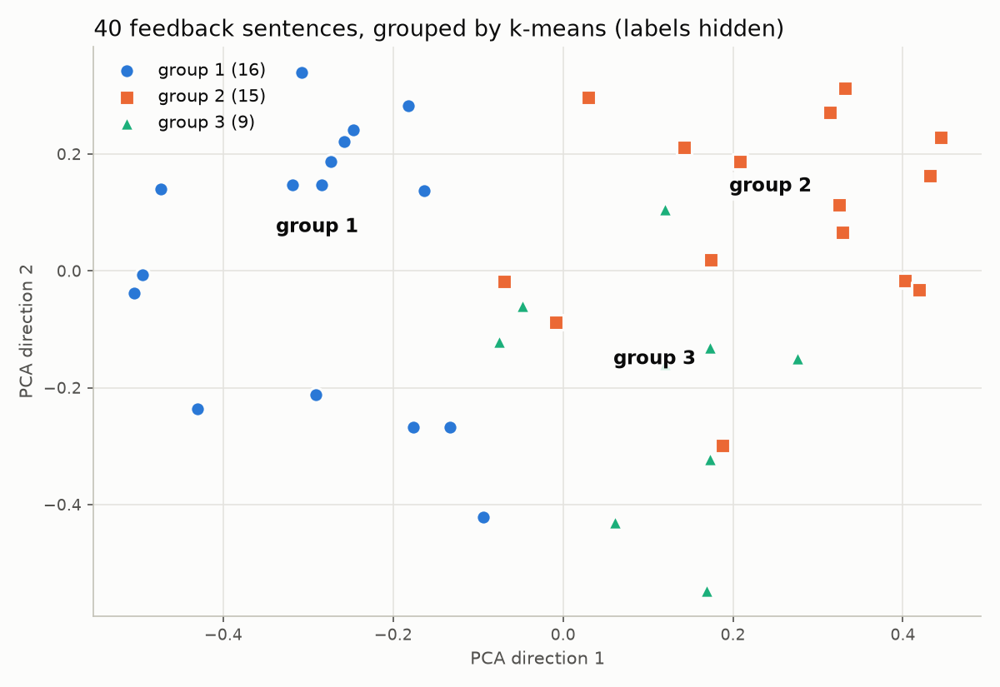

# Episode 01: What Is AI, Really? AI vs ML vs Deep Learning vs GenAI, Plus Your Free Gemini Setup

> Part of **AI Engineering From Zero** by Ravi Shanker Singh (TechWithRavi).
> Video: the link goes here when the episode is published  |  Code: https://github.com/replyravi/ai-engineering-course/tree/main/ep01-four-kinds-of-ai

## What you will build

Byte Bites, an invented college canteen, collects short feedback from students. You will sort the same
40 comments into **praise**, **complaint** or **suggestion** in four different ways, one for each ring of the
AI map, and compare them on one scoreboard:

| Program | Approach | Ring of the AI map |
|---|---|---|
| `a_rules.py` | keyword rules a person writes | AI (rule-based) |
| `b_supervised.py` | TF-IDF + logistic regression trained on labelled rows | Machine learning |
| `c_clusters.py` | a small neural network's embeddings + k-means, labels hidden | Deep learning |
| `d_genai.py` | Gemini, zero training rows | Generative AI |

One tricky sentence, four answers (real output; Gemini's answer appears once your key is in `.env`):

```text
"Great job, the dosa was cold again."

  A rules          praise
  B trained model  complaint
  C clusters       group 1 (mostly complaint)
  D Gemini         needs your free Gemini key (run check_setup.py)
```

Steps 1-5 also set up your workbench for the **whole series**: Python 3.13, VS Code, one virtual environment,
a free Gemini key in one `.env` file, and your first call to a model.

**You will learn:**

- How the four rings fit inside each other (GenAI inside deep learning, inside machine learning, inside AI), with a working program for each ring
- Rules versus learning: who writes the rules, a person or the data
- Supervised, unsupervised and zero-shot (pre-trained) learning on the same task, with honest numbers
- The ML lifecycle in miniature: collect, clean, split, train, evaluate, deploy, monitor
- Why a fluent AI answer can still be invented, and how one pasted fact fixes it

> **Seen an older tutorial?** It printed `response.content`. With Gemini 3 models that is a list of blocks,
> like `[{'type': 'text', 'text': '...'}]`. In 2026 we print `response.text`, which always gives plain text.
> Older tutorials also pasted the key into the code. We keep it in `.env`, which git never uploads.

## Prerequisites

- None. Basic Python helps (variables, lists, functions, running a script). We set up everything together.
- Windows 10/11, macOS 14+ on Apple Silicon, or 64-bit Linux. A Google account for the free Gemini key.
- About 60 minutes. Downloads: PyTorch (the biggest one-time download) and the local embeddings model (about 90 MB, step 10).
- The one model we download, [`sentence-transformers/all-MiniLM-L6-v2`](https://huggingface.co/sentence-transformers/all-MiniLM-L6-v2),
  is released under the **Apache-2.0** licence: free to use, also commercially (keep its licence notice if you share the model files).

## The files

| File | Step | What it does |
|---|---|---|
| `check_setup.py` | 4 | checks Python, the environment, libraries, the `.env` file and your key (masked) |
| `first_call.py` | 5 | your first message to Gemini, with token counts |
| `data/feedback.csv` | 6 | 40 invented feedback rows with an answer key (`label`) and a `note` for tricky rows |
| `common.py` | 6, 8 | load, clean and split the data (shared by every approach) |
| `a_rules.py` | 7 | approach A: keyword rules |
| `b_supervised.py` | 9 | approach B: TF-IDF + logistic regression |
| `c_clusters.py` | 10 | approach C: local embeddings + k-means, and a picture |
| `d_genai.py` | 11 | approach D: Gemini zero-shot with structured output |
| `e_reply_and_probe.py` | 12, 13 | Gemini writes reply drafts, then the hallucination probe |
| `predict.py` | 14 | save the trained model, predict one sentence, log it |
| `compare.py` | 15 | the scoreboard, and four answers for one sentence |
| `llm.py`, `testing/` | all | shared helpers copied from `_template/` (do not edit here) |
| `tests/` | 15 | offline tests with fake models |

Generated when you run things (git ignores them): `outputs/` (picture, saved model, Gemini results) and `logs/`.

Every file above is already in this folder. Each step shows the complete file: type it yourself as we go
(the best way to learn), or open the file in VS Code and read along.

---

## Step 1 - Install Python 3.13 and VS Code

Use the Python version the libraries support, not the newest download. python.org's big button now gives
Python 3.15, but PyTorch has no packages for 3.15 yet and CrewAI does not install on 3.14 or newer.
**Python 3.13** works with every episode. Get it from the Python 3.13.17 release page, https://www.python.org/downloads/release/python-31317/ (Windows: "Windows installer (64-bit)", macOS: "macOS installer").
Full instructions for each system, including Linux, are in [SETUP.md](../SETUP.md#1-install-python-313).

**Windows (PowerShell):**

```powershell
py -3.13 --version
```

**macOS / Linux:**

```bash
python3.13 --version
```

Expected output (the last number can be different):

```text
Python 3.13.x
```

Then install VS Code (https://code.visualstudio.com/) and the **Python** extension published by Microsoft.

> [!WARNING]
> **Common errors**
> - `py is not recognized` / `command not found: python3.13` - Python 3.13 is not installed. Install **3.13** (not 3.15) from the 3.13.17 release page, https://www.python.org/downloads/release/python-31317/ . On Windows tick **Add python.exe to PATH** in the installer. On macOS you can also run `brew install python@3.13`.
> - `python --version` says 3.15 - that is fine, you can have several versions. Always use `py -3.13` (Windows) or `python3.13` (macOS, Linux) when you create the environment in step 3.
> - **Intel Mac** - the current PyTorch no longer ships for Intel Macs. Use Google Colab or a Windows/Linux PC for steps 10 and later episodes that need it.

## Step 2 - Get the course code

Clone the repo (or download the ZIP), then open the **whole** `ai-engineering-course` folder in VS Code,
not just this episode folder. The shared environment and `.env` file live at the top.

```bash
git clone https://github.com/replyravi/ai-engineering-course.git
cd ai-engineering-course
code .
```

No git? On GitHub click **Code > Download ZIP**, unzip it and rename the folder to `ai-engineering-course`.

Expected: the VS Code Explorer shows the repo root, something like this (more episode folders appear as the series grows):

```text
.env.example
.gitignore
LICENSE
README.md
SETUP.md
_template/
ep01-four-kinds-of-ai/
requirements-base.txt
requirements-crewai.txt
tools/
```

> [!WARNING]
> **Common errors**
> - `git is not recognized` / `command not found: git` - install Git from https://git-scm.com/downloads, or use the ZIP download.
> - `code is not recognized` - open VS Code yourself and use **File > Open Folder...**. (On a Mac, run **Shell Command: Install 'code' command in PATH** from the Command Palette to enable `code .`.)
> - You opened only `ep01-four-kinds-of-ai` - close it and open the `ai-engineering-course` folder instead, so steps 3 and 4 create `.venv` and `.env` in the right place.

## Step 3 - Create the series virtual environment and install

A virtual environment is a private box of libraries for this course. We make **one**, called `.venv`,
at the repo root, and every episode uses it. On Windows and Linux we first install the small CPU-only
PyTorch, because the default Linux download is the large NVIDIA build and nothing here needs a GPU.

Run these from the repo root (the folder with `SETUP.md`).

**Windows (PowerShell):**

```powershell
py -3.13 -m venv .venv
.\.venv\Scripts\Activate.ps1
python -m pip install --upgrade pip
pip install torch==2.14.1 --index-url https://download.pytorch.org/whl/cpu
pip install -r requirements-base.txt
pip check
```

**macOS:**

```bash
python3.13 -m venv .venv
source .venv/bin/activate
python -m pip install --upgrade pip
pip install -r requirements-base.txt
pip check
```

**Linux:** the same as macOS, plus the `pip install torch==2.14.1 --index-url https://download.pytorch.org/whl/cpu`
line before `pip install -r requirements-base.txt` (skip it only if you have an NVIDIA GPU).

Expected: the prompt starts with `(.venv)`, and the last command prints:

```text
No broken requirements found.
```

In VS Code press **Ctrl+Shift+P** (Cmd+Shift+P on a Mac), run **Python: Select Interpreter** and pick `.venv`.

> [!WARNING]
> **Common errors**
> - Windows: `running scripts is disabled on this system` - run `Set-ExecutionPolicy -ExecutionPolicy Bypass -Scope Process` (this window only), then activate again.
> - `No matching distribution found for torch==2.14.1` - the `.venv` was made with Python 3.14 or 3.15. Delete the `.venv` folder and run the first line again with Python 3.13.
> - Windows: `Microsoft Visual C++ 14.0 or greater is required` - pip is trying to build a package from source, which means the Python version is wrong. Use 3.13.
> - No `(.venv)` at the start of the prompt - the environment is not active, so pip installs into the wrong Python. Run the activate line again.

## Step 4 - Get a free Gemini key and store it safely

Keys never go into code or onto the screen. They live in **one** `.env` file at the repo root, and
`.gitignore` makes sure git never uploads it.

1. Open https://aistudio.google.com/apikey, sign in with Google, accept the terms and click **Create API key**. No credit card is needed.
2. From the repo root, copy the example file: `Copy-Item .env.example .env` (Windows) or `cp .env.example .env` (macOS, Linux).
3. Open `.env` in VS Code and paste your key: `GEMINI_API_KEY=AIza...your-key...` (no quotes, no spaces).

Now check the whole workbench. Create `check_setup.py` in `ep01-four-kinds-of-ai`:

```python
"""
check_setup.py - check your AI workbench once, before the first call (step 4).

    python check_setup.py                              (inside ep01-four-kinds-of-ai)
    python ep01-four-kinds-of-ai/check_setup.py        (from the repo root)

Nothing is sent over the internet, and your key is never printed in full.
"""

import os
import subprocess
import sys
from importlib.metadata import PackageNotFoundError, version
from pathlib import Path

import llm

HERE = Path(__file__).resolve().parent
PACKAGES = ["langchain", "langchain-google-genai", "scikit-learn", "pandas",
            "matplotlib", "sentence-transformers", "torch", "python-dotenv"]


def mask(key: str) -> str:
    """Show only the first and last 4 characters of a key."""
    if len(key) < 12:
        return "*" * len(key)
    return f"{key[:4]}...{key[-4:]}"


def repo_root() -> Path:
    """The folder that holds .env.example (the top of ai-engineering-course)."""
    for folder in (HERE, *HERE.parents):
        if (folder / ".env.example").is_file():
            return folder
    return HERE.parent


def ignored_by_git(path: Path) -> str:
    """Is this file protected by .gitignore? Asks git, or reads .gitignore if git cannot tell."""
    try:
        result = subprocess.run(["git", "check-ignore", "-q", str(path)], cwd=path.parent,
                                capture_output=True, timeout=10)
        if result.returncode == 0:
            return "yes"
        if result.returncode == 1:
            return "NO - add a line .env to .gitignore"
    except (OSError, subprocess.TimeoutExpired):
        pass   # git is not installed
    # Not a git folder (for example a ZIP download): read .gitignore ourselves.
    for folder in (path.parent, *path.parent.parents):
        gitignore = folder / ".gitignore"
        if gitignore.is_file():
            lines = [line.strip() for line in gitignore.read_text(encoding="utf-8").splitlines()]
            return "yes (.gitignore lists .env)" if ".env" in lines else "NO - add a line .env to .gitignore"
    return "unknown (no .gitignore found)"


def line(name: str, value: str) -> None:
    print(f"{name + ' ':.<25} {value}")


def main() -> int:
    problems = 0
    print("AI Engineering From Zero - setup check\n")

    # 1. Python version: 3.11 to 3.13 (3.13 recommended)
    v = sys.version_info
    if (3, 11) <= (v.major, v.minor) <= (3, 13):
        line("Python", f"{v.major}.{v.minor}.{v.micro} OK")
    else:
        line("Python", f"{v.major}.{v.minor}.{v.micro} NOT SUPPORTED - install Python 3.13")
        problems += 1

    # 2. Virtual environment
    if sys.prefix != sys.base_prefix:
        line("Virtual env", f"active ({Path(sys.prefix).name})")
    else:
        line("Virtual env", "NOT active - activate .venv first (see SETUP.md)")
        problems += 1

    # 3. Libraries
    for package in PACKAGES:
        try:
            line(package, version(package))
        except PackageNotFoundError:
            line(package, "MISSING - run: pip install -r requirements-base.txt")
            problems += 1

    # 4. The .env file and the key
    root = repo_root()
    env_file = Path(llm.ENV_FILE) if llm.ENV_FILE else root / ".env"
    if llm.ENV_FILE:
        line(".env file", f"found ({env_file.parent.name}/.env)")
    else:
        line(".env file", "NOT FOUND - copy .env.example to .env in the repo root")
        problems += 1

    try:
        provider = llm.get_provider()
    except ValueError as error:   # a typo in LLM_PROVIDER
        line("Provider", f"WRONG - {error}")
        print(f"\n{problems + 1} thing(s) to fix, see above.")
        return 1
    line("Provider", provider)
    line("Model", llm.get_model_name(provider))

    key_names = llm.API_KEY_NAMES[provider]
    found = {name: os.getenv(name, "").strip() for name in key_names}
    found = {name: key for name, key in found.items() if key and not key.startswith("paste-your")}
    if not key_names:
        line("API key", "not needed (local model)")
    elif found:
        for name, key in found.items():
            line("API key", f"{name} found ({mask(key)})")
        if len(found) > 1:
            print("  Note: both are set. GOOGLE_API_KEY wins.")
    else:
        line("API key", f"MISSING - put {key_names[0]}=... in the .env file")
        problems += 1

    line(".env ignored by git", ignored_by_git(env_file))

    print()
    if problems == 0:
        print("All good. Next: python first_call.py")
        return 0
    print(f"{problems} thing(s) to fix, see above.")
    if provider in llm.WHERE_TO_GET_A_KEY and not found:
        print("\n" + llm.WHERE_TO_GET_A_KEY[provider])
    return 1


if __name__ == "__main__":
    raise SystemExit(main())
```

Run it from the episode folder:

```bash
cd ep01-four-kinds-of-ai
python check_setup.py
```

Expected output with your key in place (your Python patch number and the masked key will differ):

```text
AI Engineering From Zero - setup check

Python .................. 3.13.x OK
Virtual env ............. active (.venv)
langchain ............... 1.4.7
langchain-google-genai .. 4.4.2
scikit-learn ............ 1.9.1
pandas .................. 3.1.0
matplotlib .............. 3.11.2
sentence-transformers ... 6.2.0
torch ................... 2.14.1
python-dotenv ........... 1.2.4
.env file ............... found (ai-engineering-course/.env)
Provider ................ gemini
Model ................... gemini-3.5-flash-lite
API key ................. GEMINI_API_KEY found (AIza...xxxx)
.env ignored by git ..... yes

All good. Next: python first_call.py
```

(Downloaded the ZIP instead of cloning? The last check says `yes (.gitignore lists .env)`.)

And this is what it prints **before** you add a key (a real run with no `.env` file; the environment name was
`venv-langchain` on the recording machine, yours says `.venv`):

```text
AI Engineering From Zero - setup check

Python .................. 3.11.17 OK
Virtual env ............. active (venv-langchain)
langchain ............... 1.4.7
langchain-google-genai .. 4.4.2
scikit-learn ............ 1.9.1
pandas .................. 3.1.0
matplotlib .............. 3.11.2
sentence-transformers ... 6.2.0
torch ................... 2.14.1
python-dotenv ........... 1.2.4
.env file ............... NOT FOUND - copy .env.example to .env in the repo root
Provider ................ gemini
Model ................... gemini-3.5-flash-lite
API key ................. MISSING - put GEMINI_API_KEY=... in the .env file
.env ignored by git ..... yes (.gitignore lists .env)

2 thing(s) to fix, see above.

Get a FREE Gemini key (no credit card needed):
  1. Open https://aistudio.google.com/apikey
  2. Sign in with your Google account and accept the terms
  3. Click 'Create API key' and copy it
  4. Put it in your .env file like this:  GEMINI_API_KEY=paste-your-key-here
```

> **Safety note.** The free tier may use your prompts to improve Google's products, so never send private data.
> Recording or sharing your screen? Use a separate key and delete it in AI Studio afterwards.

> [!WARNING]
> **Common errors**
> - `.env file ... NOT FOUND` - the file is missing, sits in the wrong folder, or is secretly called `.env.txt` (Windows hides extensions). Create it in VS Code, in the repo root.
> - `API key ... MISSING` - the line still says `paste-your-key-here`, or the key has quotes or spaces around it.
> - `.env ignored by git ... NO` - someone removed `.env` from `.gitignore`. Add the line `.env` back before you commit anything.

## Step 5 - Make the first call

`get_llm()` in `llm.py` reads `LLM_PROVIDER` from `.env` (Gemini by default) and gives you a chat model.
We send it a message, print the answer with `.text`, and look at the **token** counts: tokens are the
small pieces of text a model reads and writes, and free-tier limits are counted in them.

Create `first_call.py`:

```python
"""
first_call.py - your first call to an AI model (step 5).

get_llm() reads LLM_PROVIDER from the .env file (gemini by default) and returns a chat model.
We send one message, print the answer with .text, and show how many tokens it used.

Run:  python first_call.py
Try:  LLM_PROVIDER=openai in .env (with no OpenAI key) to see the friendly help message.
"""

import time

from langchain_core.messages import HumanMessage, SystemMessage

from llm import MissingAPIKeyError, get_llm, get_model_name, get_provider

QUESTION = "In exactly two sentences, explain to a college student what a large language model is."


def main(llm=None) -> int:
    try:
        provider = get_provider()          # reads LLM_PROVIDER from .env
        print(f"Provider: {provider}   Model: {get_model_name(provider)}")
        if llm is None:
            llm = get_llm()
    except (MissingAPIKeyError, ValueError) as error:
        print(f"\n{str(error).strip()}")   # friendly help (no key, or a typo in LLM_PROVIDER), not a traceback
        return 1

    messages = [
        SystemMessage("You are a patient teacher. Use simple words."),
        HumanMessage(QUESTION),
    ]
    start = time.perf_counter()
    reply = llm.invoke(messages)
    seconds = time.perf_counter() - start

    print(f"\nYou asked: {QUESTION}")
    # .text, not .content: Gemini 3 returns content as a list of blocks.
    print(f"\nAI replied:\n{reply.text}\n")

    usage = reply.usage_metadata   # how many tokens went in and came out
    if usage:
        print(f"Tokens: {usage['input_tokens']} in, {usage['output_tokens']} out, {usage['total_tokens']} total")
    else:
        print("Tokens: not reported by this model")
    print(f"Time: {seconds:.1f} s")
    return 0


if __name__ == "__main__":
    raise SystemExit(main())
```

```bash
python first_call.py
```

Expected output (Gemini writes its own sentences, so your wording and numbers will differ):

```text
Provider: gemini   Model: gemini-3.5-flash-lite

You asked: In exactly two sentences, explain to a college student what a large language model is.

AI replied:
<two sentences written by Gemini>

Tokens: <N> in, <N> out, <N> total
Time: <seconds> s
```

**The one-line switch.** Change `LLM_PROVIDER=gemini` to `LLM_PROVIDER=openai` in `.env` and run it again.
With no OpenAI key, you get friendly help instead of a crash (real output, recorded before a `.env` file existed;
yours names your `.env` file on the last line):

```text
Provider: openai   Model: gpt-6-luna

No API key found for LLM_PROVIDER=openai.
Looked for: OPENAI_API_KEY in your .env file.

Get an OpenAI key (paid, needs billing):
  1. Open https://platform.openai.com/api-keys
  2. Click 'Create new secret key' and copy it
  3. Put it in your .env file like this:  OPENAI_API_KEY=paste-your-key-here

No .env file yet? In the ai-engineering-course folder (the repo root), copy .env.example to .env:
  macOS / Linux:       cp .env.example .env
  Windows PowerShell:  Copy-Item .env.example .env
(.env file in use right now: none found)
```

Put it back to `LLM_PROVIDER=gemini`. With no Gemini key at all, the help points to AI Studio (real output):

```text
Provider: gemini   Model: gemini-3.5-flash-lite

No API key found for LLM_PROVIDER=gemini.
Looked for: GEMINI_API_KEY or GOOGLE_API_KEY in your .env file.

Get a FREE Gemini key (no credit card needed):
  1. Open https://aistudio.google.com/apikey
  2. Sign in with your Google account and accept the terms
  3. Click 'Create API key' and copy it
  4. Put it in your .env file like this:  GEMINI_API_KEY=paste-your-key-here

No .env file yet? In the ai-engineering-course folder (the repo root), copy .env.example to .env:
  macOS / Linux:       cp .env.example .env
  Windows PowerShell:  Copy-Item .env.example .env
(.env file in use right now: none found)
```

> [!WARNING]
> **Common errors**
> - `API key not valid. Please pass a valid API key.` - the key was copied with a missing character or an extra space. Copy it again from AI Studio.
> - `429 RESOURCE_EXHAUSTED` - you hit a free-tier limit. Wait a minute (per-minute limit) or until the next day (daily limit). Your limits: https://aistudio.google.com/rate-limit
> - `404 ... model not found` - `LLM_MODEL` in `.env` names a retired or misspelled model. Leave `LLM_MODEL=` empty to use the default.
> - You see `[{'type': 'text', 'text': ...}]` - you printed `reply.content`. Print `reply.text`.

## Step 6 - Load the feedback file

A CSV file is **structured** data: rows and columns, like a spreadsheet. The `label` column is the
**answer key** a person wrote. Free text inside a cell is unstructured, and JSON would be semi-structured.
Here are the first rows of `data/feedback.csv` (all 40 rows are invented; the `note` column marks the
sarcastic and negated rows we will watch closely):

```text
id,text,label,note
1,The biryani was far too oily and the portion was tiny.,complaint,
2,The cashier was rude when I asked for change.,complaint,
3,A separate counter for takeaway orders would save everyone time.,suggestion,
4,Steel plates instead of paper ones would cut a lot of waste.,suggestion,
5,"Found a fly in my lassi glass, not acceptable.",complaint,negation
6,Can we get a bigger cup option for filter coffee?,suggestion,
7,Thank you for keeping the tables so clean this semester.,praise,
...
```

Create `common.py` with the loading part:

```python
"""
common.py - load, clean and split the Byte Bites feedback (shared by every approach).

Step 6:  load the CSV and look at it          (lifecycle stage: collect)
Step 8:  clean the text and split train/test  (lifecycle stage: clean)

Run:  python common.py
"""

import re
from pathlib import Path

import pandas as pd
from sklearn.model_selection import train_test_split

HERE = Path(__file__).resolve().parent
DATA_FILE = HERE / "data" / "feedback.csv"
LABELS = ["praise", "complaint", "suggestion"]

SEED = 42        # a fixed seed: the "random" split is the same on every run and every laptop
TEST_ROWS = 10   # rows we hide from training, to test on later


# ---------------------------------------------------------------------------
# Step 6 - load
# ---------------------------------------------------------------------------

def load_feedback(path=DATA_FILE) -> pd.DataFrame:
    """Read the feedback CSV into a table (a pandas DataFrame)."""
    df = pd.read_csv(path, keep_default_na=False)   # keep empty notes as "" (not NaN)
    return df


def show_dataset(df: pd.DataFrame) -> None:
    """Print a short summary of the table."""
    print(f"{len(df)} rows, {df['label'].nunique()} labels")
    for label, count in df["label"].value_counts().items():
        print(f"  {label:<11} {count}")
    tricky = df[df["note"] != ""]
    notes = ", ".join(f"{count} {name}" for name, count in tricky["note"].value_counts().items())
    print(f"Rows marked tricky: {len(tricky)} ({notes})")
    print()
    print(df.head(3).to_string(index=False))


# For now (step 6). Step 8 replaces this with the full version.
if __name__ == "__main__":
    show_dataset(load_feedback())
```

```bash
python common.py
```

Expected output:

```text
40 rows, 3 labels
  complaint   14
  praise      14
  suggestion  12
Rows marked tricky: 10 (6 negation, 4 sarcasm)

 id                                                             text      label note
  1           The biryani was far too oily and the portion was tiny.  complaint     
  2                    The cashier was rude when I asked for change.  complaint     
  3 A separate counter for takeaway orders would save everyone time. suggestion
```

> [!WARNING]
> **Common errors**
> - `FileNotFoundError: ... data/feedback.csv` - the `data` folder was moved or renamed. `common.py` looks for `data/feedback.csv` next to itself.
> - `ModuleNotFoundError: No module named 'pandas'` - the `.venv` is not active (step 3).
> - Empty notes show as `NaN` - you left out `keep_default_na=False`, so pandas turned empty cells into "not a number".

## Step 7 - Approach A: hand-written rules

The oldest kind of AI: a person writes the rules, the computer follows them. No examples, no training.
Rules plus data give answers. It is fast and easy to explain, and it breaks the moment people write
something the rule-writer did not expect.

Create `a_rules.py`:

```python
"""
a_rules.py - Approach A: hand-written rules (rule-based, or "symbolic", AI).

A person writes the rules. The computer only follows them.
No examples, no training: rules + data -> answers.

Run:  python a_rules.py
"""

import re
import time

from common import load_feedback

# The rulebook is read from top to bottom. The FIRST label with a matching word wins.
RULEBOOK = {
    "suggestion": ["please", "could", "should", "would", "maybe", "suggest", "add"],
    "praise": ["good", "great", "love", "loved", "tasty", "delicious", "best", "amazing", "awesome",
               "excellent", "thanks", "thank", "friendly", "fresh", "perfect", "nice", "lovely"],
    "complaint": ["bad", "cold", "late", "slow", "dirty", "rude", "stale", "oily", "worst",
                  "expensive", "waited", "queue", "broken", "hair"],
}


def rules_label(text: str) -> str:
    """Return the label of the first rule that matches, or 'unknown'."""
    words = set(re.findall(r"[a-z']+", text.lower()))   # the words in the sentence
    for label, keywords in RULEBOOK.items():
        for keyword in keywords:
            if keyword in words:
                return label
    return "unknown"   # no rule matched


def accuracy(predicted, truth) -> float:
    """Share of answers that match the answer key (1.0 = all right)."""
    right = sum(p == t for p, t in zip(predicted, truth))
    return right / len(truth)


def main() -> None:
    df = load_feedback()

    start = time.perf_counter()
    df["rules"] = df["text"].map(rules_label)
    ms_per_row = (time.perf_counter() - start) * 1000 / len(df)

    right = int((df["rules"] == df["label"]).sum())
    print(f"Rules accuracy on all {len(df)} rows: {right / len(df):.0%} ({right} of {len(df)})")
    print(f"No rule matched at all: {(df['rules'] == 'unknown').sum()} rows")
    print(f"Time: {ms_per_row:.4f} ms per row")

    misses = df[df["rules"] != df["label"]]
    tricky = df[df["note"] != ""]
    tricky_right = int((tricky["rules"] == tricky["label"]).sum())
    print(f"Tricky rows (sarcasm or negation): {tricky_right} of {len(tricky)} right")

    print("\nTwo misses worth a look (a word fooled the rules):")
    fooled = misses[misses["rules"] != "unknown"]
    for note in ["sarcasm", "negation"]:
        row = fooled[fooled["note"] == note].iloc[0]
        print(f"  [{note}] \"{row['text']}\"")
        print(f"      rules said {row['rules']}, the answer key says {row['label']}")


if __name__ == "__main__":
    main()
```

```bash
python a_rules.py
```

Expected output (the time per row will differ):

```text
Rules accuracy on all 40 rows: 70% (28 of 40)
No rule matched at all: 7 rows
Time: 0.0190 ms per row
Tricky rows (sarcasm or negation): 2 of 10 right

Two misses worth a look (a word fooled the rules):
  [sarcasm] "Oh great, the curd rice ran out by half past twelve again."
      rules said praise, the answer key says complaint
  [negation] "The chutney was not fresh today and smelled sour."
      rules said praise, the answer key says complaint
```

Seventy percent from a short list of keywords is not bad. But look at the tricky rows: sarcasm and "not"
fool the rules almost every time, and seven rows match no rule at all.

> [!WARNING]
> **Common errors**
> - Every row says `unknown` - the keywords must be lower case, because the sentence is lower-cased before matching.
> - Your accuracy is different - you changed a keyword or the order of the rulebook. The first matching label wins, so order matters.

## Step 8 - Clean and split

Two lifecycle stages. **Clean**: make the text uniform (lower case, `don't` becomes `do not` so the
"not" survives, no punctuation). **Split**: hide 10 rows from training so we can test on sentences the
model has never seen. A fixed **seed** makes the "random" split identical on every run and every laptop.

Open `common.py` again. Delete the temporary block at the bottom from step 6 (the `# For now (step 6)` comment
and the `if __name__ == "__main__":` lines under it), then add this code in its place:

```python
# ---------------------------------------------------------------------------
# Step 8 - clean and split
# ---------------------------------------------------------------------------

def clean_text(text: str) -> str:
    """Make text easier for a program to compare.

    lower case, "don't" -> "do not" (keeps the NOT!), drop punctuation, single spaces.
    """
    text = text.lower()
    text = text.replace("can't", "can not").replace("won't", "will not")
    text = re.sub(r"n't\b", " not", text)        # didn't -> did not, wasn't -> was not
    text = re.sub(r"[^a-z0-9\s]", " ", text)     # keep only letters, digits and spaces
    return re.sub(r"\s+", " ", text).strip()


def split_feedback(df: pd.DataFrame, test_rows: int = TEST_ROWS, seed: int = SEED):
    """Split into a training table and a test table.

    stratify keeps the same mix of labels in both parts.
    random_state=seed makes the split identical on every run.
    """
    train, test = train_test_split(df, test_size=test_rows, random_state=seed, stratify=df["label"])
    return train.sort_values("id"), test.sort_values("id")


def load_and_split():
    """Load, add a clean_text column, and split. Used by steps 9 to 15."""
    df = load_feedback()
    df["clean"] = df["text"].map(clean_text)
    return split_feedback(df)


def show_split(train: pd.DataFrame, test: pd.DataFrame) -> None:
    """Print the split so you can check it is the same on every run."""
    print(f"train {len(train)}, test {len(test)}")
    print("test ids:", ", ".join(str(i) for i in test["id"]))
    print("test labels:", ", ".join(f"{label} {count}" for label, count in test["label"].value_counts().items()))
    print()
    example = "Please DON'T stop the Friday pav bhaji!!"
    print("Cleaning example:")
    print("  before:", example)
    print("  after: ", clean_text(example))


if __name__ == "__main__":
    show_dataset(load_feedback())
    print("\n" + "-" * 60 + "\n")
    show_split(*load_and_split())
```

```bash
python common.py
```

Expected output (the same every time you run it):

```text
40 rows, 3 labels
  complaint   14
  praise      14
  suggestion  12
Rows marked tricky: 10 (6 negation, 4 sarcasm)

 id                                                             text      label note
  1           The biryani was far too oily and the portion was tiny.  complaint     
  2                    The cashier was rude when I asked for change.  complaint     
  3 A separate counter for takeaway orders would save everyone time. suggestion     

------------------------------------------------------------

train 30, test 10
test ids: 8, 10, 15, 20, 24, 29, 33, 35, 38, 40
test labels: complaint 4, praise 3, suggestion 3

Cleaning example:
  before: Please DON'T stop the Friday pav bhaji!!
  after:  please do not stop the friday pav bhaji
```

> [!WARNING]
> **Common errors**
> - Different test ids from the video - you changed `SEED`, `TEST_ROWS` or the data file. Put them back to see the same numbers.
> - `ValueError: The least populated class in y has only 1 member` - after editing the data, one label has too few rows for a stratified split. Keep at least a few rows per label.

## Step 9 - Approach B: supervised machine learning

Now the computer writes its own rules. We give it the 30 training rows **with** their answers.
**TF-IDF** turns each sentence into numbers (one per word: how important that word is in this sentence),
and **logistic regression** learns a weight for every word and label. That is **training**, done once.
Predicting new sentences with the frozen weights is **inference**.

Create `b_supervised.py`:

```python
"""
b_supervised.py - Approach B: supervised machine learning (classic ML).

We give the computer examples WITH answers (labels). It writes its own rules as numbers.
Data + answers -> learned rules (the "weights").

  TF-IDF:              turns each sentence into numbers, one per word (how important that word is here)
  Logistic regression: learns one weight per word for each label, then picks the label with the best score

Training happens once. Inference (predicting) reuses the frozen weights on new sentences.

Run:  python b_supervised.py
"""

import time

import pandas as pd
from sklearn.feature_extraction.text import TfidfVectorizer
from sklearn.linear_model import LogisticRegression
from sklearn.metrics import confusion_matrix
from sklearn.pipeline import Pipeline

from common import LABELS, load_and_split

# Feature engineering: filler words carry no opinion, so we drop them.
# We do NOT use scikit-learn's built-in English list: it would also delete
# "not", "please" and "would", the very words that matter for this task.
FILLER_WORDS = ["the", "a", "an", "is", "are", "was", "were", "and", "to", "of", "in", "on", "at",
                "for", "my", "it", "this", "i", "me", "so", "just", "by", "with", "as", "we", "you", "be"]


def train_model(texts, labels) -> Pipeline:
    """Training: learn the weights from labelled examples."""
    model = Pipeline([
        # single words AND word pairs, so "not fresh" is a feature of its own
        ("tfidf", TfidfVectorizer(ngram_range=(1, 2), stop_words=FILLER_WORDS)),
        ("logreg", LogisticRegression(max_iter=1000)),
    ])
    model.fit(texts, labels)
    return model


def top_words(model: Pipeline, n: int = 5) -> dict:
    """The n words with the biggest weight for each label: the rules the model wrote for itself."""
    words = model.named_steps["tfidf"].get_feature_names_out()
    logreg = model.named_steps["logreg"]
    result = {}
    for label, weights in zip(logreg.classes_, logreg.coef_):
        biggest = weights.argsort()[::-1][:n]
        result[label] = [words[i] for i in biggest]
    return result


def main() -> None:
    train, test = load_and_split()

    start = time.perf_counter()
    model = train_model(train["clean"], train["label"])          # training (once)
    train_ms = (time.perf_counter() - start) * 1000

    start = time.perf_counter()
    predicted = model.predict(test["clean"])                      # inference (every new sentence)
    ms_per_row = (time.perf_counter() - start) * 1000 / len(test)

    right = int((predicted == test["label"]).sum())
    print(f"Trained on {len(train)} labelled rows in {train_ms:.0f} ms")
    print(f"Test accuracy on {len(test)} unseen rows: {right / len(test):.0%} ({right} of {len(test)})")
    print(f"Prediction time: {ms_per_row:.3f} ms per row")

    matrix = confusion_matrix(test["label"], predicted, labels=LABELS)
    print("\nConfusion matrix (rows = answer key, columns = model's guess):")
    print(pd.DataFrame(matrix, index=LABELS, columns=LABELS).to_string())

    print("\nTop five words the model taught itself, per label:")
    for label, words in top_words(model).items():
        print(f"  {label:<11} {', '.join(words)}")

    print("\nTest rows it got wrong:")
    for text, truth, guess in zip(test["text"], test["label"], predicted):
        if truth != guess:
            print(f"  \"{text}\"  key: {truth}, model: {guess}")


if __name__ == "__main__":
    main()
```

```bash
python b_supervised.py
```

Expected output (the times will differ, everything else should match):

```text
Trained on 30 labelled rows in 3 ms
Test accuracy on 10 unseen rows: 50% (5 of 10)
Prediction time: 0.043 ms per row

Confusion matrix (rows = answer key, columns = model's guess):
            praise  complaint  suggestion
praise           2          1           0
complaint        3          1           0
suggestion       1          0           2

Top five words the model taught itself, per label:
  complaint   cold, again, vada cold, cold soggy, lunch time
  praise      clean, thank, tasty, morning, friendly
  suggestion  would, counter, please, get, can get

Test rows it got wrong:
  "Waited twenty five minutes for a plain paratha, the service is so slow."  key: complaint, model: praise
  "How about a Jain thali option on the menu once a week?"  key: suggestion, model: praise
  "The coffee was not hot, just lukewarm brown water."  key: complaint, model: praise
  "Wow, a forty minute wait for one samosa. Amazing service."  key: complaint, model: praise
  "The lemon rice was fresh and the portion was generous."  key: praise, model: complaint
```

Read the top words: the model really did teach itself sensible rules (`cold`, `again` for complaints;
`thank`, `tasty`, `friendly` for praise; `would`, `please` for suggestions). Yet it gets only half the test rows
right, no better than our rules. Thirty short rows is very little to learn from: most words appear only once,
so the model has never seen words like "waited" or "lukewarm" in training. Classic ML shines with thousands
of labelled rows. Keep this number in mind for steps 11 and 15.

> [!WARNING]
> **Common errors**
> - `ConvergenceWarning: lbfgs failed to converge` - the solver needed more steps. Keep `max_iter=1000`.
> - `ValueError: empty vocabulary` - every word was filtered out, usually because the input column is empty. Check you passed `train["clean"]`.
> - Why not scikit-learn's ready-made English stop-word list? It also deletes `not`, `please` and `would`, the most useful words here.

## Step 10 - Approach C: unsupervised clustering

This time we **hide the labels**. A small pre-trained neural network, `all-MiniLM-L6-v2`, turns each sentence
into 384 numbers (an **embedding**) so that sentences with similar meaning get similar numbers. Then **k-means**
puts the 40 sentences into 3 groups using only those numbers. **PCA** squeezes 384 numbers down to 2 so we can
draw a picture. The model runs on your computer: no key, and no internet after the first download.

Create `c_clusters.py`:

```python
"""
c_clusters.py - Approach C: unsupervised learning (clustering). The labels stay HIDDEN.

  1. A small pre-trained neural network (all-MiniLM-L6-v2, that's deep learning) turns each
     sentence into 384 numbers, an "embedding". Sentences with similar meaning get similar numbers.
  2. k-means puts the 40 sentences into 3 groups, using only those numbers.
  3. PCA squeezes 384 numbers down to 2, so we can draw the groups as a picture.

Run:  python c_clusters.py
(The first run downloads the model, about 90 MB. After that it works offline.)
"""

import time

import matplotlib

matplotlib.use("Agg")  # draw straight into a PNG file, no window needed
import matplotlib.pyplot as plt  # noqa: E402
import numpy as np  # noqa: E402
import pandas as pd  # noqa: E402
from sklearn.cluster import KMeans  # noqa: E402
from sklearn.decomposition import PCA  # noqa: E402
from sklearn.preprocessing import normalize  # noqa: E402

from common import HERE, SEED, load_feedback  # noqa: E402

PICTURE = HERE / "outputs" / "clusters.png"
GROUPS = 3

# Colours and shapes for groups 1, 2 and 3 (colour-blind safe; the shapes help too).
COLOURS = ["#2a78d6", "#eb6834", "#1baf7a"]
SHAPES = ["o", "s", "^"]


def embed(texts, embeddings=None) -> np.ndarray:
    """Turn sentences into embeddings (one row of numbers per sentence)."""
    if embeddings is None:
        from llm import get_embeddings   # the free local model from llm.py
        embeddings = get_embeddings()
    vectors = np.array(embeddings.embed_documents(list(texts)))
    return normalize(vectors)   # length 1 each, so k-means compares meaning (direction), not size


def find_groups(vectors: np.ndarray, k: int = GROUPS) -> KMeans:
    """k-means: put the points into k groups. The seed makes it the same every run."""
    return KMeans(n_clusters=k, n_init=10, random_state=SEED).fit(vectors)


def save_picture(vectors: np.ndarray, groups: np.ndarray, path=PICTURE):
    """Squeeze the embeddings to 2D with PCA and save a scatter plot."""
    points = PCA(n_components=2, random_state=SEED).fit_transform(vectors)
    path.parent.mkdir(parents=True, exist_ok=True)

    fig, ax = plt.subplots(figsize=(8, 5.5), dpi=150)
    fig.patch.set_facecolor("#fcfcfb")
    ax.set_facecolor("#fcfcfb")
    for g in sorted(set(groups)):
        mine = points[groups == g]
        ax.scatter(mine[:, 0], mine[:, 1], s=70, c=COLOURS[g - 1], marker=SHAPES[g - 1],
                   edgecolors="#fcfcfb", linewidths=1.5, label=f"group {g} ({len(mine)})", zorder=3)
        centre = mine.mean(axis=0)
        ax.annotate(f"group {g}", centre, xytext=(0, 14), textcoords="offset points",
                    ha="center", fontsize=11, fontweight="bold", color="#0b0b0b", zorder=4,
                    bbox={"boxstyle": "round,pad=0.25", "facecolor": "#fcfcfb", "edgecolor": "none", "alpha": 0.85})

    ax.set_title("40 feedback sentences, grouped by k-means (labels hidden)", loc="left",
                 fontsize=13, color="#0b0b0b")
    ax.set_xlabel("PCA direction 1", color="#52514e")
    ax.set_ylabel("PCA direction 2", color="#52514e")
    ax.tick_params(colors="#52514e", labelsize=9)
    ax.grid(color="#e4e3df", linewidth=0.8, zorder=0)
    for side in ["top", "right"]:
        ax.spines[side].set_visible(False)
    for side in ["left", "bottom"]:
        ax.spines[side].set_color("#c3c2b7")
    ax.legend(frameon=False, labelcolor="#0b0b0b")
    fig.tight_layout()
    fig.savefig(path)
    plt.close(fig)
    return path


def main(embeddings=None, picture=PICTURE) -> pd.DataFrame:
    df = load_feedback()

    start = time.perf_counter()
    vectors = embed(df["text"], embeddings)
    seconds = time.perf_counter() - start
    print(f"Embedded {len(df)} sentences, {vectors.shape[1]} numbers each, in {seconds:.1f} s")

    df["group"] = find_groups(vectors).labels_ + 1   # groups 1, 2, 3 instead of 0, 1, 2

    for g in range(1, GROUPS + 1):
        mine = df[df["group"] == g]
        print(f"\nGroup {g} ({len(mine)} sentences). What do these have in common?")
        for text in mine["text"].head(5):
            print(f"  - {text}")

    print("\nNow peek at the hidden labels (k-means never saw them):")
    print(pd.crosstab(df["group"], df["label"]).to_string())

    path = save_picture(vectors, df["group"].to_numpy(), picture)
    print(f"\nSaved the picture: {path.relative_to(HERE) if path.is_relative_to(HERE) else path}")
    return df


if __name__ == "__main__":
    main()
```

```bash
python c_clusters.py
```

Expected output (the time will differ):

```text
Embedded 40 sentences, 384 numbers each, in 2.6 s

Group 1 (16 sentences). What do these have in common?
  - A separate counter for takeaway orders would save everyone time.
  - Steel plates instead of paper ones would cut a lot of waste.
  - Can we get a bigger cup option for filter coffee?
  - Thank you for keeping the tables so clean this semester.
  - Fantastic, the card machine is broken again, so the queue never moves.

Group 2 (15 sentences). What do these have in common?
  - The biryani was far too oily and the portion was tiny.
  - The cashier was rude when I asked for change.
  - Prices went up again but the portions got smaller.
  - Fresh fruit bowls in the morning, thank you Byte Bites!
  - Loved the new paneer roll, fresh and worth every rupee.

Group 3 (9 sentences). What do these have in common?
  - Found a fly in my lassi glass, not acceptable.
  - Waited twenty five minutes for a plain paratha, the service is so slow.
  - The weekend thali is great value and the plates are always clean.
  - Please don't stop the Friday pav bhaji, just make it less spicy.
  - Lovely, another hair in my upma. Truly the best kitchen.

Now peek at the hidden labels (k-means never saw them):
label  complaint  praise  suggestion
group                               
1              2       4          10
2              8       7           0
3              4       3           2

Saved the picture: outputs/clusters.png
```

The first run also downloads the model (about 90 MB) with progress bars. Every run prints a few grey lines from
the libraries before our output, such as `Loading weights: 100%` and, on a Mac,
`NOTE: Redirects are currently not supported in MacOs.` They are harmless.

Open `outputs/clusters.png`. This is the picture from the recording machine:



Name the groups by eye. Group 1 is mostly **suggestions** (10 of 16), plus remarks about counters, tables and staff.
Group 2 is mostly sentences that **name a dish** (biryani, idli, vada, dosa...), complaints and praise mixed together
(8 and 7): k-means grouped the sentences by *topic*, not by *mood*, because nobody told it what we care about.
That is the honest lesson of unsupervised learning: it finds structure, not necessarily your labels.
Groups 1 and 2 form clear blobs; group 3 overlaps them in this flat picture (384 numbers squeezed into 2 always loses something).

> [!WARNING]
> **Common errors**
> - `OSError: We couldn't connect to 'https://huggingface.co'` - the first run needs internet to download the model. Connect once; after that it works offline.
> - The first run seems stuck - it is downloading the model files (about 90 MB). Wait for the progress bars to finish.
> - Your group numbers are in a different order - group numbers are just names. With the same library versions and seed you get the same groups.

## Step 11 - Approach D: GenAI zero-shot

Gemini was **pre-trained** by Google on a huge amount of text (by guessing the next word, which is
**self-supervised** learning), then tuned to follow instructions. We give it **zero** training rows and just ask.
`with_structured_output` makes it fill in a small form, the `FeedbackLabel` class, so we always get back
exactly one of our three labels instead of a paragraph.
`prompt | model` is a LangChain **pipe**: the filled-in prompt flows into the model, like water through
connected pipes. Episode 6 explains pipes in depth; for now, read `|` as "then".

Create `d_genai.py`:

```python
"""
d_genai.py - Approach D: generative AI, zero-shot.

Gemini was pre-trained by Google on a huge amount of text (self-supervised: guess the
next word), then tuned to follow instructions. We give it ZERO training rows. We just ask.

with_structured_output makes the model fill in a small form (the FeedbackLabel class)
instead of writing free text, so we always get back exactly one of our three labels.

Run:  python d_genai.py      (needs your free Gemini key in the .env file at the repo root)
"""

import csv
import time
from typing import Literal

from langchain_core.prompts import ChatPromptTemplate
from pydantic import BaseModel, Field

from common import HERE, load_and_split
from llm import MissingAPIKeyError, get_llm

RESULTS_FILE = HERE / "outputs" / "gemini_test_labels.csv"


class FeedbackLabel(BaseModel):
    """The label for one piece of canteen feedback."""

    label: Literal["praise", "complaint", "suggestion"] = Field(description="the kind of feedback")
    reason: str = Field(description="why, in at most ten words")


prompt = ChatPromptTemplate.from_messages([
    ("system",
     "You sort feedback for Byte Bites, a college canteen.\n"
     "praise: the student is happy with something.\n"
     "complaint: the student is unhappy with something.\n"
     "suggestion: the student asks for, or proposes, a change."),
    ("human", "Feedback: {text}"),
])


def build_classifier(llm=None):
    """prompt -> model that must answer with a FeedbackLabel."""
    if llm is None:
        llm = get_llm()
    return prompt | llm.with_structured_output(FeedbackLabel)


def classify(texts, llm=None) -> list:
    """Label each text. Returns a list of (FeedbackLabel, milliseconds) pairs."""
    classifier = build_classifier(llm)
    results = []
    for text in texts:
        start = time.perf_counter()
        answer = classifier.invoke({"text": text})
        results.append((answer, (time.perf_counter() - start) * 1000))
    return results


def save_results(test, results, path=RESULTS_FILE) -> None:
    """Save Gemini's answers, so compare.py can use them without spending your quota again."""
    path.parent.mkdir(parents=True, exist_ok=True)
    with open(path, "w", newline="", encoding="utf-8") as f:
        writer = csv.writer(f)
        writer.writerow(["id", "text", "label", "gemini", "reason", "ms"])
        for (_, row), (answer, ms) in zip(test.iterrows(), results):
            writer.writerow([row["id"], row["text"], row["label"], answer.label, answer.reason, f"{ms:.0f}"])


def main(llm=None, results_file=RESULTS_FILE) -> int:
    if llm is None:
        try:
            llm = get_llm()
        except (MissingAPIKeyError, ValueError) as error:
            print(f"\n{str(error).strip()}")   # friendly help (no key, or a typo in LLM_PROVIDER)
            return 1

    train, test = load_and_split()
    model_name = getattr(llm, "model", None) or type(llm).__name__
    print(f"{model_name} labels the {len(test)} test rows. Training rows used: 0\n")

    results = classify(test["text"], llm)

    print(f"  {'id':>3}  {'answer key':<11} {'model':<11} reason")
    right = 0
    for (_, row), (answer, ms) in zip(test.iterrows(), results):
        mark = "" if answer.label == row["label"] else "   <- miss"
        right += answer.label == row["label"]
        print(f"  {row['id']:>3}  {row['label']:<11} {answer.label:<11} {answer.reason}{mark}")

    ms_per_row = sum(ms for _, ms in results) / len(results)
    print(f"\nZero-shot accuracy on the {len(test)} test rows: {right / len(test):.0%} ({right} of {len(test)})")
    print(f"Time: {ms_per_row:.0f} ms per row (a round trip over the internet)")

    save_results(test, results, results_file)
    print(f"Saved {results_file.name} in outputs/ (compare.py reuses it)")
    return 0


if __name__ == "__main__":
    raise SystemExit(main())
```

```bash
python d_genai.py
```

Expected output with your key (Gemini writes the reasons, so wording, accuracy and time will differ):

```text
gemini-3.5-flash-lite labels the 10 test rows. Training rows used: 0

   id  answer key  model       reason
    8  complaint   complaint   <a short reason written by Gemini>
   10  praise      praise      <a short reason written by Gemini>
   15  complaint   complaint   <a short reason written by Gemini>
  ...  (10 rows in all; a row the model gets wrong ends with "<- miss")

Zero-shot accuracy on the 10 test rows: <N>% (<right> of 10)
Time: <N> ms per row (a round trip over the internet)
Saved gemini_test_labels.csv in outputs/ (compare.py reuses it)
```

Without a key you get the same friendly help as in step 5 (real output):

```text
No API key found for LLM_PROVIDER=gemini.
Looked for: GEMINI_API_KEY or GOOGLE_API_KEY in your .env file.

Get a FREE Gemini key (no credit card needed):
  1. Open https://aistudio.google.com/apikey
  2. Sign in with your Google account and accept the terms
  3. Click 'Create API key' and copy it
  4. Put it in your .env file like this:  GEMINI_API_KEY=paste-your-key-here

No .env file yet? In the ai-engineering-course folder (the repo root), copy .env.example to .env:
  macOS / Linux:       cp .env.example .env
  Windows PowerShell:  Copy-Item .env.example .env
(.env file in use right now: none found)
```

> [!WARNING]
> **Common errors**
> - `429 RESOURCE_EXHAUSTED` - each row is one request. Wait a minute and run it again.
> - It takes a few seconds - every row is a round trip to Google's servers. Steps 7 and 9 answer in a fraction of a millisecond on your own computer.
> - `ValidationError` mentioning `label` - the model answered with a word outside our three labels. Run it again; keeping the `Literal[...]` list short and clear helps.

## Step 12 - GenAI generates

Sorting is not the whole story: **generative** AI writes new text. Here Gemini drafts short, polite replies
to three complaints. The drafts are only printed; nothing is ever sent.
`StrOutputParser()` at the end of each pipe turns the model's reply into a plain Python string.

Create `e_reply_and_probe.py` (part 1 is this step, part 2 is step 13):

```python
"""
e_reply_and_probe.py - GenAI GENERATES new text, and it can also make things up.

Part 1 (step 12): draft short, polite replies to three complaints. Printed only, never sent.
Part 2 (step 13): the hallucination probe. We ask about opening hours twice:
                  first with no facts, then with one fact pasted into the prompt
                  (a tiny taste of RAG, which we build properly in Episode 7).

Run:  python e_reply_and_probe.py      (needs your free Gemini key)
"""

from langchain_core.output_parsers import StrOutputParser
from langchain_core.prompts import ChatPromptTemplate

from common import load_feedback
from llm import MissingAPIKeyError, get_llm

# Byte Bites is invented, so no AI model can know its hours. Only this line knows.
CANTEEN_FACT = "Byte Bites opens at 7:30 am on weekdays and 9 am on Saturdays. It is closed on Sundays."
QUESTION = "What time does the Byte Bites canteen open on Sunday?"

reply_prompt = ChatPromptTemplate.from_messages([
    ("system",
     "You are the friendly manager of Byte Bites, a college canteen. "
     "Reply to the student's complaint in at most two short sentences. "
     "Say sorry and say what you will check. Do not promise refunds or free food."),
    ("human", "Complaint: {text}"),
])

plain_prompt = ChatPromptTemplate.from_messages([
    ("human", "{question}"),
])

grounded_prompt = ChatPromptTemplate.from_messages([
    ("system",
     "Answer using ONLY the fact below. "
     "If the fact does not answer the question, say \"I don't know\".\n\n"
     "Fact: {fact}"),
    ("human", "{question}"),
])


def draft_replies(complaints, llm) -> list:
    """One polite reply draft per complaint (generation, not just sorting)."""
    chain = reply_prompt | llm | StrOutputParser()
    return [chain.invoke({"text": text}) for text in complaints]


def ask(question: str, llm, fact: str | None = None) -> str:
    """Ask a question, with or without a fact pasted into the prompt."""
    if fact is None:
        chain = plain_prompt | llm | StrOutputParser()
        return chain.invoke({"question": question})
    chain = grounded_prompt | llm | StrOutputParser()
    return chain.invoke({"question": question, "fact": fact})


def main(llm=None) -> int:
    if llm is None:
        try:
            llm = get_llm()
        except (MissingAPIKeyError, ValueError) as error:
            print(f"\n{str(error).strip()}")   # friendly help (no key, or a typo in LLM_PROVIDER)
            return 1

    # Part 1 - generate replies
    df = load_feedback()
    complaints = df[(df["label"] == "complaint") & (df["note"] == "")]["text"].head(3)
    print("Part 1 - reply drafts (printed only, nothing is sent)\n")
    for text, reply in zip(complaints, draft_replies(complaints, llm)):
        print(f"Complaint: {text}")
        print(f"Draft:     {reply.strip()}\n")

    # Part 2 - hallucination probe
    print("Part 2 - hallucination probe")
    print(f"Question: {QUESTION}\n")
    print("[1] No facts given:")
    print(ask(QUESTION, llm).strip() + "\n")
    print("[2] With one fact pasted into the prompt:")
    grounded = ask(QUESTION, llm, fact=CANTEEN_FACT).strip()
    print(grounded + "\n")
    print("Answer [2] uses the pasted fact (says 'closed'):", "yes" if "closed" in grounded.lower() else "no")
    return 0


if __name__ == "__main__":
    raise SystemExit(main())
```

```bash
python e_reply_and_probe.py
```

Expected output, part 1 (your drafts will be worded differently every run):

```text
Part 1 - reply drafts (printed only, nothing is sent)

Complaint: The biryani was far too oily and the portion was tiny.
Draft:     <a two-sentence apology written by Gemini>

Complaint: The cashier was rude when I asked for change.
Draft:     <a two-sentence apology written by Gemini>

Complaint: Prices went up again but the portions got smaller.
Draft:     <a two-sentence apology written by Gemini>
```

> [!WARNING]
> **Common errors**
> - A draft promises a refund or free food - the system message forbids it, but models do not always obey. Read every draft before you use it: a person stays in charge.
> - The same `No API key found` help as step 5 - add your key to the root `.env`.

## Step 13 - Hallucination probe

Byte Bites is invented, so no model can know its opening hours. Watch what happens when we ask anyway,
and then when we paste one fact into the prompt. A **hallucination** is a fluent, confident answer with no
support in facts. Putting the right facts into the prompt at question time is the idea behind **RAG**,
which we build properly in Episode 7.

The probe is part 2 of the same file. These are the pieces that matter:

```python
CANTEEN_FACT = "Byte Bites opens at 7:30 am on weekdays and 9 am on Saturdays. It is closed on Sundays."

QUESTION = "What time does the Byte Bites canteen open on Sunday?"

grounded_prompt = ChatPromptTemplate.from_messages([
    ("system",
     "Answer using ONLY the fact below. "
     "If the fact does not answer the question, say \"I don't know\".\n\n"
     "Fact: {fact}"),
    ("human", "{question}"),
])

def ask(question: str, llm, fact: str | None = None) -> str:
    """Ask a question, with or without a fact pasted into the prompt."""
    if fact is None:
        chain = plain_prompt | llm | StrOutputParser()
        return chain.invoke({"question": question})
    chain = grounded_prompt | llm | StrOutputParser()
    return chain.invoke({"question": question, "fact": fact})
```

Expected output, part 2 (wording will differ):

```text
Part 2 - hallucination probe
Question: What time does the Byte Bites canteen open on Sunday?

[1] No facts given:
<either invented opening hours, or a polite 'I have no information about this canteen'>

[2] With one fact pasted into the prompt:
<an answer that says Byte Bites is closed on Sundays>

Answer [2] uses the pasted fact (says 'closed'): yes
```

Both outcomes of [1] teach something: an invented time is a hallucination, and a hedge shows the model
was tuned to admit what it does not know. Only [2] is grounded in a fact you control.

> [!WARNING]
> **Common errors**
> - `[2]` says "I don't know" - check that `CANTEEN_FACT` still mentions Sundays and the prompt still contains `{fact}`.
> - `uses the pasted fact ... no` while the answer looks right - our check only looks for the word "closed". Read the answer yourself; simple checks can miss a correct answer worded differently.

## Step 14 - Save, predict and log

Deploy and monitor, in miniature. `predict.py` trains approach B once and **saves** the model to a file;
later runs just load it. Every prediction is **logged** to `logs/predictions.csv`, so you can check later
what people typed and how sure the model was. That log is how real teams notice when new data drifts away
from the training data.

Create `predict.py`:

```python
"""
predict.py - deploy and monitor, in miniature (step 14).

    python predict.py "the sambar was cold"

Deploy:  use the trained model from a file. The first run trains it (approach B) and saves it.
Monitor: every prediction is added to logs/predictions.csv, so you can check later
         what real users typed and how sure the model was.
"""

import csv
import sys
from datetime import datetime

import joblib

from b_supervised import train_model
from common import HERE, clean_text, load_and_split

MODEL_FILE = HERE / "outputs" / "feedback_model.joblib"
LOG_FILE = HERE / "logs" / "predictions.csv"


def load_or_train(model_file=MODEL_FILE):
    """Return (model, trained_now). Train and save only if there is no saved model yet."""
    if model_file.exists():
        # joblib files can run code when loaded: only load model files YOU made.
        return joblib.load(model_file), False
    train, _ = load_and_split()
    model = train_model(train["clean"], train["label"])
    model_file.parent.mkdir(parents=True, exist_ok=True)
    joblib.dump(model, model_file)
    return model, True


def predict(text: str, model) -> tuple:
    """Return (label, confidence) for one sentence. Confidence is between 0 and 1."""
    chances = model.predict_proba([clean_text(text)])[0]   # one chance per label
    best = chances.argmax()
    return model.classes_[best], float(chances[best])


def log_prediction(text: str, label: str, confidence: float, log_file=LOG_FILE) -> int:
    """Add one row to the log. Returns how many predictions the log holds now."""
    log_file.parent.mkdir(parents=True, exist_ok=True)
    new_file = not log_file.exists()
    with open(log_file, "a", newline="", encoding="utf-8") as f:
        writer = csv.writer(f)
        if new_file:
            writer.writerow(["time", "text", "label", "confidence"])
        writer.writerow([datetime.now().isoformat(timespec="seconds"), text, label, f"{confidence:.2f}"])
    with open(log_file, encoding="utf-8") as f:
        return sum(1 for _ in f) - 1   # minus the header row


def main(argv=None, model_file=MODEL_FILE, log_file=LOG_FILE) -> int:
    words = sys.argv[1:] if argv is None else argv
    if not words:
        print('Usage: python predict.py "your feedback sentence"')
        return 2
    text = " ".join(words)

    model, trained_now = load_or_train(model_file)
    if trained_now:
        print(f"No saved model yet: trained one and saved it to outputs/{model_file.name}")
    else:
        print(f"Loaded the saved model from outputs/{model_file.name}")

    label, confidence = predict(text, model)
    print(f"\"{text}\" -> {label} (confidence {confidence:.0%})")

    count = log_prediction(text, label, confidence, log_file)
    print(f"Logged to logs/{log_file.name} ({count} prediction{'' if count == 1 else 's'} so far)")
    return 0


if __name__ == "__main__":
    raise SystemExit(main())
```

```bash
python predict.py "the sambar was cold"
python predict.py "Please add more chairs near the window"
```

Expected output (real run):

```text
No saved model yet: trained one and saved it to outputs/feedback_model.joblib
"the sambar was cold" -> complaint (confidence 44%)
Logged to logs/predictions.csv (1 prediction so far)
```

```text
Loaded the saved model from outputs/feedback_model.joblib
"Please add more chairs near the window" -> suggestion (confidence 36%)
Logged to logs/predictions.csv (2 predictions so far)
```

And the log file (your times will differ):

```text
time,text,label,confidence
2026-10-23T14:33:31,the sambar was cold,complaint,0.44
2026-10-23T14:33:32,Please add more chairs near the window,suggestion,0.36
```

The confidence is low (44%): with only 30 training rows the model is unsure, and it is good that it tells us.

> [!WARNING]
> **Common errors**
> - `Usage: python predict.py "your feedback sentence"` - put the sentence after the file name, in quotes.
> - You changed the data but predictions did not change - the old model is still saved. Delete `outputs/feedback_model.joblib` and run again.
> - Only load `.joblib` files you made yourself: loading one can run code.

## Step 15 - Scoreboard and offline tests

All four approaches, scored on the **same 10 test rows**. The Gemini row reads the results `d_genai.py`
saved in step 11, so the scoreboard runs offline and does not spend your free quota again.

Create `compare.py`:

```python
"""
compare.py - one scoreboard for the four kinds of AI (step 15).

All four approaches are scored on the SAME 10 test rows that nobody trained on.

    python compare.py                                        the scoreboard
    python compare.py "Great job, the dosa was cold again."  four answers for one sentence

The Gemini row comes from the file d_genai.py saved (outputs/gemini_test_labels.csv),
so this script runs offline and does not spend your free quota a second time.
"""

import csv
import sys
import time
from collections import Counter

from a_rules import rules_label
from b_supervised import train_model
from c_clusters import embed, find_groups
from common import load_and_split
from d_genai import RESULTS_FILE

NEEDS_LIVE_RUN = "needs live run"


# ---------------------------------------------------------------------------
# Score each approach on the test rows
# ---------------------------------------------------------------------------

def timed(fn, rows: int):
    """Run fn() and return (its result, milliseconds per row)."""
    start = time.perf_counter()
    result = fn()
    return result, (time.perf_counter() - start) * 1000 / rows


def score_rules(test) -> tuple:
    guesses, ms = timed(lambda: [rules_label(t) for t in test["text"]], len(test))
    return sum(g == t for g, t in zip(guesses, test["label"])), ms


def score_supervised(train, test) -> tuple:
    model = train_model(train["clean"], train["label"])                  # training is not timed
    guesses, ms = timed(lambda: model.predict(test["clean"]), len(test))  # inference is
    return int((guesses == test["label"]).sum()), ms


def fit_named_groups(train, embeddings=None):
    """k-means on the training sentences, then name each group by its most common label.

    The labels are used only to NAME the groups afterwards, like you naming them by eye.
    """
    vectors = embed(train["text"], embeddings)
    kmeans = find_groups(vectors)
    names = {}
    for group in set(kmeans.labels_):
        labels_in_group = train["label"][kmeans.labels_ == group]
        names[group] = Counter(labels_in_group).most_common(1)[0][0]
    return kmeans, names


def local_embeddings(embeddings=None):
    """Load the local embeddings model ONCE (loading takes a few seconds; we do not time that)."""
    if embeddings is None:
        from llm import get_embeddings
        embeddings = get_embeddings()
    return embeddings


def score_clusters(train, test, embeddings=None) -> tuple:
    embeddings = local_embeddings(embeddings)
    kmeans, names = fit_named_groups(train, embeddings)
    groups, ms = timed(lambda: kmeans.predict(embed(test["text"], embeddings)), len(test))
    guesses = [names[g] for g in groups]
    return sum(g == t for g, t in zip(guesses, test["label"])), ms


def saved_gemini_score(test, path=RESULTS_FILE):
    """(right, ms per row) from the saved d_genai.py run, or None if there is no valid run yet."""
    if not path.exists():
        return None
    with open(path, encoding="utf-8") as f:
        rows = list(csv.DictReader(f))
    if [int(r["id"]) for r in rows] != list(test["id"]):
        return None   # saved for a different split: run d_genai.py again
    right = sum(r["gemini"] == r["label"] for r in rows)
    return right, sum(float(r["ms"]) for r in rows) / len(rows)


# ---------------------------------------------------------------------------
# The scoreboard table
# ---------------------------------------------------------------------------

COLUMNS = [("Approach", 20), ("AI map ring", 17), ("Accuracy", 15), ("Labels", 7),
           ("Training", 9), ("Internet", 10), ("ms/row", 15), ("Idea from", 11)]


def format_ms(ms) -> str:
    if ms is None:
        return NEEDS_LIVE_RUN
    return f"{ms:.3f}" if ms < 1 else f"{ms:.1f}" if ms < 100 else f"{ms:.0f}"


def format_scoreboard(rows: list, total: int) -> str:
    """rows: dicts with approach, ring, right (None = not run yet), ms, labels, training, internet, era."""
    lines = ["".join(f"{name:<{width}}" for name, width in COLUMNS).rstrip()]
    lines.append("-" * len(lines[0]))
    for r in rows:
        accuracy = NEEDS_LIVE_RUN if r["right"] is None else f"{r['right']}/{total} ({r['right'] / total:.0%})"
        cells = [r["approach"], r["ring"], accuracy, r["labels"], r["training"], r["internet"],
                 format_ms(r["ms"]), r["era"]]
        lines.append("".join(f"{cell:<{width}}" for cell, (_, width) in zip(cells, COLUMNS)).rstrip())
    return "\n".join(lines)


def build_rows(train, test, embeddings=None, gemini_file=RESULTS_FILE) -> list:
    a_right, a_ms = score_rules(test)
    b_right, b_ms = score_supervised(train, test)
    c_right, c_ms = score_clusters(train, test, embeddings)
    gemini = saved_gemini_score(test, gemini_file)
    d_right, d_ms = gemini if gemini else (None, None)
    return [
        {"approach": "A Keyword rules", "ring": "AI (rules)", "right": a_right, "ms": a_ms,
         "labels": "no", "training": "no", "internet": "no", "era": "1950s-80s"},
        {"approach": "B TF-IDF + LogReg", "ring": "Machine learning", "right": b_right, "ms": b_ms,
         "labels": "yes", "training": "yes", "internet": "no", "era": "1990s"},
        {"approach": "C MiniLM + k-means", "ring": "Deep learning", "right": c_right, "ms": c_ms,
         "labels": "no*", "training": "yes", "internet": "1st run", "era": "2010s"},
        {"approach": "D Gemini zero-shot", "ring": "GenAI", "right": d_right, "ms": d_ms,
         "labels": "no", "training": "no", "internet": "yes", "era": "2020s"},
    ]


def show_scoreboard(embeddings=None, gemini_file=RESULTS_FILE) -> str:
    train, test = load_and_split()
    rows = build_rows(train, test, embeddings, gemini_file)
    table = format_scoreboard(rows, len(test))
    print(f"Four kinds of AI, scored on the same {len(test)} test rows\n")
    print(table)
    print("\n* C never sees labels while grouping. We use the training labels only to NAME each group.")
    print("  Training = this program learns from our rows. Gemini was pre-trained by Google; we train nothing.")
    if rows[3]["right"] is None:
        print("  D: add your free Gemini key and run d_genai.py once, then run compare.py again.")
    return table


# ---------------------------------------------------------------------------
# Four answers for one sentence (the cold open)
# ---------------------------------------------------------------------------

def four_answers(sentence: str, embeddings=None, llm=None) -> dict:
    from common import clean_text
    from d_genai import classify
    from llm import MissingAPIKeyError

    train, _ = load_and_split()
    embeddings = local_embeddings(embeddings)
    answers = {"A rules": rules_label(sentence)}
    answers["B trained model"] = train_model(train["clean"], train["label"]).predict([clean_text(sentence)])[0]
    kmeans, names = fit_named_groups(train, embeddings)
    group = kmeans.predict(embed([sentence], embeddings))[0]
    answers["C clusters"] = f"group {group + 1} (mostly {names[group]})"
    try:
        answer, _ = classify([sentence], llm)[0]
        answers["D Gemini"] = f"{answer.label} ({answer.reason})"
    except MissingAPIKeyError:
        answers["D Gemini"] = "needs your free Gemini key (run check_setup.py)"
    return answers


def main(argv=None) -> int:
    words = sys.argv[1:] if argv is None else argv
    if words:
        sentence = " ".join(words)
        print(f"\"{sentence}\"\n")
        for approach, answer in four_answers(sentence).items():
            print(f"  {approach:<16} {answer}")
    else:
        show_scoreboard()
    return 0


if __name__ == "__main__":
    raise SystemExit(main())
```

```bash
python compare.py
```

Real output on the recording machine, before a Gemini key was added (your times will differ):

```text
Four kinds of AI, scored on the same 10 test rows

Approach            AI map ring      Accuracy       Labels Training Internet  ms/row         Idea from
------------------------------------------------------------------------------------------------------
A Keyword rules     AI (rules)       6/10 (60%)     no     no       no        0.008          1950s-80s
B TF-IDF + LogReg   Machine learning 5/10 (50%)     yes    yes      no        0.040          1990s
C MiniLM + k-means  Deep learning    6/10 (60%)     no*    yes      1st run   1.9            2010s
D Gemini zero-shot  GenAI            needs live run no     no       yes       needs live run 2020s

* C never sees labels while grouping. We use the training labels only to NAME each group.
  Training = this program learns from our rows. Gemini was pre-trained by Google; we train nothing.
  D: add your free Gemini key and run d_genai.py once, then run compare.py again.
```

After you run `d_genai.py` with your key, row D shows its accuracy and time instead of `needs live run`.
Pick the simplest tool that does the job: rules and the small model answer in well under a millisecond, on your
laptop, for free. Gemini needs no training rows at all and can also write the replies, but every answer is a trip
over the internet.

Four answers for one sentence (the cold open of the video):

```bash
python compare.py "Great job, the dosa was cold again."
```

```text
"Great job, the dosa was cold again."

  A rules          praise
  B trained model  complaint
  C clusters       group 1 (mostly complaint)
  D Gemini         needs your free Gemini key (run check_setup.py)
```

Why "group 1 (mostly complaint)" when group 1 in step 10 was mostly suggestions? `compare.py` runs k-means again,
this time on the 30 training rows only, and names each new group by its most common training label. Group numbers
are just names, so they do not match step 10's groups.

Finally, prove that everything works **without internet**. The tests use fake models from `testing/fakes.py`,
so they need no key and no download, and give the same result every time. Turn off Wi-Fi and run:

```bash
python -m pytest
```

Expected output:

```text
.......................s......................................           [100%]
61 passed, 1 skipped in 2.53s
```

The `s` is one **skipped** test, not a failure: it checks the CrewAI helper, which only exists in Episodes 13-14.

How a test fakes Gemini (from `tests/test_genai.py`):

```python
def test_classifier_reads_the_structured_label():
    llm = fake_llm(structured_reply(FeedbackLabel(label="complaint", reason="sarcastic about a cold dosa")))
    (answer, ms), = classify(["Great job, the dosa was cold again."], llm)
    assert answer.label == "complaint"
```

> [!WARNING]
> **Common errors**
> - Row D still says `needs live run` - run `python d_genai.py` with your key first. If you changed the split since, run it again.
> - `ModuleNotFoundError: No module named 'common'` - run pytest from the `ep01-four-kinds-of-ai` folder (the one with `pytest.ini`).
> - `Tests must not use the internet` - a test called a real model. Pass `llm=fake_llm(...)` (or `embeddings=fake_embeddings()`) to the function you test.

---

## Final challenge

**Let a big model do the labelling.** Keep human labels only on the 10 test rows, let Gemini label the other
30 rows with structured output, train approach B on Gemini's labels and compare its test accuracy with step 9's
5 of 10. For true semi-supervised learning, try the stretch goal. Full instructions: [CHALLENGE.md](CHALLENGE.md).
Post your number in the comments.

<details>
<summary>Hint</summary>

`classify(train["text"])` from `d_genai.py` gives you 30 labels. Pass them to `train_model(train["clean"], ...)`
instead of `train["label"]`.

</details>

## What you learned

- AI contains machine learning, which contains deep learning, which contains GenAI, and you ran a program for each ring.
- Rules are written by people; learned models write their own rules as weights, but only as well as their data allows.
- Supervised learning needs labels, unsupervised learning finds groups without them, and a pre-trained model can work with zero training rows.
- The lifecycle in miniature: collect, clean, split, train, evaluate, deploy (`predict.py`) and monitor (the log).
- A fluent answer can still be invented; one pasted fact grounds it.
- Your workbench is ready for the whole series: Python 3.13, one `.venv`, one `.env`, and a one-line provider switch.

## Next episode

**Episode 02: How Transformers Read: Tokens, Embeddings and Self-Attention, Step by Step** - how does a model
like the one in step 10 turn words into numbers that carry meaning? We open it up. -> `ep02-attention-xray` (coming soon)
