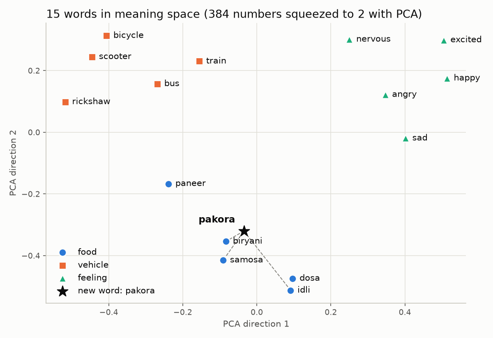
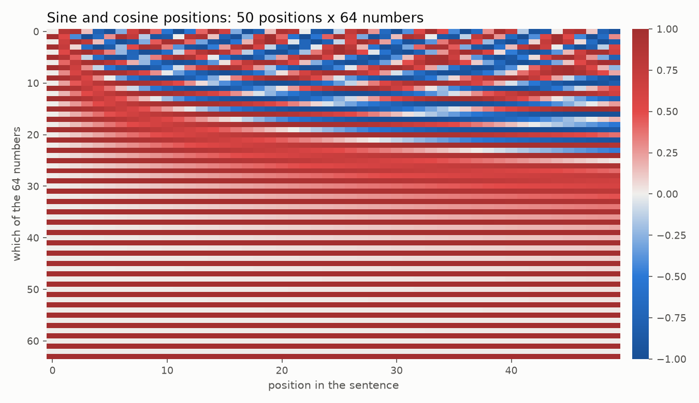
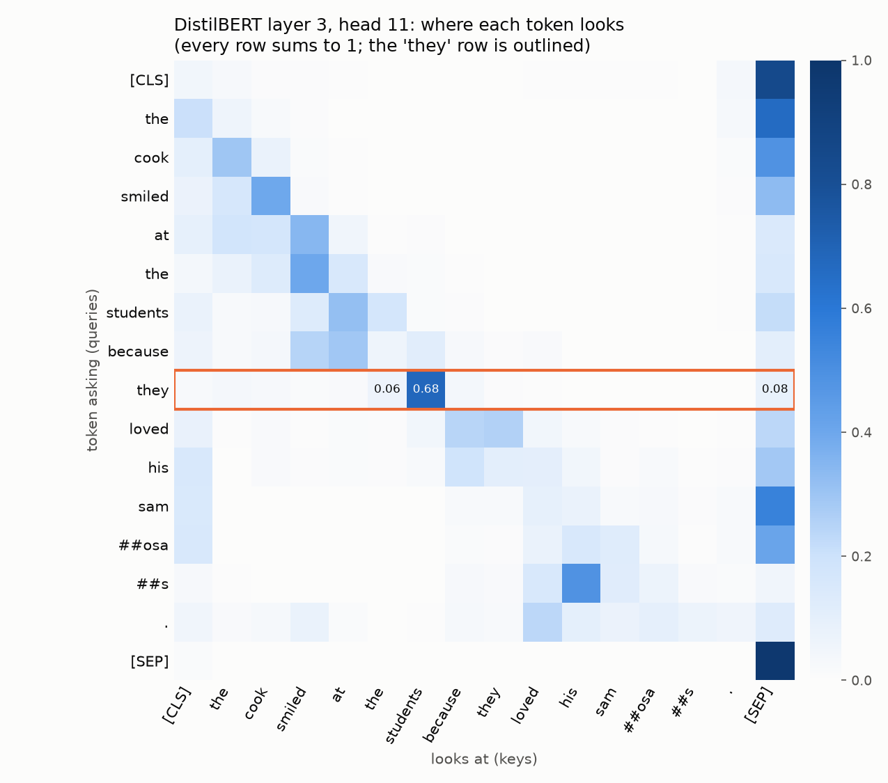

# Episode 02: How Transformers Read: Tokens, Embeddings and Self-Attention, Step by Step

> Part of **AI Engineering From Zero** by Ravi Shanker Singh (TechWithRavi).
> Video: the link goes here when the episode is published  |  Code: https://github.com/replyravi/ai-engineering-course/tree/main/ep02-attention-xray

## What you will build

An **attention X-ray**: a set of small programs that open a real Transformer encoder (DistilBERT, a smaller
copy of BERT) and show you every stage of how it reads a sentence. Text becomes tokens, tokens become IDs,
IDs become rows of a learned table, positions are added, and self-attention mixes every word with every
other word. You also write attention yourself in NumPy, with tests, so Episode 03 can build on it.

The headline result, from a real run (`python two_meanings.py`):

```text
A: We sat on the bank of the Ganga.
B: I opened an account at the bank.

Token ID of 'bank': 2924 in A, 2924 in B. Position: 5 in A, 7 in B.

Similarity of the two 'bank' vectors, stage by stage:
  input embedding (table row 2924)         1.00
  + position, after the embedding layer    0.96
  after block 1                            0.87
  after block 2                            0.69
  after block 3                            0.69
  after block 4                            0.70
  after block 5                            0.76
  after block 6                            0.66
```

Same word, same ID, same starting vector. After the model reads the sentence around it, the two "bank"
vectors are only partly alike.

**You will learn:**

- How a tokenizer cuts text into subword pieces (`##`), what a token ID is, and what `[CLS]`, `[SEP]`, `[PAD]`, `[MASK]` and `[UNK]` do
- Why the same sentence costs different numbers of tokens in different tokenizers and languages
- What an embedding table is (a learned lookup table, 30,522 rows x 768 numbers) and what "close in meaning" means
- Why attention on its own ignores word order, and how sine/cosine and learned positions fix it
- Scaled dot-product attention from scratch: Q, K, V, scores, softmax, and why we divide by the square root of d_k
- Multi-head attention and the parts of one encoder block, with shapes printed at every step
- What a trained model's attention really looks like, and how to read it honestly

> **Seen an older tutorial?** Four things changed in `transformers` 5 (we use 5.20.2):
> - `tokenizer.encode_plus(text)` and `batch_encode_plus(...)` are **gone** (`AttributeError`). Call the tokenizer itself: `tokenizer(text)` or `tokenizer([a, b], padding=True)`.
> - `pad_to_max_length=True` is **silently ignored**: no error, no padding. Use `padding=True` (or `padding="max_length"`).
> - `model(**inputs, output_attentions=True)` returns an **empty** tuple of attentions with the default fast attention (`sdpa`). Load the model with `attn_implementation="eager"` to get the weights (step 12).
> - `BertTokenizerFast` is now just another name for `BertTokenizer`: there is one tokenizer class, backed by the fast Rust tokenizer. `AutoTokenizer` picks it for you.

## Prerequisites

- Finished [Episode 01](../ep01-four-kinds-of-ai/) (the shared `.venv`, the root `.env`, and the Byte Bites canteen sentences). Basic Python and lists of numbers; NumPy arrays help.
- **Python 3.13** (3.11 and 3.12 also work). **Do not use Python 3.14 or 3.15 yet** - some course libraries (PyTorch, CrewAI) do not support them.
- The shared `.venv` and root `.env` with your **free** Gemini key from Episode 1 ([SETUP.md](../SETUP.md)). Only step 14 uses the key; steps 1-13 run on your computer.
- About 60 minutes. Downloads, once: DistilBERT (about 270 MB), the tiny BERT-base `config.json` (570 bytes, no weights), two tiktoken files (1.7 MB and 3.6 MB). The MiniLM model (about 90 MB) is already on your computer from Episode 01.

**Models and files this episode downloads, and their licences**

| What | From | Size | Licence |
|---|---|---|---|
| [`distilbert/distilbert-base-uncased`](https://huggingface.co/distilbert/distilbert-base-uncased) (weights, tokenizer, config) | Hugging Face | about 270 MB (`model.safetensors` is 267,954,768 bytes) | Apache-2.0 |
| [`google-bert/bert-base-uncased`](https://huggingface.co/google-bert/bert-base-uncased), `config.json` only (step 8) | Hugging Face | 570 bytes | Apache-2.0 |
| [`sentence-transformers/all-MiniLM-L6-v2`](https://huggingface.co/sentence-transformers/all-MiniLM-L6-v2) (step 6, from Episode 01) | Hugging Face | about 90 MB | Apache-2.0 |
| `cl100k_base` and `o200k_base` encoding files (step 3) | downloaded by the `tiktoken` library from OpenAI's public storage | 1.7 MB and 3.6 MB | the `tiktoken` library is MIT-licensed; the files come with no separate licence |

Apache-2.0 means free to use, also commercially (keep the licence notice if you share the model files).
The DistilBERT model card also warns that the model can make biased predictions. We only look inside it here.

## What is in this folder

```text
ep02-attention-xray/
├── data/sentences.txt     every sentence we read (3 lines from Episode 01 + new ones)
├── encoder.py             shared: read the sentences, load DistilBERT          (step 1)
├── tokens.py              tokens, IDs, token counts, padding                    (steps 1-4)
├── embeddings_peek.py     the token table and the position table               (steps 5, 8)
├── meaning_map.py         15 words on a 2D meaning map                          (step 6)
├── positions.py           sine/cosine positions in NumPy                        (step 7)
├── attention.py           attention, multi-head, encoder block in NumPy        (steps 9-11, reused in Episode 03)
├── real_attention.py      one real attention head as a heatmap                  (step 12)
├── two_meanings.py        "bank" and "bank", measured                           (step 13)
├── explain.py             Gemini explains our numbers                            (step 14)
├── tests/                 offline tests                                          (step 15)
├── docs/                  example pictures from the recording machine
├── llm.py, testing/       shared helpers copied from _template/ (do not edit here)
├── requirements.txt       points to the shared ../requirements-base.txt
├── CHALLENGE.md
└── plots/                 made by the scripts (git ignores it)
```

Every file is already here. Type the code yourself as we go (the best way to learn), or open the file in
VS Code and read along. Each step shows the part of the file it adds.

---

## Step 0 - Get ready (about 2 minutes)

The whole course shares **one** virtual environment (`.venv`) and **one** `.env` file, both at the
repo root (`ai-engineering-course/`). You created them once in Episode 1
([SETUP.md](../SETUP.md)). New here? Do SETUP.md first, then come back.

### 0.1 Open the repo and activate the shared environment

Open the `ai-engineering-course` folder in VS Code, then open a terminal (**Terminal > New Terminal**).

**Windows (PowerShell):**

```powershell
.\.venv\Scripts\Activate.ps1
cd ep02-attention-xray
```

**macOS / Linux:**

```bash
source .venv/bin/activate
cd ep02-attention-xray
```

Expected: your prompt starts with `(.venv)` and ends in `ep02-attention-xray`.

> [!WARNING]
> **Common errors**
> - `.venv\Scripts\Activate.ps1 cannot be loaded` / `No such file or directory` - you are not in the repo root, or the `.venv` does not exist yet. Run `cd` to the `ai-engineering-course` folder first; if there is still no `.venv`, follow [SETUP.md](../SETUP.md).
> - Windows: `running scripts is disabled on this system` - allow scripts for this window only, then activate again:
>   `Set-ExecutionPolicy -ExecutionPolicy Bypass -Scope Process`
> - VS Code already shows `(.venv)` in new terminals once you pick the interpreter: **Ctrl+Shift+P > Python: Select Interpreter > .venv**.

### 0.2 Make sure the libraries are up to date

Nothing new to install if you already ran Episode 1: this episode uses the shared `requirements-base.txt`
(`transformers`, `torch`, `tiktoken`, `numpy`, `matplotlib` and `scikit-learn` are all in it).
If you pulled a newer version of the repo, update the environment:

```bash
pip install -r ../requirements-base.txt
pip check
```

Expected (last line):

```text
No broken requirements found.
```

> [!WARNING]
> **Common errors**
> - `No matching distribution found for torch==2.14.1` - the `.venv` was made with Python 3.14/3.15. Delete the `.venv` folder and recreate it with Python 3.13 ([SETUP.md](../SETUP.md)).
> - Linux without an NVIDIA GPU: install the CPU-only PyTorch first (SETUP.md), otherwise pip downloads several GB of CUDA files.

### 0.3 Check that your key is found from this folder

Your key lives in `ai-engineering-course/.env` (made in Episode 1). `llm.py` looks for it in this folder
and then in each parent folder, so it finds the root file by itself. Do not copy `.env` into episode folders.

```bash
python llm.py
```

Expected output (the greeting will differ; your path will differ):

```text
Settings file: /.../ai-engineering-course/.env
Provider: gemini   Model: gemini-3.5-flash-lite
API key found. Asking the model a tiny question...
<a one-sentence hello written by Gemini>
```

No key yet? You get friendly help instead (real output, recorded on a machine with no `.env`):

```text
Settings file: no .env found
Provider: gemini   Model: gemini-3.5-flash-lite


No API key found for LLM_PROVIDER=gemini.
Looked for: GEMINI_API_KEY or GOOGLE_API_KEY in your .env file.

Get a FREE Gemini key (no credit card needed):
  1. Open https://aistudio.google.com/apikey
  2. Sign in with your Google account and accept the terms
  3. Click 'Create API key' and copy it
  4. Put it in your .env file like this:  GEMINI_API_KEY=paste-your-key-here

No .env file yet? In the ai-engineering-course folder (the repo root), copy .env.example to .env:
  macOS / Linux:       cp .env.example .env
  Windows PowerShell:  Copy-Item .env.example .env
(.env file in use right now: none found)
```

Only step 14 needs the key, so you can do steps 1-13 first and add the key later.

> **Want another AI?** Change ONE line in the root `.env`: `LLM_PROVIDER=openai`, `anthropic` or `ollama` (free, local - install from https://ollama.com and run `ollama pull qwen3.5:4b`). Nothing else changes.

> [!WARNING]
> **Common errors**
> - `Settings file: no .env found` and `No API key found` - the root `.env` is missing or is named `.env.txt` (Windows hides extensions!). Create it from the repo root: `Copy-Item .env.example .env` (Windows) or `cp .env.example .env` (macOS/Linux), then paste your key.
> - `429 RESOURCE_EXHAUSTED` - you hit the free-tier limit. Wait a minute (per-minute limit) or until tomorrow (daily limit, resets at midnight Pacific time). See your limits at https://aistudio.google.com/rate-limit
> - `404 ... model not found` - the model name in `LLM_MODEL` is wrong or retired. Leave `LLM_MODEL=` empty to use the default.

---

## Step 1 - Tokenise three feedback lines

A model cannot read letters. A **tokenizer** first cuts text into **tokens** from a fixed list, the
vocabulary. DistilBERT uses **WordPiece**: common words are one token, and a word the list does not hold
is built from smaller pieces it does hold. A piece that glues onto the one before it starts with `##`.
Nobody "borrows" a similar word's ID; the word is spelled out in known pieces.

All our sentences live in `data/sentences.txt`. The first three are copied from Episode 01's canteen file:

```text
[feedback]
# Three lines copied from ../ep01-four-kinds-of-ai/data/feedback.csv (rows 1, 3 and 30)
The biryani was far too oily and the portion was tiny.
A separate counter for takeaway orders would save everyone time.
The masala dosa was hot, crisp and really tasty today.
```

Create `encoder.py`. Every later file uses it to read the sentences and load the model:

```python
"""
encoder.py - shared helpers: read our sentences and load the small encoder we look inside.

The model is DistilBERT, "distilbert/distilbert-base-uncased" on Hugging Face. It is a smaller copy
of BERT-base: the same 30,522-entry vocabulary and 768 numbers per token, but 6 layers instead of 12.
The first load downloads about 270 MB. After that it works offline.

Used by tokens.py, embeddings_peek.py, real_attention.py, two_meanings.py and explain.py.
"""

from pathlib import Path

HERE = Path(__file__).resolve().parent
SENTENCES_FILE = HERE / "data" / "sentences.txt"
PLOTS = HERE / "plots"          # every picture lands here (git ignores it)

MODEL_NAME = "distilbert/distilbert-base-uncased"
SEED = 42                       # fixed seed: the "random" numbers are the same on every run


def read_sentences(path=SENTENCES_FILE) -> dict:
    """Read data/sentences.txt into {"group name": [sentence, ...]}."""
    groups = {}
    group = None
    for line in Path(path).read_text(encoding="utf-8").splitlines():
        line = line.strip()
        if not line or line.startswith("#"):
            continue                         # skip empty lines and comments
        if line.startswith("[") and line.endswith("]"):
            group = line[1:-1]               # a new group starts, like [feedback]
            groups[group] = []
        else:
            groups[group].append(line)
    return groups


def load_tokenizer(name: str = MODEL_NAME):
    """The tokenizer that belongs to the model: text -> tokens -> IDs."""
    from transformers import AutoTokenizer

    return AutoTokenizer.from_pretrained(name)


def load_encoder(name: str = MODEL_NAME):
    """Return (tokenizer, model), ready to read sentences.

    attn_implementation="eager" runs attention the plain way, so the model can hand back its
    attention weights. (The faster default, "sdpa", returns none of them in transformers 5.)
    """
    import transformers
    from transformers import AutoModel

    # Hide the load report: it lists the unused "guess the hidden word" layers, which we do not need.
    transformers.logging.set_verbosity_error()
    model = AutoModel.from_pretrained(name, attn_implementation="eager")
    model.eval()   # reading mode: switches off dropout, so the same sentence gives the same numbers
    return load_tokenizer(name), model


def save_note(path: Path) -> str:
    """'plots/x.png' instead of a long absolute path, for printing."""
    path = Path(path)
    return str(path.relative_to(HERE)) if path.is_relative_to(HERE) else str(path)
```

Create `tokens.py`. It will hold steps 1 to 4; here is the start, the step 1 functions and the end:

```python
"""
tokens.py - how a Transformer turns text into token IDs (steps 1 to 4).

    python tokens.py pieces     step 1: split three Episode 01 feedback lines into tokens
    python tokens.py ids        step 2: token IDs, [CLS], [SEP] and the other special tokens
    python tokens.py compare    step 3: same sentence, English vs Hindi, three tokenizers
    python tokens.py pad        step 4: pad two sentences into one batch, with an attention mask

The first run downloads the DistilBERT tokenizer (and, in step 3, two small tiktoken files).
"""

import argparse

from encoder import load_tokenizer, read_sentences

# tiktoken encodings used by OpenAI's GPT models (step 3)
GPT_ENCODINGS = {"cl100k_base": "gpt-4", "o200k_base": "gpt-4o"}


# ---------------------------------------------------------------------------
# Step 1 - text -> tokens (subword pieces)
# ---------------------------------------------------------------------------


def split_words(text: str, tokenizer) -> list:
    """Return [(word, [its pieces]), ...] for every word the tokenizer cut into pieces."""
    encoding = tokenizer(text, add_special_tokens=False)
    pieces = encoding.tokens()          # the token strings
    word_of_piece = encoding.word_ids()  # which word each piece came from: 0, 1, 1, 1, 2, ...
    words = {}
    for piece, word in zip(pieces, word_of_piece):
        words.setdefault(word, []).append(piece)
    return [("".join(p.removeprefix("##") for p in group), group) for group in words.values() if len(group) > 1]


def show_pieces(tokenizer) -> None:
    for number, line in enumerate(read_sentences()["feedback"], start=1):
        pieces = tokenizer.tokenize(line)
        print(f"Sentence {number}: {line}")
        print(f"  {len(pieces)} tokens: {' | '.join(pieces)}")
        splits = [f"{word} = {' + '.join(group)}" for word, group in split_words(line, tokenizer)]
        print(f"  cut into pieces: {', '.join(splits) if splits else 'none'}\n")
    print("'##' means: this piece glues onto the piece before it, with no space.")


STEPS = {"pieces": show_pieces, "ids": show_ids, "compare": show_compare, "pad": show_pad}


def main(argv=None) -> int:
    parser = argparse.ArgumentParser(description="Episode 02, steps 1-4: tokens and token IDs")
    parser.add_argument("step", nargs="?", default="pieces", choices=list(STEPS))
    args = parser.parse_args(argv)
    STEPS[args.step](load_tokenizer())
    return 0


if __name__ == "__main__":
    raise SystemExit(main())
```

`STEPS` already lists all four steps; you add `show_ids`, `show_compare` and `show_pad` in steps 2-4
(type them now, or comment those names out until then).

```bash
python tokens.py pieces
```

Expected output (the first run downloads the tokenizer, under 1 MB, then the model files come in step 5):

```text
Sentence 1: The biryani was far too oily and the portion was tiny.
  15 tokens: the | bi | ##rya | ##ni | was | far | too | oil | ##y | and | the | portion | was | tiny | .
  cut into pieces: biryani = bi + ##rya + ##ni, oily = oil + ##y

Sentence 2: A separate counter for takeaway orders would save everyone time.
  12 tokens: a | separate | counter | for | take | ##away | orders | would | save | everyone | time | .
  cut into pieces: takeaway = take + ##away

Sentence 3: The masala dosa was hot, crisp and really tasty today.
  15 tokens: the | mas | ##ala | dos | ##a | was | hot | , | crisp | and | really | ta | ##sty | today | .
  cut into pieces: masala = mas + ##ala, dosa = dos + ##a, tasty = ta + ##sty

'##' means: this piece glues onto the piece before it, with no space.
```

Even "tasty" is cut in two: `ta` + `##sty`. The vocabulary has only 30,522 entries, so less common words are
built from pieces. And everything is lower case, because this is the **uncased** model.

The first run may also print one grey line above the output: `Warning: You are sending unauthenticated
requests to the HF Hub`. It is harmless. Downloads work without a Hugging Face account.

> [!WARNING]
> **Common errors**
> - `OSError: We couldn't connect to 'https://huggingface.co' ...` - the first run needs internet to download the tokenizer. Connect once; after that it works offline.
> - `invalid choice: 'idz'` - a typo in the step name. The choices are `pieces`, `ids`, `compare` and `pad`.
> - `NameError: name 'show_ids' is not defined` - you typed `STEPS` before the step 2-4 functions. Add them, or comment them out of `STEPS` for now.

## Step 2 - Token IDs and special tokens

A **token ID** is simply the token's row number in the vocabulary list. The tokenizer also adds two
**special tokens**: `[CLS]` at the start (its final vector is what a classifier reads) and `[SEP]` at the end
(it separates sentences). `[UNK]` is the last resort for a character the list cannot build at all.

Add to `tokens.py`:

```python
def show_ids(tokenizer) -> None:
    line = read_sentences()["feedback"][1]
    ids = tokenizer(line)["input_ids"]                  # adds [CLS] and [SEP] by itself
    print(f"Sentence: {line}\n")
    print(f"  {'token':<10} {'ID':>6}")
    for token, token_id in zip(tokenizer.convert_ids_to_tokens(ids), ids):
        print(f"  {token:<10} {token_id:>6}")

    print(f"\nVocabulary size: {len(tokenizer):,} entries (IDs 0 to {len(tokenizer) - 1:,})")
    print(f"An ID is just a row number: entry {ids[1]} of the vocabulary is {tokenizer.convert_ids_to_tokens(ids[1])!r}")

    print("\nSpecial tokens:")
    for token in ["[PAD]", "[UNK]", "[CLS]", "[SEP]", "[MASK]"]:
        print(f"  {token:<7} ID {tokenizer.convert_tokens_to_ids(token)}")

    tricky = "🍛 biryani"
    print(f"\nA character the vocabulary has never seen: {tricky!r} -> {tokenizer.tokenize(tricky)}")
```

```bash
python tokens.py ids
```

Expected output:

```text
Sentence: A separate counter for takeaway orders would save everyone time.

  token          ID
  [CLS]         101
  a            1037
  separate     3584
  counter      4675
  for          2005
  take         2202
  ##away       9497
  orders       4449
  would        2052
  save         3828
  everyone     3071
  time         2051
  .            1012
  [SEP]         102

Vocabulary size: 30,522 entries (IDs 0 to 30,521)
An ID is just a row number: entry 1037 of the vocabulary is 'a'

Special tokens:
  [PAD]   ID 0
  [UNK]   ID 100
  [CLS]   ID 101
  [SEP]   ID 102
  [MASK]  ID 103

A character the vocabulary has never seen: '🍛 biryani' -> ['[UNK]', 'bi', '##rya', '##ni']
```

`[CLS]` is 101 and `[SEP]` is 102, in every sentence. IDs start at 0, which is `[PAD]`. `[MASK]` (103) is the
blank BERT learned to fill in during pre-training: it read text with some words hidden and guessed them.

> [!WARNING]
> **Common errors**
> - `AttributeError: BertTokenizer has no attribute encode_plus` - an older tutorial's method, removed in transformers 5. Call `tokenizer(text)` instead (see the Fix-It Corner below for the real message).
> - Your IDs differ - you are using a different model's tokenizer (for example a cased one). Every model has its own vocabulary, so IDs only make sense with the model they belong to.

## Step 3 - Count tokens: English vs Hindi, three tokenizers

Models read, and APIs bill, in tokens, not words. The same sentence gives different counts with different
tokenizers. We compare DistilBERT's WordPiece with two tokenizers OpenAI's GPT models use (through the
`tiktoken` library), on one English sentence and its Hindi translation:

```text
[english_hindi]
The canteen opens at eight in the morning.
कैंटीन सुबह आठ बजे खुलती है।
```

Add to `tokens.py`. `GPT_ENCODINGS` is already at the top of the file from step 1; it is shown again here so
you can see which two tokenizers we mean (do not type it twice):

```python
GPT_ENCODINGS = {"cl100k_base": "gpt-4", "o200k_base": "gpt-4o"}


def count_tokens(text: str, tokenizer) -> dict:
    """Tokens for one text under WordPiece and two GPT tokenizers (special tokens not counted)."""
    import tiktoken

    counts = {"WordPiece (DistilBERT, BERT)": len(tokenizer(text, add_special_tokens=False)["input_ids"])}
    for name, model in GPT_ENCODINGS.items():
        counts[f"{name} ({model})"] = len(tiktoken.get_encoding(name).encode(text))
    return counts


def show_compare(tokenizer) -> None:
    import tiktoken

    english, hindi = read_sentences()["english_hindi"]
    print(f"English: {english}\nHindi:   {hindi}\n")

    for name, model in GPT_ENCODINGS.items():   # proof that the names match the models
        print(f"tiktoken says {model} uses {tiktoken.encoding_for_model(model).name}")

    english_counts, hindi_counts = count_tokens(english, tokenizer), count_tokens(hindi, tokenizer)
    print(f"\n  {'tokenizer':<30} {'English':>7} {'Hindi':>6}")
    for name in english_counts:
        print(f"  {name:<30} {english_counts[name]:>7} {hindi_counts[name]:>6}")

    ids = tokenizer(hindi, add_special_tokens=False)["input_ids"]
    print(f"\nWordPiece pieces for the Hindi line: {tokenizer.convert_ids_to_tokens(ids)}")
    print(f"WordPiece turns them back into text: {tokenizer.decode(ids)}")
    o200k = tiktoken.get_encoding("o200k_base")
    print(f"o200k_base pieces for the Hindi line: {[o200k.decode([i]) for i in o200k.encode(hindi)]}")
```

```bash
python tokens.py compare
```

Expected output (the first run downloads two small tiktoken files):

```text
English: The canteen opens at eight in the morning.
Hindi:   कैंटीन सुबह आठ बजे खुलती है।

tiktoken says gpt-4 uses cl100k_base
tiktoken says gpt-4o uses o200k_base

  tokenizer                      English  Hindi
  WordPiece (DistilBERT, BERT)         9     16
  cl100k_base (gpt-4)                 11     33
  o200k_base (gpt-4o)                 10     11

WordPiece pieces for the Hindi line: ['क', '##ट', '##ी', '##न', 'स', '##ब', '##ह', '[UNK]', 'ब', '##ज', 'ख', '##ल', '##त', '##ी', 'ह', '।']
WordPiece turns them back into text: कटीन सबह [UNK] बज खलती ह ।
o200k_base pieces for the Hindi line: ['क', 'ैं', 'ट', 'ीन', ' सुबह', ' आठ', ' बजे', ' खुल', 'ती', ' है', '।']
```

Three lessons in one table:

- The older GPT-4 tokenizer (`cl100k_base`) needs **33** tokens for the Hindi line and **11** for the English one: three times the cost for the same meaning.
- The newer `o200k_base` has a much bigger vocabulary with more Hindi pieces: **11** for Hindi, close to English's **10**.
- WordPiece was built for English. It drops the Hindi vowel signs (look at the decoded text) and turns `आठ` into `[UNK]`. An English-only encoder is the wrong tool for Hindi; multilingual models exist for that.

> [!WARNING]
> **Common errors**
> - The Hindi line shows as boxes in your terminal - the terminal font has no Devanagari letters. The counts are still right. VS Code's terminal shows Hindi fine.
> - `requests.exceptions.ConnectionError` from tiktoken - the first run downloads its two files. Connect once; tiktoken keeps them in a cache folder.

## Step 4 - Pad a batch and build the attention mask

A model reads many sentences at once in a **batch**, and a batch must be a rectangle. So shorter sentences
get `[PAD]` tokens, and an **attention mask** says which tokens are real (1) and which are padding (0).
Attention will give padding exactly zero weight (you prove that in the final challenge).

```text
[short]
Filter coffee here is the best on campus.
Chai, please!
```

Add to `tokens.py`:

```python
def show_pad(tokenizer) -> None:
    long_line, short_line = read_sentences()["short"]
    batch = tokenizer([long_line, short_line], padding=True)   # pad the shorter one up to the longer one
    width = 8
    for row, (ids, mask) in enumerate(zip(batch["input_ids"], batch["attention_mask"]), start=1):
        tokens = tokenizer.convert_ids_to_tokens(ids)
        print(f"row {row} tokens: " + "".join(f"{t:<{width}}" for t in tokens).rstrip())
        print(f"row {row} IDs:    " + "".join(f"{i:<{width}}" for i in ids).rstrip())
        print(f"row {row} mask:   " + "".join(f"{m:<{width}}" for m in mask).rstrip() + "\n")
    lengths = {len(ids) for ids in batch["input_ids"]}
    print(f"Both rows now have {lengths.pop()} tokens. Mask 1 = a real token, 0 = [PAD] (ignore it).")
```

```bash
python tokens.py pad
```

Expected output:

```text
row 1 tokens: [CLS]   filter  coffee  here    is      the     best    on      campus  .       [SEP]
row 1 IDs:    101     11307   4157    2182    2003    1996    2190    2006    3721    1012    102
row 1 mask:   1       1       1       1       1       1       1       1       1       1       1

row 2 tokens: [CLS]   cha     ##i     ,       please  !       [SEP]   [PAD]   [PAD]   [PAD]   [PAD]
row 2 IDs:    101     15775   2072    1010    3531    999     102     0       0       0       0
row 2 mask:   1       1       1       1       1       1       1       0       0       0       0

Both rows now have 11 tokens. Mask 1 = a real token, 0 = [PAD] (ignore it).
```

> [!WARNING]
> **Common errors**
> - Your rows have different lengths - you used an older tutorial's `pad_to_max_length=True`, which transformers 5 silently ignores. Use `padding=True`.
> - `ValueError: Unable to create tensor ... Perhaps your features have different length` - you asked for `return_tensors="pt"` without `padding=True`.

## Step 5 - Inspect the embedding table

Each token ID now picks one **row** of a big learned table: its **embedding**, a list of 768 numbers.
That is all the "embedding layer" is: a lookup table, trained together with the rest of the model.
These are the input vectors, before any attention.

To compare two rows we use **cosine similarity**: it checks whether two lists of numbers point the same
way. 1.0 means the same direction, 0 means unrelated. In the code, `.detach().numpy()` turns PyTorch's
table into a plain NumPy array that we can print and do maths on.

Create `embeddings_peek.py` (the step 8 function comes later):

```python
"""
embeddings_peek.py - look at two tables inside the real encoder (steps 5 and 8).

    python embeddings_peek.py              step 5: the token embedding table (one row per vocabulary entry)
    python embeddings_peek.py positions    step 8: the position table (BERT-style models LEARN positions)

Both tables are plain grids of numbers that were learned during training, like every other weight.
"""

import argparse

import numpy as np

from encoder import MODEL_NAME, load_encoder
from positions import positional_encoding

BERT_BASE = "google-bert/bert-base-uncased"   # step 8 reads only its small config.json, not the weights


def first_five(row) -> list:
    """The first five numbers of a row, rounded for printing."""
    return [round(float(x), 4) for x in row[:5]]


def cell(value) -> str:
    """30522 -> '30,522' for the table; text stays as it is."""
    return f"{value:,}" if isinstance(value, int) else str(value)


def cosine(a, b) -> float:
    """Cosine similarity: 1.0 = same direction, 0 = unrelated."""
    return float(np.dot(a, b) / (np.linalg.norm(a) * np.linalg.norm(b)))


def show_token_table(tokenizer, model) -> None:
    import torch

    table = model.embeddings.word_embeddings.weight.detach().numpy()   # rows = vocabulary, columns = numbers
    rows, width = table.shape
    total = sum(p.numel() for p in model.parameters())
    print(f"Token embedding table: {table.shape} -> {rows:,} rows (one per vocabulary entry) x {width} numbers")
    print(f"That is {table.size:,} learned numbers, {table.size / total:.0%} of all {total:,} in DistilBERT.\n")

    word = "coffee"
    token_id = tokenizer.convert_tokens_to_ids(word)
    print(f"{word!r} has ID {token_id}, so its embedding is row {token_id}.")
    print(f"First five of its {width} numbers: {first_five(table[token_id])}")

    with torch.inference_mode():   # the layer itself, given the ID, returns exactly that row
        from_layer = model.embeddings.word_embeddings(torch.tensor([token_id]))[0].numpy()
    print(f"The lookup layer returns exactly that row: {np.array_equal(from_layer, table[token_id])}\n")

    print("Cosine similarity between rows (input vectors, before any attention):")
    for other in ["tea", "bus"]:
        similarity = cosine(table[token_id], table[tokenizer.convert_tokens_to_ids(other)])
        print(f"  {word} ~ {other:<4} {similarity:.2f}")


STEPS = {"tokens": show_token_table, "positions": show_position_table}


def main(argv=None) -> int:
    parser = argparse.ArgumentParser(description="Episode 02, steps 5 and 8: tables inside the encoder")
    parser.add_argument("table", nargs="?", default="tokens", choices=list(STEPS))
    args = parser.parse_args(argv)
    tokenizer, model = load_encoder()
    STEPS[args.table](tokenizer, model)
    return 0


if __name__ == "__main__":
    raise SystemExit(main())
```

```bash
python embeddings_peek.py
```

Expected output (the first run downloads DistilBERT, about 270 MB):

```text
Token embedding table: (30522, 768) -> 30,522 rows (one per vocabulary entry) x 768 numbers
That is 23,440,896 learned numbers, 35% of all 66,362,880 in DistilBERT.

'coffee' has ID 4157, so its embedding is row 4157.
First five of its 768 numbers: [-0.0493, 0.0109, 0.0034, 0.0064, 0.017]
The lookup layer returns exactly that row: True

Cosine similarity between rows (input vectors, before any attention):
  coffee ~ tea  0.65
  coffee ~ bus  0.32
```

The table alone holds about a third of the whole model. And even before reading any sentence, "coffee" is
closer to "tea" than to "bus": training pushed words that appear in similar places towards similar rows.

The first run prints download bars. Every run also prints a few grey library lines first, such as
`Loading weights: 100%` and, on a Mac, `NOTE: Redirects are currently not supported in MacOs.` Online, you may also see
`Warning: You are sending unauthenticated requests to the HF Hub`. All of them are harmless.

> [!WARNING]
> **Common errors**
> - The first run seems stuck - it is downloading about 270 MB. Wait for the progress bars to finish.
> - `OSError: We couldn't connect to 'https://huggingface.co'` - the first run needs internet. After that it works offline.
> - `NameError: name 'show_position_table' is not defined` - `STEPS` already lists the step 8 function. Add it in step 8, or comment it out of `STEPS` for now.
> - `ModuleNotFoundError: No module named 'positions'` - this file borrows one function from `positions.py`, which you write in step 7. It is already in the folder you downloaded. If you deleted it, get it back with `git checkout positions.py`, or copy it again from the GitHub page.

## Step 6 - Draw a meaning map

To see "close in meaning" with our own eyes, we embed 15 words with the small local model from Episode 01
(`get_embeddings()`, 384 numbers per text), measure **cosine similarity** (1.0 = same direction), squeeze
384 numbers down to 2 with PCA and draw them. Then we drop in a new word, `pakora`.

Create `meaning_map.py` (the `save_picture` function, which only styles the plot, is in the file):

```python
"""
meaning_map.py - words with similar meanings get similar vectors (step 6).

get_embeddings() from llm.py is the free local model all-MiniLM-L6-v2 (a small encoder, like
DistilBERT's little cousin). It turns each word into 384 numbers. We then:
  1. find each word's nearest neighbour by cosine similarity (1.0 = same direction)
  2. squeeze 384 numbers down to 2 with PCA, and draw the map
  3. drop in a new word and find its three nearest neighbours

Run:  python meaning_map.py      (saves plots/meaning_map.png; the model is about 90 MB, cached since Episode 01)
"""

import numpy as np

from encoder import PLOTS, SEED, save_note

PICTURE = PLOTS / "meaning_map.png"

GROUPS = {
    "food": ["dosa", "biryani", "samosa", "idli", "paneer"],
    "vehicle": ["bus", "train", "bicycle", "scooter", "rickshaw"],
    "feeling": ["happy", "angry", "sad", "excited", "nervous"],
}
QUERY = "pakora"   # a new word that is not on the map yet

# Colours and shapes for the three groups (colour-blind safe; the shapes help too)
COLOURS = ["#2a78d6", "#eb6834", "#1baf7a"]
SHAPES = ["o", "s", "^"]


def embed(words, embeddings=None) -> np.ndarray:
    """One row of numbers per word, each row scaled to length 1 (so a dot product = cosine similarity)."""
    if embeddings is None:
        from llm import get_embeddings
        embeddings = get_embeddings()
    vectors = np.array(embeddings.embed_documents(list(words)))
    return vectors / np.linalg.norm(vectors, axis=1, keepdims=True)


def nearest(vector, vectors, words, k=3, skip=None) -> list:
    """The k words whose vectors point most in the same direction as `vector`: [(word, similarity), ...]."""
    similarities = vectors @ vector
    order = [i for i in np.argsort(similarities)[::-1] if words[i] != skip]
    return [(words[i], float(similarities[i])) for i in order[:k]]


def main(embeddings=None, picture=PICTURE) -> int:
    from sklearn.decomposition import PCA

    words = [w for group in GROUPS.values() for w in group]
    groups = [name for name, group in GROUPS.items() for _ in group]
    vectors = embed(words + [QUERY], embeddings)
    vectors, query = vectors[:-1], vectors[-1]
    print(f"Embedded {len(words)} words (+1 new word), {vectors.shape[1]} numbers each\n")

    print("Nearest neighbour of each word (cosine similarity):")
    same_group = 0
    for word, group in zip(words, groups):
        (other, similarity), = nearest(vectors[words.index(word)], vectors, words, k=1, skip=word)
        same = groups[words.index(other)] == group
        same_group += same
        print(f"  {word:<9} -> {other:<9} {similarity:.2f}   {'same group' if same else 'OTHER group'}")
    print(f"Nearest neighbour in the same group: {same_group} of {len(words)}\n")

    neighbours = nearest(query, vectors, words, k=3)
    print(f"New word {QUERY!r}, three nearest: " + ", ".join(f"{w} {s:.2f}" for w, s in neighbours))

    pca = PCA(n_components=2, random_state=SEED).fit(vectors)    # learn the 2 best directions from the 15 words
    points, query_point = pca.transform(vectors), pca.transform(query[np.newaxis])[0]
    print(f"The 2D map keeps {pca.explained_variance_ratio_.sum():.0%} of the spread of the 384 numbers.")

    path = save_picture(points, words, groups, query_point, neighbours, picture)
    print(f"\nSaved the picture: {save_note(path)}")
    return 0
```

```bash
python meaning_map.py
```

Expected output:

```text
Embedded 15 words (+1 new word), 384 numbers each

Nearest neighbour of each word (cosine similarity):
  dosa      -> idli      0.38   same group
  biryani   -> paneer    0.35   same group
  samosa    -> biryani   0.27   same group
  idli      -> dosa      0.38   same group
  paneer    -> biryani   0.35   same group
  bus       -> train     0.47   same group
  train     -> bus       0.47   same group
  bicycle   -> scooter   0.50   same group
  scooter   -> bicycle   0.50   same group
  rickshaw  -> bicycle   0.47   same group
  happy     -> excited   0.58   same group
  angry     -> excited   0.45   same group
  sad       -> happy     0.37   same group
  excited   -> happy     0.58   same group
  nervous   -> angry     0.41   same group
Nearest neighbour in the same group: 15 of 15

New word 'pakora', three nearest: idli 0.46, samosa 0.45, biryani 0.43
The 2D map keeps 28% of the spread of the 384 numbers.

Saved the picture: plots/meaning_map.png
```

Open `plots/meaning_map.png` (click it in the VS Code Explorer). This is the picture from the recording machine:



Every word's nearest neighbour is in its own group, and `pakora` lands among the foods. Honest note: the
flat map keeps only 28% of the spread, so distances on the picture are a rough sketch. The similarity
numbers come from all 384 numbers and are the real ones.

> [!WARNING]
> **Common errors**
> - `OSError ... all-MiniLM-L6-v2` - the model is downloaded on the first run (about 90 MB). If you did Episode 01 it is already there.
> - Your 2D picture is mirrored - PCA may flip a direction on another computer. The groups and the similarity numbers stay the same.

## Step 7 - Sine and cosine positions in NumPy

Attention looks at every word at once, so on its own it sees a **bag** of word vectors: "Priya pays Ravi"
and "Ravi pays Priya" are the same bag. The 2017 Transformer paper adds a **position pattern** to every word
vector, built from sine and cosine waves of different speeds, like clock hands. Each position gets a unique
reading.

In the formula below, `pos` is the word's position (0, 1, 2, ...), `d_model` is how many numbers each word
vector has (64 in our demo, 768 in DistilBERT), and `i` counts the pairs of columns (0, 1, 2, ...).

Create `positions.py` (`save_picture` is in the file):

```python
"""
positions.py - give every position in a sentence its own pattern of numbers (step 7).

Attention on its own sees a sentence as a BAG of word vectors: shuffle the words and the bag
is the same. So we add a position pattern to each word vector. This file writes the sine and
cosine patterns from the 2017 Transformer paper, "Attention Is All You Need":

    PE[pos, 2i]   = sin(pos / 10000 ** (2i / d_model))
    PE[pos, 2i+1] = cos(pos / 10000 ** (2i / d_model))

Each pair of columns is a clock hand turning at its own speed. Together they give every
position a unique reading.

Run:  python positions.py      (saves plots/positions.png)
"""

from pathlib import Path

import numpy as np

# Only NumPy at the top: attention.py (and Episode 03) import this file without loading any model.
PICTURE = Path(__file__).resolve().parent / "plots" / "positions.png"
SEED = 42


def positional_encoding(num_positions: int, d_model: int, base: float = 10000.0) -> np.ndarray:
    """The sine/cosine position table, shape (num_positions, d_model). Row p is added to the word at position p."""
    if d_model % 2:
        raise ValueError("d_model must be even: sine and cosine columns come in pairs")
    positions = np.arange(num_positions)[:, np.newaxis]        # column: 0, 1, 2, ...
    pair_starts = np.arange(0, d_model, 2)[np.newaxis, :]       # row: 0, 2, 4, ... (one per clock hand)
    angles = positions / base ** (pair_starts / d_model)        # fast hands first, slow hands last
    table = np.zeros((num_positions, d_model))
    table[:, 0::2] = np.sin(angles)                             # even columns
    table[:, 1::2] = np.cos(angles)                             # odd columns
    return table


def same_bag(a: np.ndarray, b: np.ndarray) -> bool:
    """True if a and b hold the same row vectors, in any order (a 'bag' of vectors)."""
    if a.shape != b.shape:
        return False
    return all(any(np.allclose(row, other) for other in b) for row in a)


def main(picture=PICTURE) -> int:
    from encoder import read_sentences, save_note

    table = positional_encoding(50, 64)
    print(f"Position table: {table.shape} (50 positions x 64 numbers)\n")
    for pos in [0, 1, 2, 49]:
        print(f"  position {pos:>2}, first six numbers: {np.round(table[pos, :6], 3).tolist()}")

    unique_rows = len(np.unique(table.round(6), axis=0))
    print(f"\nall rows unique: {unique_rows == len(table)}  ({unique_rows} different rows)")

    similarity = table @ table[10]          # dot product of every position with position 10
    similarity[10] = -np.inf                # skip position 10 itself
    closest = np.argsort(similarity)[::-1][:2]
    print(f"positions most like position 10: {sorted(closest.tolist())} (neighbours look alike)")

    # Same words, different order: a bag of word vectors cannot tell them apart.
    first, second = read_sentences()["order"]
    words = sorted(set(first.lower().split()))
    rng = np.random.default_rng(SEED)
    vectors = {word: rng.normal(size=64) for word in words}   # pretend word vectors
    a = np.array([vectors[w] for w in first.lower().split()])
    b = np.array([vectors[w] for w in second.lower().split()])
    print(f"\n'{first}' vs '{second}'")
    print(f"  same bag of vectors? words only:       {same_bag(a, b)}")
    print(f"  same bag of vectors? words + positions: {same_bag(a + table[:3], b + table[:3])}")

    path = save_picture(table, picture)
    print(f"\nSaved the picture: {save_note(path)}")
    return 0
```

```bash
python positions.py
```

Expected output:

```text
Position table: (50, 64) (50 positions x 64 numbers)

  position  0, first six numbers: [0.0, 1.0, 0.0, 1.0, 0.0, 1.0]
  position  1, first six numbers: [0.841, 0.54, 0.682, 0.732, 0.533, 0.846]
  position  2, first six numbers: [0.909, -0.416, 0.997, 0.071, 0.902, 0.431]
  position 49, first six numbers: [-0.954, 0.301, -0.816, 0.578, 0.659, -0.752]

all rows unique: True  (50 different rows)
positions most like position 10: [9, 11] (neighbours look alike)

'Priya pays Ravi' vs 'Ravi pays Priya'
  same bag of vectors? words only:       True
  same bag of vectors? words + positions: False

Saved the picture: plots/positions.png
```



Each column is one position. The top rows (fast clock hands) change quickly from column to column; the
bottom rows (slow hands) change slowly. No two columns are the same, and neighbours look alike.

> [!WARNING]
> **Common errors**
> - `ValueError: d_model must be even` - sine and cosine come in pairs. Use an even width, such as 64 or 768.
> - Summing or averaging the word vectors does NOT fix word order, even with positions added (the sum of the positions is the same for both sentences). Attention fixes it, because it works on the separate vectors (step 9).

## Step 8 - Reality check on the real encoder

Many explanations teach the sine formula and then use BERT as the example. Let us look inside the real model.

Add to `embeddings_peek.py`. `BERT_BASE` is already at the top of the file from step 5; it is shown again here
next to the code that uses it (do not type it twice):

```python
BERT_BASE = "google-bert/bert-base-uncased"   # step 8 reads only its small config.json, not the weights


def show_position_table(tokenizer, model) -> None:
    from transformers import AutoConfig

    learned = model.embeddings.position_embeddings.weight.detach().numpy()
    positions, width = learned.shape
    print(f"DistilBERT position table: {learned.shape} -> {positions} positions x {width} numbers")
    print(f"config.sinusoidal_pos_embds = {model.config.sinusoidal_pos_embds}\n")

    sine = positional_encoding(positions, width)        # our step 7 formula, same size
    print("Position 1, first five numbers:")
    print(f"  learned by DistilBERT:  {first_five(learned[1])}")
    print(f"  sine formula (step 7):  {first_five(sine[1])}")
    print(f"Same table? {bool(np.allclose(learned, sine, atol=1e-3))} -> BERT-style models learn their positions.")
    print(f"Longest input: {positions} tokens (the tokenizer knows it too: {tokenizer.model_max_length})\n")

    has_segments = hasattr(model.embeddings, "token_type_embeddings")
    print(f"DistilBERT has segment (sentence A / B) embeddings: {has_segments}")

    bert = AutoConfig.from_pretrained(BERT_BASE)        # downloads config.json only (570 bytes), no weights
    print(f"\n  {'':<22} {'BERT-base':>10} {'DistilBERT':>11}")
    distil = model.config
    for label, b, d in [("layers (blocks)", bert.num_hidden_layers, distil.n_layers),
                        ("attention heads", bert.num_attention_heads, distil.n_heads),
                        ("numbers per token", bert.hidden_size, distil.dim),
                        ("positions", bert.max_position_embeddings, distil.max_position_embeddings),
                        ("segment types", bert.type_vocab_size, "none"),
                        ("vocabulary", bert.vocab_size, distil.vocab_size)]:
        print(f"  {label:<22} {cell(b):>10} {cell(d):>11}")
    print(f"\nBERT-base position type: {bert.position_embedding_type} (a learned table, like DistilBERT's)")
    print(f"(model: {MODEL_NAME}; BERT-base numbers from {BERT_BASE}/config.json)")
```

```bash
python embeddings_peek.py positions
```

Expected output (it downloads BERT-base's `config.json` only, 570 bytes, no weights):

```text
DistilBERT position table: (512, 768) -> 512 positions x 768 numbers
config.sinusoidal_pos_embds = False

Position 1, first five numbers:
  learned by DistilBERT:  [0.0078, 0.0023, -0.0194, -0.0171, -0.0132]
  sine formula (step 7):  [0.8415, 0.5403, 0.8284, 0.5601, 0.8153]
Same table? False -> BERT-style models learn their positions.
Longest input: 512 tokens (the tokenizer knows it too: 512)

DistilBERT has segment (sentence A / B) embeddings: False

                          BERT-base  DistilBERT
  layers (blocks)                12           6
  attention heads                12          12
  numbers per token             768         768
  positions                     512         512
  segment types                   2        none
  vocabulary                 30,522      30,522

BERT-base position type: absolute (a learned table, like DistilBERT's)
(model: distilbert/distilbert-base-uncased; BERT-base numbers from google-bert/bert-base-uncased/config.json)
```

BERT-style models **learn** their position table, exactly like the token table, and it stops at 512
positions. Your sine formula from step 7 belongs to the original 2017 Transformer. A third method, rotary
position embeddings, turns each query and key by an angle that depends on the position; many newer
decoder models use it (check each model's own documentation before naming one). BERT-base also adds a
segment table (sentence A or B, 2 types); DistilBERT dropped it.

> [!WARNING]
> **Common errors**
> - `RuntimeError: The size of tensor a (1202) must match the size of tensor b (512)` - the text has more tokens than the position table has rows. Pass `truncation=True` to the tokenizer (see the Fix-It Corner).
> - `OSError ... bert-base-uncased` - the BERT-base `config.json` is fetched once from the internet.

## Step 9 - Attention from scratch

Now we write the heart of the Transformer ourselves. Every token makes three vectors from its own vector,
with three learned matrices: a **query** (what am I looking for?), a **key** (what do I offer?) and a
**value** (what do I pass on?). Then:

1. scores = Q times K-transposed: how well every query matches every key (K-transposed, `K.T` in NumPy, turns K's rows into columns, so one matrix multiplication compares every query with every key)
2. divide by the square root of d_k, the length of each query and key vector (4 in our demo; step 10 shows why)
3. softmax on each row, so each row becomes weights that sum to 1
4. output = weights times V: each token's output is a weighted mix of all the values

Softmax comes **before** multiplying by V. Create `attention.py`; here are the top, the two step 9
functions and the step 9 demo (steps 10 and 11 add more):

```python
"""
attention.py - self-attention in plain NumPy, written from scratch (steps 9, 10 and 11).

The top half is a small library. Episode 03 imports it and adds a causal mask:

    from attention import scaled_dot_product_attention, multi_head_attention, positional_encoding

    softmax(scores)                                   turn scores into weights that sum to 1
    scaled_dot_product_attention(Q, K, V, mask=None)  -> (output, weights)
    split_heads(x, num_heads), combine_heads(x)       reshape for multi-head attention
    multi_head_attention(X, Wq, Wk, Wv, Wo, num_heads, mask=None)  -> (output, weights of every head)
    layer_norm(x), encoder_block(X, params, num_heads, mask=None)  one BERT-style encoder block
    random_block_params(d_model, d_ff, rng)           made-up weights for the demos and tests
    positional_encoding(num_positions, d_model)       re-exported from positions.py (step 7)

Shapes: the last two axes are (tokens, numbers). Extra axes in front, like a batch, are carried
along, so the same code works for one sentence (n, d) and for a batch (b, n, d).

Masks follow Hugging Face's attention_mask: True or 1 = "may look at this key", False or 0 = "hidden".
A mask must broadcast to the score matrix (..., n_queries, n_keys).

The bottom half runs the demos:
    python attention.py            step 9:  attention from scratch on 4 tokens
    python attention.py scaling    step 10: why we divide by the square root of d_k
    python attention.py heads      step 11: two heads, then one whole encoder block
"""

import argparse

import numpy as np

from positions import positional_encoding

__all__ = ["softmax", "scaled_dot_product_attention", "split_heads", "combine_heads",
           "multi_head_attention", "layer_norm", "encoder_block", "random_block_params", "positional_encoding"]


# ---------------------------------------------------------------------------
# Step 9 - scaled dot-product attention
# ---------------------------------------------------------------------------


def softmax(scores: np.ndarray, axis: int = -1) -> np.ndarray:
    """Turn any row of scores into positive weights that sum to 1."""
    shifted = scores - np.max(scores, axis=axis, keepdims=True)   # same answer, but no overflow for big scores
    exps = np.exp(shifted)                                        # exp(-inf) = 0, so hidden keys get weight 0
    return exps / np.sum(exps, axis=axis, keepdims=True)


def scaled_dot_product_attention(Q, K, V, mask=None, scale: bool = True):
    """softmax(Q @ K.T / sqrt(d_k)) @ V.  Returns (output, weights).

    Q: (..., n_queries, d_k)   K: (..., n_keys, d_k)   V: (..., n_keys, d_v)
    weights: (..., n_queries, n_keys), every row sums to 1
    output:  (..., n_queries, d_v), each row is a weighted mix of the rows of V
    mask:    optional, True/1 = may look, False/0 = hidden (gets weight exactly 0)
    scale:   False skips the division by sqrt(d_k) (only to see why we need it, step 10)
    """
    d_k = Q.shape[-1]
    scores = Q @ np.swapaxes(K, -1, -2)              # how well each query matches each key
    if scale:
        scores = scores / np.sqrt(d_k)               # keep scores in a range where softmax stays smooth
    if mask is not None:
        allowed = np.broadcast_to(np.asarray(mask, dtype=bool), scores.shape)
        if not allowed.any(axis=-1).all():
            raise ValueError("Every query must be allowed to look at one key at least (a mask row is all False).")
        scores = np.where(allowed, scores, -np.inf)  # hidden keys: minus infinity, so softmax gives them 0
    weights = softmax(scores, axis=-1)
    return weights @ V, weights


SEED = 42


TOKENS = ["the", "dosa", "was", "crisp"]


def show(name: str, matrix: np.ndarray, labels=None) -> None:
    """Print a small matrix with 2 decimals, rows labelled by token."""
    print(f"{name} {matrix.shape}")
    if labels is not None and matrix.shape[-1] == len(labels):
        print("        " + "".join(f"{t:>7}" for t in labels))
    for label, row in zip(labels or [""] * len(matrix), matrix):
        print(f"  {label:<6}" + "".join(f"{x:>7.2f}" for x in row))


def demo_scratch() -> None:
    rng = np.random.default_rng(SEED)
    X = rng.normal(size=(4, 8))                     # 4 tokens x 8 numbers (pretend embeddings + positions)
    Wq, Wk, Wv = (rng.normal(size=(8, 4)) for _ in range(3))   # learned in a real model, random here
    print(f"Tokens: {TOKENS}   X {X.shape}   Wq, Wk, Wv {Wq.shape} each\n")

    Q, K, V = X @ Wq, X @ Wk, X @ Wv                # every token: a query, a key and a value
    print(f"Q = X @ Wq {Q.shape}   K = X @ Wk {K.shape}   V = X @ Wv {V.shape}\n")

    scores = Q @ K.T                                # 4 x 4: query of row i against key of column j
    scaled = scores / np.sqrt(K.shape[-1])          # divide by sqrt(d_k) = sqrt(4) = 2
    weights = softmax(scaled)                       # each row becomes percentages
    show("scores = Q @ K.T", scores, TOKENS)
    print()
    show("weights = softmax(scores / sqrt(4))", weights, TOKENS)
    print(f"row sums: {weights.sum(axis=1).round(6).tolist()}\n")

    i = TOKENS.index("dosa")                        # follow one query, like the animation
    print(f"The query of {TOKENS[i]!r} meets the four keys:")
    print("  scores:     " + "  ".join(f"{t} {s:.2f}" for t, s in zip(TOKENS, scores[i])))
    print("  / 2:        " + "  ".join(f"{t} {s:.2f}" for t, s in zip(TOKENS, scaled[i])))
    print("  softmax:    " + "  ".join(f"{t} {w:.0%}" for t, w in zip(TOKENS, weights[i]))
          + f"   (total {weights[i].sum():.0%})")

    output = weights @ V                            # 4 x 4: a weighted mix of the value rows
    print(f"\noutput = weights @ V {output.shape}")
    mix = sum(w * v for w, v in zip(weights[i], V))
    print(f"Row {TOKENS[i]!r} of the output equals the weighted mix of the four value rows: {np.allclose(output[i], mix)}")

    out_lib, w_lib = scaled_dot_product_attention(Q, K, V)
    print(f"scaled_dot_product_attention() gives the same answer: {np.allclose(out_lib, output) and np.allclose(w_lib, weights)}")

    # Attention alone is order-blind: reverse the tokens and every token's output stays the same.
    flipped = X[::-1]
    out_flipped, _ = scaled_dot_product_attention(flipped @ Wq, flipped @ Wk, flipped @ Wv)
    print(f"\nReverse the 4 tokens: each token's output is unchanged: {np.allclose(out_flipped[::-1], output)}")
    P = positional_encoding(4, 8)                   # step 7: add a position pattern first
    with_pos = (X + P) @ Wq, (X + P) @ Wk, (X + P) @ Wv
    flipped_pos = (flipped + P) @ Wq, (flipped + P) @ Wk, (flipped + P) @ Wv
    same = np.allclose(scaled_dot_product_attention(*flipped_pos)[0][::-1], scaled_dot_product_attention(*with_pos)[0])
    print(f"Add positions first, then reverse: each token's output is unchanged: {same} (order matters now)")


DEMOS = {"scratch": demo_scratch, "scaling": demo_scaling, "heads": demo_heads}


def main(argv=None) -> int:
    parser = argparse.ArgumentParser(description="Episode 02, steps 9-11: attention in NumPy")
    parser.add_argument("demo", nargs="?", default="scratch", choices=list(DEMOS))
    args = parser.parse_args(argv)
    np.set_printoptions(precision=2, suppress=True)
    DEMOS[args.demo]()
    return 0


if __name__ == "__main__":
    raise SystemExit(main())
```

```bash
python attention.py
```

Expected output:

```text
Tokens: ['the', 'dosa', 'was', 'crisp']   X (4, 8)   Wq, Wk, Wv (8, 4) each

Q = X @ Wq (4, 4)   K = X @ Wk (4, 4)   V = X @ Wv (4, 4)

scores = Q @ K.T (4, 4)
            the   dosa    was  crisp
  the      5.38   0.89   4.96   4.03
  dosa    -0.39  -1.62   0.25   0.03
  was      5.73   3.30   5.13   2.84
  crisp    2.26   2.62   2.24   0.03

weights = softmax(scores / sqrt(4)) (4, 4)
            the   dosa    was  crisp
  the      0.41   0.04   0.33   0.21
  dosa     0.24   0.13   0.33   0.30
  was      0.44   0.13   0.33   0.10
  crisp    0.28   0.34   0.28   0.09
row sums: [1.0, 1.0, 1.0, 1.0]

The query of 'dosa' meets the four keys:
  scores:     the -0.39  dosa -1.62  was 0.25  crisp 0.03
  / 2:        the -0.20  dosa -0.81  was 0.12  crisp 0.01
  softmax:    the 24%  dosa 13%  was 33%  crisp 30%   (total 100%)

output = weights @ V (4, 4)
Row 'dosa' of the output equals the weighted mix of the four value rows: True
scaled_dot_product_attention() gives the same answer: True

Reverse the 4 tokens: each token's output is unchanged: True
Add positions first, then reverse: each token's output is unchanged: False (order matters now)
```

Our weights are random, so the pattern means nothing yet (training is what makes queries and keys useful).
But the mechanics are exact: every row sums to 1, and the output of `dosa` is a 24% / 13% / 33% / 30% mix
of the four value rows. The last two lines prove step 7's point: without positions, reversing the words
changes nothing for any word.

> [!WARNING]
> **Common errors**
> - `ValueError: matmul: Input operand 1 has a mismatch in its core dimension` - Q and K must have the same width (d_k). Check the shapes of `Wq` and `Wk`.
> - Rows do not sum to 1 - you applied softmax on the wrong axis. Use `axis=-1` (along each row).
> - `NameError: name 'demo_scaling' is not defined` - `DEMOS` lists all three demos; add the step 10 and 11 functions, or comment them out for now.

## Step 10 - Toggle the scaling

Why divide by the square root of d_k? A dot product adds up d_k products, so with wider vectors the scores
spread out more. Softmax on big scores turns **nearly one-hot**: one key takes all the weight, and the model
stops learning from the others. We measure it on 500 random sentences.

Add to `attention.py`:

```python
def demo_scaling() -> None:
    rng = np.random.default_rng(SEED)
    n, sentences = 6, 500
    print(f"{sentences} random sentences of {n} tokens. Q and K numbers are random with spread 1.\n")
    print(f"  {'d_k':>4}  {'spread of Q.K scores':>20}  {'biggest weight in a row (average)':>34}")
    print(f"  {'':>4}  {'':>20}  {'unscaled':>15}  {'divided by sqrt(d_k)':>20}")
    for d_k in [4, 64, 512]:
        Q = rng.normal(size=(sentences, n, d_k))
        K = rng.normal(size=(sentences, n, d_k))
        V = rng.normal(size=(sentences, n, d_k))
        scores = Q @ np.swapaxes(K, -1, -2)
        _, unscaled = scaled_dot_product_attention(Q, K, V, scale=False)
        _, scaled = scaled_dot_product_attention(Q, K, V)
        print(f"  {d_k:>4}  {scores.std():>20.1f}  {unscaled.max(axis=-1).mean():>15.2f}  "
              f"{scaled.max(axis=-1).mean():>20.2f}")
    print(f"\nThe spread grows like sqrt(d_k): sqrt(4) = 2, sqrt(64) = 8, sqrt(512) = {np.sqrt(512):.1f}")

    print("\nOne row, d_k = 512, the same scores two ways:")
    print("  unscaled:          " + "  ".join(f"{w:.2f}" for w in unscaled[0, 0]))
    print("  divided by 22.6:   " + "  ".join(f"{w:.2f}" for w in scaled[0, 0]))
    print("Unscaled, one key takes almost everything (nearly one-hot). Scaled, the weights stay spread out.")
```

```bash
python attention.py scaling
```

Expected output:

```text
500 random sentences of 6 tokens. Q and K numbers are random with spread 1.

   d_k  spread of Q.K scores   biggest weight in a row (average)
                                     unscaled  divided by sqrt(d_k)
     4                   2.0             0.58                  0.40
    64                   8.0             0.89                  0.42
   512                  22.7             0.96                  0.42

The spread grows like sqrt(d_k): sqrt(4) = 2, sqrt(64) = 8, sqrt(512) = 22.6

One row, d_k = 512, the same scores two ways:
  unscaled:          0.00  0.00  0.00  0.00  1.00  0.00
  divided by 22.6:   0.02  0.25  0.25  0.03  0.37  0.08
Unscaled, one key takes almost everything (nearly one-hot). Scaled, the weights stay spread out.
```

Without scaling, the biggest weight climbs from 0.58 to 0.96 as d_k grows. With scaling it stays near 0.4
for every width. DistilBERT's heads use d_k = 64 (768 numbers / 12 heads).

> [!WARNING]
> **Common errors**
> - Dividing by d_k instead of its square root - the scores shrink too much and every row turns almost flat. The formula is `scores / np.sqrt(d_k)`.

## Step 11 - Two heads, then one encoder block

One attention pattern is one spotlight. **Multi-head attention** runs several smaller attentions side by
side: split each token's numbers into heads, attend in each head, glue the heads back together, then
project back to the model width. An **encoder block** wraps it: add the input back (the skip path), layer
norm, a feed-forward layer for each token on its own, add and norm again. Blocks stack: 6 in DistilBERT,
12 in BERT-base.

Add to `attention.py`:

```python
def split_heads(x: np.ndarray, num_heads: int) -> np.ndarray:
    """(..., n, d_model) -> (..., num_heads, n, d_model // num_heads): each head gets its own slice of numbers."""
    *front, n, d_model = x.shape
    if d_model % num_heads:
        raise ValueError(f"d_model={d_model} cannot be split evenly into {num_heads} heads")
    x = x.reshape(*front, n, num_heads, d_model // num_heads)
    return np.swapaxes(x, -3, -2)


def combine_heads(x: np.ndarray) -> np.ndarray:
    """(..., num_heads, n, d_head) -> (..., n, num_heads * d_head): glue the heads side by side again."""
    x = np.swapaxes(x, -3, -2)
    *front, n, num_heads, d_head = x.shape
    return x.reshape(*front, n, num_heads * d_head)


def multi_head_attention(X, Wq, Wk, Wv, Wo, num_heads: int, mask=None):
    """Several attention heads side by side. Returns (output, weights).

    X: (..., n, d_model). Wq, Wk, Wv, Wo: (d_model, d_model).
    output: (..., n, d_model), the same width as X.  weights: (..., num_heads, n, n).
    mask: (n_keys,), (n, n), or for a batch (batch, n, n) or (batch, 1, n_keys).
    """
    Q, K, V = (split_heads(X @ W, num_heads) for W in (Wq, Wk, Wv))   # (..., heads, n, d_head)
    if mask is not None:
        mask = np.asarray(mask, dtype=bool)
        if mask.ndim >= 2:
            mask = np.expand_dims(mask, axis=-3)    # (..., 1, n, n): the same mask for every head
    heads, weights = scaled_dot_product_attention(Q, K, V, mask)
    return combine_heads(heads) @ Wo, weights                         # concatenate, then project


def layer_norm(x: np.ndarray, eps: float = 1e-5) -> np.ndarray:
    """Give every token's numbers mean 0 and spread 1 (real models also learn a scale and shift)."""
    mean = x.mean(axis=-1, keepdims=True)
    var = x.var(axis=-1, keepdims=True)
    return (x - mean) / np.sqrt(var + eps)


def encoder_block(X, params: dict, num_heads: int, mask=None) -> np.ndarray:
    """One encoder block, BERT style: attention -> add & norm -> feed-forward -> add & norm."""
    attended, _ = multi_head_attention(X, params["Wq"], params["Wk"], params["Wv"], params["Wo"], num_heads, mask)
    X = layer_norm(X + attended)                              # add: the skip path keeps the original signal
    hidden = np.maximum(0, X @ params["W1"])                  # feed-forward, each token on its own (ReLU)
    return layer_norm(X + hidden @ params["W2"])              # add & norm again


def random_block_params(d_model: int, d_ff: int, rng) -> dict:
    """Made-up weights for one block (a trained model learns these). Scaled so the numbers stay moderate."""
    def matrix(rows, cols):
        return rng.normal(size=(rows, cols)) / np.sqrt(rows)

    params = {name: matrix(d_model, d_model) for name in ["Wq", "Wk", "Wv", "Wo"]}
    params["W1"], params["W2"] = matrix(d_model, d_ff), matrix(d_ff, d_model)
    return params


def demo_heads() -> None:
    rng = np.random.default_rng(SEED)
    d_model, num_heads = 8, 2
    X = rng.normal(size=(4, d_model))
    params = random_block_params(d_model, 4 * d_model, rng)
    Wq, Wk, Wv, Wo = params["Wq"], params["Wk"], params["Wv"], params["Wo"]

    print(f"X                         {X.shape}  4 tokens, model width {d_model}")
    Q, K, V = X @ Wq, X @ Wk, X @ Wv
    print(f"Q, K, V = X @ W           {Q.shape}  each")
    Qh, Kh, Vh = split_heads(Q, num_heads), split_heads(K, num_heads), split_heads(V, num_heads)
    print(f"split into {num_heads} heads        {Qh.shape}  heads, tokens, numbers per head")
    heads, weights = scaled_dot_product_attention(Qh, Kh, Vh)
    print(f"attention weights         {weights.shape}  one 4 x 4 grid per head")
    print(f"head outputs              {heads.shape}")
    joined = combine_heads(heads)
    print(f"concatenate the heads     {joined.shape}")
    output = joined @ Wo
    print(f"project with Wo           {output.shape}  back to the input width\n")

    lib_output, _ = multi_head_attention(X, Wq, Wk, Wv, Wo, num_heads)
    print(f"multi_head_attention() gives the same answer: {np.allclose(lib_output, output)}")
    i = TOKENS.index("dosa")
    for h in range(num_heads):
        j = int(np.argmax(weights[h, i]))
        print(f"  head {h + 1}: {TOKENS[i]!r} looks most at {TOKENS[j]!r} ({weights[h, i, j]:.0%})")
    print("(Random weights, so these choices mean nothing yet. Training gives each head its own job.)\n")

    block_out = encoder_block(X, params, num_heads)
    print(f"One encoder block: in {X.shape} -> attention, add & norm, feed-forward {params['W1'].shape}, "
          f"add & norm -> out {block_out.shape}")
    print(f"After layer norm, each token's numbers have mean {abs(block_out.mean(axis=-1)).max():.2f} "
          f"and spread {block_out.std(axis=-1).mean():.2f}")
    print("DistilBERT does the same with 12 heads x 64 numbers = 768, and stacks 6 such blocks (step 8).")
```

```bash
python attention.py heads
```

Expected output:

```text
X                         (4, 8)  4 tokens, model width 8
Q, K, V = X @ W           (4, 8)  each
split into 2 heads        (2, 4, 4)  heads, tokens, numbers per head
attention weights         (2, 4, 4)  one 4 x 4 grid per head
head outputs              (2, 4, 4)
concatenate the heads     (4, 8)
project with Wo           (4, 8)  back to the input width

multi_head_attention() gives the same answer: True
  head 1: 'dosa' looks most at 'dosa' (29%)
  head 2: 'dosa' looks most at 'the' (47%)
(Random weights, so these choices mean nothing yet. Training gives each head its own job.)

One encoder block: in (4, 8) -> attention, add & norm, feed-forward (8, 32), add & norm -> out (4, 8)
After layer norm, each token's numbers have mean 0.00 and spread 1.00
DistilBERT does the same with 12 heads x 64 numbers = 768, and stacks 6 such blocks (step 8).
```

"Add & norm" is a skip connection plus layer normalisation, not softmax. Real blocks also learn a scale
and a shift inside each layer norm, add biases, and BERT uses GELU instead of ReLU in the feed-forward layer.
The shapes are the same.

> [!WARNING]
> **Common errors**
> - `ValueError: d_model=8 cannot be split evenly into 3 heads` - the width must divide by the number of heads.
> - `ValueError: cannot reshape array` - you swapped the heads and tokens axes before `reshape`. Reshape first, then swap (see `split_heads`).

## Step 12 - Look at real attention

Time to X-ray the trained model. We ask DistilBERT for all its attention weights (6 layers x 12 heads = 72
grids) on a sentence written for this episode:

```text
[pronoun]
The cook smiled at the students because they loved his samosas.
```

Who loved the samosas? "they" has two candidates, the cook and the students. The code searches all 72
heads for the one where "they" looks most at "students", and draws it.

Create `real_attention.py` (`save_picture` is in the file):

```python
"""
real_attention.py - look at the attention weights inside a trained model (step 12).

DistilBERT has 6 layers x 12 heads = 72 attention heads. We read our pronoun sentence, ask the
model for every head's weights (output_attentions=True), and search for the head where "they"
looks most at "students". Then we draw that head as a heatmap.

Be honest about it: we picked the best head out of 72. Most heads do other jobs.

Run:  python real_attention.py      (saves plots/real_attention.png)
Try:  python real_attention.py "The students thanked the cook because they loved his samosas." they students
      (your own sentence, the word that asks, the word it should find; both must be single tokens)
"""

import argparse
from collections import Counter

import numpy as np

from encoder import PLOTS, load_encoder, read_sentences, save_note

PICTURE = PLOTS / "real_attention.png"
FROM_WORD, TO_WORD = "they", "students"


def attention_maps(sentence: str, tokenizer, model):
    """Return (tokens, weights) with weights shaped (layers, heads, tokens, tokens)."""
    import torch

    inputs = tokenizer(sentence, return_tensors="pt")
    with torch.inference_mode():
        outputs = model(**inputs, output_attentions=True)
    if not outputs.attentions:   # an empty tuple: the model runs the fast "sdpa" attention
        raise RuntimeError("No attention weights came back. Load the model with attn_implementation='eager'.")
    weights = torch.stack(outputs.attentions)[:, 0].numpy()   # one sentence, so drop the batch axis
    return tokenizer.convert_ids_to_tokens(inputs["input_ids"][0]), weights


def find_head(weights, tokens, from_word, to_word):
    """The (layer, head) where from_word gives the most weight to to_word. Numbers start at 1, like the plot."""
    i, j = tokens.index(from_word), tokens.index(to_word)
    layer, head = np.unravel_index(np.argmax(weights[:, :, i, j]), weights.shape[:2])
    return int(layer) + 1, int(head) + 1, float(weights[layer, head, i, j])


def top_attended(weights, tokens, from_word, layer, head, k=3):
    """The k tokens that from_word looks at most in one head: [(token, weight), ...]."""
    row = weights[layer - 1, head - 1, tokens.index(from_word)]
    return [(tokens[t], float(row[t])) for t in np.argsort(row)[::-1][:k]]


def favourite_targets(weights, tokens, from_word) -> Counter:
    """For every head: which token does from_word look at most? Counted over all heads."""
    row_index = tokens.index(from_word)
    picks = weights[:, :, row_index].argmax(axis=-1).ravel()
    return Counter(tokens[p] for p in picks)


def main(argv=None, picture=PICTURE) -> int:
    parser = argparse.ArgumentParser(description="Episode 02, step 12: real attention heads")
    parser.add_argument("sentence", nargs="?", default=read_sentences()["pronoun"][0])
    parser.add_argument("from_word", nargs="?", default=FROM_WORD, help="the token that asks, e.g. they")
    parser.add_argument("to_word", nargs="?", default=TO_WORD, help="the token it should find, e.g. students")
    args = parser.parse_args(argv)
    from_word, to_word = args.from_word, args.to_word

    tokenizer, model = load_encoder()
    tokens, weights = attention_maps(args.sentence, tokenizer, model)
    layers, heads, n, _ = weights.shape
    print(f"Sentence: {args.sentence}")
    print(f"Tokens ({n}): {' '.join(tokens)}")
    for word in (from_word, to_word):
        if word not in tokens:
            print(f"{word!r} is not one of these tokens. Pick two words from the list above.")
            return 1
    print(f"Attention weights: {weights.shape} = {layers} layers x {heads} heads, each a {n} x {n} grid")
    print(f"Every row sums to 1: {bool(np.allclose(weights.sum(axis=-1), 1, atol=1e-5))}\n")

    layer, head, weight = find_head(weights, tokens, from_word, to_word)
    print(f"Searched all {layers * heads} heads for the one where {from_word!r} looks most at {to_word!r}:")
    print(f"  layer {layer}, head {head}: {from_word!r} gives {weight:.2f} of its attention to {to_word!r}")
    top = top_attended(weights, tokens, from_word, layer, head)
    print(f"  top 3 for {from_word!r} in that head: " + ", ".join(f"{t} {w:.2f}" for t, w in top))

    counts = favourite_targets(weights, tokens, from_word)
    print(f"\nHonest check: in how many of the {layers * heads} heads is {to_word!r} the top choice of {from_word!r}? "
          f"{counts[to_word]}")
    print(f"What {from_word!r} looks at most, counted over all {layers * heads} heads:")
    for token, count in counts.most_common(5):
        print(f"  {token:<10} {count:>2} heads")

    path = save_picture(weights[layer - 1, head - 1], tokens, layer, head, from_word, picture)
    print(f"\nSaved the picture: {save_note(path)} (layer {layer}, head {head})")
    return 0
```

```bash
python real_attention.py
```

Expected output:

```text
Sentence: The cook smiled at the students because they loved his samosas.
Tokens (16): [CLS] the cook smiled at the students because they loved his sam ##osa ##s . [SEP]
Attention weights: (6, 12, 16, 16) = 6 layers x 12 heads, each a 16 x 16 grid
Every row sums to 1: True

Searched all 72 heads for the one where 'they' looks most at 'students':
  layer 3, head 11: 'they' gives 0.68 of its attention to 'students'
  top 3 for 'they' in that head: students 0.68, [SEP] 0.08, the 0.06

Honest check: in how many of the 72 heads is 'students' the top choice of 'they'? 7
What 'they' looks at most, counted over all 72 heads:
  [SEP]      23 heads
  .          11 heads
  [CLS]       9 heads
  students    7 heads
  his         6 heads

Saved the picture: plots/real_attention.png (layer 3, head 11)
```



**Read it honestly.** We picked the best head out of 72. In only 7 heads is "students" the top choice of
"they"; many heads put their weight on `[SEP]`, `.` or `[CLS]`, a common habit of heads that have nothing
useful to do for a token. Look at the other rows of the picture too: this head often looks a word or two
back, and "students" is two words before "they". Is it only a "look back" head? Test it with a sentence
where the students are far away:

```bash
python real_attention.py "The students thanked the cook because they loved his samosas." they students
```

```text
Sentence: The students thanked the cook because they loved his samosas.
Tokens (15): [CLS] the students thanked the cook because they loved his sam ##osa ##s . [SEP]
Attention weights: (6, 12, 15, 15) = 6 layers x 12 heads, each a 15 x 15 grid
Every row sums to 1: True

Searched all 72 heads for the one where 'they' looks most at 'students':
  layer 5, head 1: 'they' gives 0.54 of its attention to 'students'
  top 3 for 'they' in that head: students 0.54, [SEP] 0.25, cook 0.07

Honest check: in how many of the 72 heads is 'students' the top choice of 'they'? 11
What 'they' looks at most, counted over all 72 heads:
  [SEP]      22 heads
  students   11 heads
  .          11 heads
  loved       9 heads
  [CLS]       7 heads

Saved the picture: plots/real_attention.png (layer 5, head 1)
```

Now "cook" is close to "they", and "students" is five tokens back. The model still links "they" to
"students": 11 heads pick it as their top choice, more than before, and the strongest one is now a different
head (layer 5, head 1). So it is not only "look back a word or two". But heads vary from sentence to sentence:
attention weights are a clue about what the model does, not a full explanation. Run `python real_attention.py`
again to put the default picture back.

> [!WARNING]
> **Common errors**
> - `IndexError: tuple index out of range` together with `` `sdpa` attention does not support `output_attentions=True` `` - the model was loaded with the fast default attention, which returns no weights. Load it with `attn_implementation="eager"` (our `load_encoder()` does).
> - `'samosas' is not one of these tokens` - the word was cut into pieces (`sam ##osa ##s`). Pick words that are single tokens; the program prints the token list.

## Step 13 - Same word, two meanings

The cold open of the video. "bank" has one ID, so it starts as one row of the table in both sentences.
We follow the two vectors through every block and measure their cosine similarity.

```text
[two_meanings]
We sat on the bank of the Ganga.
I opened an account at the bank.
The boat was tied to the muddy bank of the river.
She paid the fees at the bank counter.
```

Create `two_meanings.py`:

```python
"""
two_meanings.py - the same word, two meanings, measured (step 13).

"bank" has ONE token ID, so it starts as ONE row of the embedding table in both sentences.
After the encoder's 6 blocks of attention, each "bank" has its own contextual vector, coloured
by the words around it. Cosine similarity (1.00 = same direction) shows how far they moved.

Run:  python two_meanings.py
"""

import numpy as np

from encoder import load_encoder, read_sentences

WORD = "bank"


def cosine(a, b) -> float:
    return float(np.dot(a, b) / (np.linalg.norm(a) * np.linalg.norm(b)))


def word_vectors(sentence: str, word: str, tokenizer, model) -> dict:
    """The word's vector at every stage: its table row, then the output of each layer."""
    import torch

    inputs = tokenizer(sentence, return_tensors="pt")
    tokens = tokenizer.convert_ids_to_tokens(inputs["input_ids"][0])
    position = tokens.index(word)
    with torch.inference_mode():
        outputs = model(**inputs, output_hidden_states=True)
    token_id = int(inputs["input_ids"][0, position])
    return {
        "id": token_id,
        "position": position,
        "table_row": model.embeddings.word_embeddings.weight[token_id].detach().numpy(),   # before anything
        "layers": [h[0, position].numpy() for h in outputs.hidden_states],   # 0 = embeddings + position, 1-6 = blocks
    }


def compare(first: dict, second: dict) -> dict:
    """Cosine similarity of the two words at every stage."""
    return {
        "table_row": cosine(first["table_row"], second["table_row"]),
        "layers": [cosine(a, b) for a, b in zip(first["layers"], second["layers"])],
    }


def main() -> int:
    tokenizer, model = load_encoder()
    river, money, river_2, money_2 = read_sentences()["two_meanings"]
    vectors = {s: word_vectors(s, WORD, tokenizer, model) for s in (river, money, river_2, money_2)}

    a, b = vectors[river], vectors[money]
    print(f"A: {river}\nB: {money}\n")
    print(f"Token ID of {WORD!r}: {a['id']} in A, {b['id']} in B. Position: {a['position']} in A, {b['position']} in B.\n")

    result = compare(a, b)
    stages = [(f"input embedding (table row {a['id']})", result["table_row"]),
              ("+ position, after the embedding layer", result["layers"][0])]
    stages += [(f"after block {n}", similarity) for n, similarity in enumerate(result["layers"][1:], start=1)]
    print(f"Similarity of the two {WORD!r} vectors, stage by stage:")
    for label, similarity in stages:
        print(f"  {label:<40} {similarity:.2f}")
    print(f"\nSame word, same ID, same input vector. After reading the sentence: {result['layers'][-1]:.2f}")

    print("\nFlukes? Two more sentences, final vectors only:")
    for label, x, y in [("river ~ river", river, river_2), ("money ~ money", money, money_2),
                        ("river ~ money", river, money)]:
        print(f"  {label}   {compare(vectors[x], vectors[y])['layers'][-1]:.2f}")
    return 0


if __name__ == "__main__":
    raise SystemExit(main())
```

```bash
python two_meanings.py
```

Expected output:

```text
A: We sat on the bank of the Ganga.
B: I opened an account at the bank.

Token ID of 'bank': 2924 in A, 2924 in B. Position: 5 in A, 7 in B.

Similarity of the two 'bank' vectors, stage by stage:
  input embedding (table row 2924)         1.00
  + position, after the embedding layer    0.96
  after block 1                            0.87
  after block 2                            0.69
  after block 3                            0.69
  after block 4                            0.70
  after block 5                            0.76
  after block 6                            0.66

Same word, same ID, same input vector. After reading the sentence: 0.66

Flukes? Two more sentences, final vectors only:
  river ~ river   0.87
  money ~ money   0.92
  river ~ money   0.66
```

The input vectors are identical (1.00). Adding the position already moves them a little (0.96), because
"bank" sits at position 5 in one sentence and 7 in the other. Then the blocks mix in the neighbours, and
the two banks end at 0.66. The path is not a straight line (block 5 goes back up to 0.76), but the end
result is clear: two river banks stay close (0.87), two money banks stay close (0.92), and a river bank
and a money bank do not (0.66). That is a **contextual vector**: the same word, coloured by its sentence.

This is what encoders are good at in 2026: turning text into vectors that capture meaning in context. The
`[CLS]` vector feeds classifiers (spam or not, praise or complaint), and encoder models like MiniLM produce
the embeddings that RAG search uses in Episodes 07 and 08. BERT was pre-trained by filling in hidden words
(`[MASK]`) and by guessing whether sentence B follows sentence A. It does not write text one word at a
time; that is the decoder's job, in Episode 03.

> [!WARNING]
> **Common errors**
> - `ValueError: 'bank' is not in list` - your sentence does not contain "bank" as a separate token (for example "banks" becomes `banks` or "Bank's" is split). Use the plain word.
> - Slightly different numbers in the last digit - different CPUs can round floats differently. The story stays the same.

## Step 14 - Ask Gemini to explain

An LLM can be a patient tutor, as long as we give it **our** numbers instead of letting it invent some.
`explain.py` runs step 12 again, puts the real numbers in a prompt and asks for three sentences for a fresher.

Create `explain.py`:

```python
"""
explain.py - ask Gemini to explain OUR attention numbers to a fresher (step 14).

  1. Run DistilBERT on the pronoun sentence and collect real numbers (same as step 12).
  2. Put those numbers in a prompt.
  3. Ask the model in .env (Gemini by default) for a three-sentence explanation.

The numbers come from your computer. Only the explanation comes from Gemini, and Gemini only
sees the short prompt printed below.

Run:  python explain.py      (needs your free Gemini key in the .env file at the repo root)
"""

from langchain_core.messages import HumanMessage, SystemMessage

from llm import MissingAPIKeyError, get_llm

SYSTEM = "You are a patient teacher. You explain AI to college freshers in simple, friendly words."


def gather_facts(tokenizer=None, model=None) -> dict:
    """Real numbers from the local model: the best head for 'they' -> 'students' and its top 3 tokens."""
    from encoder import load_encoder, read_sentences
    from real_attention import FROM_WORD, TO_WORD, attention_maps, favourite_targets, find_head, top_attended

    if model is None:
        tokenizer, model = load_encoder()
    sentence = read_sentences()["pronoun"][0]
    tokens, weights = attention_maps(sentence, tokenizer, model)
    layer, head, _ = find_head(weights, tokens, FROM_WORD, TO_WORD)
    layers, heads = weights.shape[:2]
    return {
        "sentence": sentence,
        "from_word": FROM_WORD,
        "to_word": TO_WORD,
        "layer": layer,
        "head": head,
        "top": top_attended(weights, tokens, FROM_WORD, layer, head),
        "heads_agreeing": favourite_targets(weights, tokens, FROM_WORD)[TO_WORD],
        "total_heads": layers * heads,
    }


def build_messages(facts: dict) -> list:
    top = ", ".join(f"{token} {weight:.2f}" for token, weight in facts["top"])
    question = (
        f"I ran a small encoder model, DistilBERT, on this sentence:\n"
        f"\"{facts['sentence']}\"\n"
        f"In layer {facts['layer']}, head {facts['head']}, the token \"{facts['from_word']}\" gave its "
        f"attention (out of 1.00) mostly to: {top}.\n"
        f"In {facts['heads_agreeing']} of the {facts['total_heads']} heads, \"{facts['to_word']}\" was the token "
        f"\"{facts['from_word']}\" looked at most.\n\n"
        "Explain to a fresher, in exactly three short sentences, what these top-attended tokens show. "
        "Use only the numbers above and do not invent new ones."
    )
    return [SystemMessage(SYSTEM), HumanMessage(question)]


def explain(facts: dict, llm=None) -> str:
    if llm is None:
        llm = get_llm()
    reply = llm.invoke(build_messages(facts))
    return reply.text   # .text, not .content: Gemini 3 returns content as a list of blocks


def main(llm=None, facts=None) -> int:
    if facts is None:
        facts = gather_facts()
    messages = build_messages(facts)
    print("Real numbers from your computer, sent to the model as this prompt:\n")
    print(messages[1].content + "\n")

    if llm is None:
        try:
            llm = get_llm()
        except (MissingAPIKeyError, ValueError) as error:
            print(str(error).strip())   # friendly help (no key, or a typo in LLM_PROVIDER), not a traceback
            return 1
    model_name = getattr(llm, "model", None) or type(llm).__name__
    print(f"{model_name} explains:\n")
    print(explain(facts, llm))
    return 0


if __name__ == "__main__":
    raise SystemExit(main())
```

```bash
python explain.py
```

Expected output with your key. The prompt part is real output from the recording machine and should match
yours exactly. The last lines only show the **shape** of the answer: Gemini writes its own three sentences,
so your wording will differ (no Gemini answer was recorded for this page).

```text
Real numbers from your computer, sent to the model as this prompt:

I ran a small encoder model, DistilBERT, on this sentence:
"The cook smiled at the students because they loved his samosas."
In layer 3, head 11, the token "they" gave its attention (out of 1.00) mostly to: students 0.68, [SEP] 0.08, the 0.06.
In 7 of the 72 heads, "students" was the token "they" looked at most.

Explain to a fresher, in exactly three short sentences, what these top-attended tokens show. Use only the numbers above and do not invent new ones.

gemini-3.5-flash-lite explains:

<three short sentences written by Gemini>
```

Without a key, the real numbers still print, then the friendly help (real output):

```text
No API key found for LLM_PROVIDER=gemini.
Looked for: GEMINI_API_KEY or GOOGLE_API_KEY in your .env file.

Get a FREE Gemini key (no credit card needed):
  1. Open https://aistudio.google.com/apikey
  2. Sign in with your Google account and accept the terms
  3. Click 'Create API key' and copy it
  4. Put it in your .env file like this:  GEMINI_API_KEY=paste-your-key-here

No .env file yet? In the ai-engineering-course folder (the repo root), copy .env.example to .env:
  macOS / Linux:       cp .env.example .env
  Windows PowerShell:  Copy-Item .env.example .env
(.env file in use right now: none found)
```

Check the answer against the numbers in the prompt. If Gemini says something the numbers do not show
(for example that the model "understands" who loved the samosas), that is your cue that fluent is not the
same as correct, the lesson of Episode 01's hallucination probe.

> [!WARNING]
> **Common errors**
> - `No API key found` - add your free key to the root `.env` (step 0.3).
> - `429 RESOURCE_EXHAUSTED` - free-tier limit. Wait a minute and run it again.
> - You see `[{'type': 'text', 'text': ...}]` - you printed `reply.content`. Print `reply.text`.

## Step 15 - Run the offline tests

The maths in `attention.py` and `positions.py` are pure functions, so we can test them on fixed inputs:
rows sum to 1, shapes, the scaling effect, a padding mask that gives exactly zero weight, unique positions.
The tokenizer and model tests use the downloaded models without internet, and the Gemini step uses a
**fake model** from `testing/fakes.py`, so the tests need no key and give the same result every time.
Turn off Wi-Fi and run:

```bash
python -m pytest
```

Expected output (your time will differ):

```text
..............................s.........................                 [100%]
55 passed, 1 skipped in 4.90s
```

The `s` is one **skipped** test, not a failure: it checks the CrewAI helper, which only exists in Episodes 13-14.

How a test proves the padding mask works (from `tests/test_attention.py`):

```python
def test_padding_mask_gives_exactly_zero_weight(rng):
    Q, K, V = (rng.normal(size=(4, 8)) for _ in range(3))
    mask = np.array([1, 1, 1, 0])                     # like attention_mask: the last token is [PAD]
    output, weights = scaled_dot_product_attention(Q, K, V, mask=mask)
    assert (weights[:, 3] == 0.0).all()               # exactly zero, not just small
    assert np.allclose(weights.sum(axis=-1), 1.0)
    # the padded token's value cannot leak in: change it and nothing changes
    V2 = V.copy()
    V2[3] = 999.0
    assert np.allclose(scaled_dot_product_attention(Q, K, V2, mask=mask)[0], output)
```

And how the Gemini step is tested without Gemini (from `tests/test_explain.py`):

```python
def test_explain_returns_the_model_text():
    llm = fake_llm(REPLY)
    assert explain.explain(FACTS, llm=llm) == REPLY
    assert len(llm.received) == 1                     # one call, with our two messages
    assert len(llm.received[0]) == 2
```

Never downloaded the models? Those tests **skip** and tell you the fix instead of failing. A plain
`python -m pytest` only shows `s` marks and the count; add `-rs` to print the reason for every skip:

```bash
python -m pytest -rs
```

Real output with empty model caches (shortened):

```text
SKIPPED [1] tests/test_tokens.py:33: DistilBERT tokenizer not downloaded yet: run the step once with internet (it downloads the model), then run the tests again (python tokens.py) [OSError]
SKIPPED [1] tests/test_tokens.py:41: DistilBERT tokenizer not downloaded yet: run the step once with internet (it downloads the model), then run the tests again (python tokens.py) [OSError]
SKIPPED [1] tests/test_tokens.py:49: DistilBERT tokenizer not downloaded yet: run the step once with internet (it downloads the model), then run the tests again (python tokens.py) [OSError]
43 passed, 13 skipped in 3.97s
```

> [!WARNING]
> **Common errors**
> - `ModuleNotFoundError: No module named 'attention'` - run pytest from the `ep02-attention-xray` folder (the one with `pytest.ini`).
> - `Tests must not use the internet` - a test called a real model or a download. Pass `llm=fake_llm(...)`, or run the step once online first.
> - Many `s` (skipped) - the models are not downloaded yet. `python -m pytest -rs` says which ones. Run steps 1, 3, 5 and 6 once with internet.

---

## Fix-It Corner

Real messages from the recording machine, and the fix.

**1. No attention weights.** An older tutorial loads the model the default way and asks for attentions:

```python
import torch
from transformers import AutoModel, AutoTokenizer
name = "distilbert/distilbert-base-uncased"
tokenizer = AutoTokenizer.from_pretrained(name)
model = AutoModel.from_pretrained(name)          # no attn_implementation: the fast default
inputs = tokenizer("The cook smiled.", return_tensors="pt")
outputs = model(**inputs, output_attentions=True)
print(len(outputs.attentions))
print(outputs.attentions[0].shape)
```

It first prints a load report table (left out here), then:

```text
[transformers] `sdpa` attention does not support `output_attentions=True`. Please set your attention to `eager` if you want any of these features.
0
Traceback (most recent call last):
  File "<string>", line 9, in <module>
IndexError: tuple index out of range
```

Fix: `AutoModel.from_pretrained(name, attn_implementation="eager")`, as in `encoder.py`.

**2. `encode_plus` is gone.**

```text
AttributeError: BertTokenizer has no attribute encode_plus. Did you mean: '_encode_plus'?
```

Fix: `tokenizer("Chai, please!")`.

**3. Padding that silently does nothing.**

```python
from encoder import load_tokenizer
tokenizer = load_tokenizer()
old = tokenizer(["Filter coffee here is the best on campus.", "Chai, please!"], pad_to_max_length=True)
new = tokenizer(["Filter coffee here is the best on campus.", "Chai, please!"], padding=True)
print("pad_to_max_length=True ->", [len(ids) for ids in old["input_ids"]])
print("padding=True           ->", [len(ids) for ids in new["input_ids"]])
```

```text
pad_to_max_length=True -> [11, 7]
padding=True           -> [11, 11]
```

Fix: `padding=True`.

**4. Longer than 512 tokens.**

```python
from encoder import load_encoder
tokenizer, model = load_encoder()
text = "chai " * 600
inputs = tokenizer(text, return_tensors="pt")
print(inputs["input_ids"].shape)
model(**inputs)
```

```text
torch.Size([1, 1202])
...
RuntimeError: The size of tensor a (1202) must match the size of tensor b (512) at non-singleton dimension 1
```

600 times "chai " is 1,202 tokens (`cha` + `##i` each, plus `[CLS]` and `[SEP]`), but the position table has 512 rows.

Fix: `tokenizer(text, truncation=True)` keeps the first 512 tokens (real run: `torch.Size([1, 512]) torch.Size([1, 512, 768])`).
For long documents, split the text into chunks first (Episode 08).

**5. Offline before the first download.**

```text
OSError: We couldn't connect to 'https://huggingface.co' to load the files, and couldn't find them in the cached files.
Check your internet connection or see how to run the library in offline mode at 'https://huggingface.co/docs/transformers/installation#offline-mode'.
```

Fix: run the step once with internet.

### Common mix-ups

| You may have heard | What the code shows |
|---|---|
| "An unknown word borrows a similar word's ID." | It is spelled out in known pieces (`bi ##rya ##ni`); `[UNK]` only when nothing fits (step 1, 2). |
| "BERT uses the sine and cosine positions." | BERT learns a 512-row position table; sine/cosine is the 2017 paper's method (step 8). |
| "Multiply by V, then softmax." | Softmax first, then multiply the weights by V (step 9). |
| "Divide the scores by d_k." | Divide by the **square root** of d_k (step 10). |
| "Add & Norm is a softmax." | It is a skip connection plus layer normalisation (step 11). |
| "BERT predicts the next word." | BERT fills in hidden (`[MASK]`) words; next-word writing is the decoder's job (Episode 03). |

## Final challenge

**One batch, two lengths, zero leaks.** Add a `padding_mask()` to `attention.py`, run the two step 4
sentences through `multi_head_attention()` as one batch, and prove that the `[PAD]` tokens get exactly zero
attention and that the short sentence gives the same output as when it runs alone.
Full instructions: [CHALLENGE.md](CHALLENGE.md). Post your result in the comments.

<details>
<summary>Hint</summary>

The tokenizer's `attention_mask` has shape `(batch, tokens)`. The scores of one sentence have shape
`(queries, keys)`. Padding hides **keys**. Add one axis so the mask broadcasts over every query.

</details>

## What you learned

- Text becomes tokens (subword pieces with `##`), and a token ID is a row number in a fixed vocabulary; `[CLS]`, `[SEP]`, `[PAD]`, `[MASK]` and `[UNK]` have jobs.
- Token counts depend on the tokenizer and the language: 33 vs 11 tokens for the same Hindi line.
- An embedding is a row of a learned lookup table (30,522 x 768 in DistilBERT); similar meanings point in similar directions.
- Attention alone is order-blind; sine/cosine waves (2017) or a learned table (BERT) add positions.
- Attention is softmax(Q times K-transposed / square root of d_k) times V; every row of weights sums to 1, and the scaling keeps softmax from going one-hot.
- Multi-head attention splits, attends, concatenates and projects; an encoder block adds skip paths, layer norm and a feed-forward layer.
- The same word gets the same input vector but a different contextual vector in each sentence (1.00 -> 0.66 for our two banks).

## Next episode

**Episode 03: How GPT Writes: The Decoder, Masking and Next-Token Prediction** - our attention lets every word
see every other word, including the ones after it. How does a model write one word at a time without peeking
at the future? One small mask, added to this episode's `attention.py`. -> `ep03-next-token-lab` (coming soon)

---

All sentences are invented for teaching. Byte Bites is an invented canteen; any match with a real one is a coincidence.
