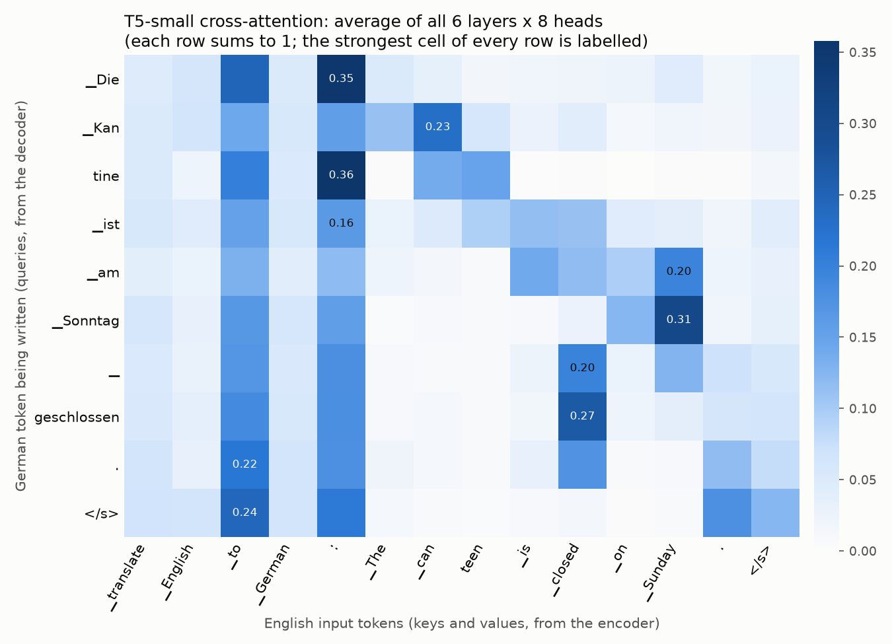

# Episode 03: How GPT Writes: The Decoder, Masking and Next-Token Prediction

> Part of **AI Engineering From Zero** by Ravi Shanker Singh (TechWithRavi).
> Video: the link goes here when the episode is published  |  Code: https://github.com/replyravi/ai-engineering-course/tree/main/ep03-next-token-lab

## What you will build

A **Next-Token Lab**: small programs that open a real GPT-style decoder on your own laptop
(SmolLM2-135M, 135 million learned numbers) and show you how it writes. It does not write a whole
sentence at once. It scores every token in its vocabulary, picks ONE, sticks it on the end, and reads
everything again. You write that loop yourself, then the knobs that steer it (temperature, top-k,
top-p), and you measure the trick that makes it fast (the KV cache).

On the way you add the **causal mask** to Episode 02's NumPy attention, run the three Transformer families
side by side, draw a cross-attention heatmap from a translator, and stream a Gemini answer with its token bill.

The headline result, from a real run (`python next_token.py`): what the model thinks comes after
"Chai tastes best when".

```text
  rank  token              ID    logit  probability
  1     ' it'             357    24.03       45.1%
  2     ' eaten'        12224    21.58        3.9%
  3     ' the'            260    21.57        3.8%
  4     ' served'        5019    21.52        3.7%
  5     ' you'            346    21.52        3.7%
  6     ' paired'       20054    21.43        3.3%
  7     ' cooked'       11410    21.14        2.5%
  8     ' made'          1135    20.54        1.4%
  9     ' combined'      5276    20.53        1.4%
  10    ' they'           502    20.31        1.1%

The top 10 hold 69.8% of the probability. The other 49,142 tokens share 30.2%.
Greedy decoding would pick ' it'. The pick comes from these probabilities and a decoding rule, not from attention scores.
```

**You will learn:**

- The three Transformer families (encoder-only, encoder-decoder, decoder-only), one model and one job for each, and why chat assistants are decoders
- How a decoder picks one token: the last position's vector, one score (logit) per vocabulary entry, softmax, a decoding rule
- The generation loop and its two stop rules: the end-of-text token and the max-tokens limit
- The causal mask: minus infinity before softmax, a lower triangle of weights, and why training needs it
- Greedy decoding, temperature, top-k and top-p on the same prompt, written by hand and checked against the library
- Cross-attention: queries from the decoder, keys and values from the encoder
- The context window, what the KV cache saves (measured), and how to read token usage and the finish reason from a real API response

> **Seen an older tutorial?** Five things are different in 2026:
> - Translation demos often used the **Tensor2Tensor** notebooks. Tensor2Tensor and its successor Trax are both archived on GitHub (checked 2026-10-23). We use Hugging Face `transformers` 5.20.2 instead.
> - `pipeline("summarization")`, `pipeline("translation_en_to_de")` and `pipeline("text2text-generation")` are **gone** in transformers 5 (`KeyError`, Fix-It Corner). For T5 we call the model ourselves: `AutoModelForSeq2SeqLM` + `model.generate()` (steps 10 and 11).
> - `output_attentions=True` returns **nothing** with the default fast attention (`sdpa`). Load the model with `attn_implementation="eager"` (step 11).
> - transformers 5 loads a model in the number type its file was saved in (`bfloat16` for SmolLM2), and the setting is called `dtype=` (older code says `torch_dtype=`, which still works but prints a deprecation warning). We pass `dtype=torch.float32` (step 2).
> - Gemini 3.5 Flash-Lite and newer **ignore** `temperature`, `top_p` and `top_k` (Google changelog, 2026-07-21). So we try those knobs on the local model, where they still work, and use Gemini for streaming and token counts.

## Prerequisites

- Finished [Episode 01](../ep01-four-kinds-of-ai/) (the shared `.venv` and the root `.env`) and [Episode 02](../ep02-attention-xray/) (tokens, embeddings and the NumPy attention in `attention.py`).
- **Python 3.13** (3.11 and 3.12 also work). **Do not use Python 3.14 or 3.15 yet** - some course libraries (PyTorch, CrewAI) do not support them.
- The shared `.venv` and root `.env` with your **free** Gemini key from Episode 1 ([SETUP.md](../SETUP.md)). Only steps 12 and 13 use the key; steps 1-11 run on your computer.
- About 60 minutes, and about 780 MB of disk for three small models (downloaded once, then everything works offline).

**Models this episode downloads, and their licences** (sizes and licences from the Hugging Face API, checked 2026-10-23)

| Model | Used in | What it is | Download | Licence |
|---|---|---|---|---|
| [`HuggingFaceTB/SmolLM2-135M`](https://huggingface.co/HuggingFaceTB/SmolLM2-135M) | steps 2-10 | a small decoder-only base model (Llama design) | about 269 MB (`model.safetensors` is 269,060,552 bytes) | Apache-2.0 |
| [`google-t5/t5-small`](https://huggingface.co/google-t5/t5-small) | steps 10, 11 | a small encoder-decoder | about 242 MB (242,043,056 bytes) | Apache-2.0 |
| [`distilbert/distilbert-base-uncased-finetuned-sst-2-english`](https://huggingface.co/distilbert/distilbert-base-uncased-finetuned-sst-2-english) | step 10 | a small encoder fine-tuned to say positive or negative | about 268 MB (267,832,558 bytes) | Apache-2.0 |

Apache-2.0 means free to use, also commercially (keep the licence notice if you share the model files).
SmolLM2-135M is a **base** model: it continues text, it was not trained to follow instructions, and it has no
safety filter. With your own prompts it can write wrong, odd or offensive text. Read each model card's
limitations section before you use a model in a real project.

## What is in this folder

```text
ep03-next-token-lab/
├── data/prompts.txt       every prompt we use (3 lines come from Episode 01)
├── attention.py           copied from Episode 02, unchanged (plus a header comment)
├── positions.py           copied from Episode 02, unchanged (attention.py imports it)
├── causal_mask.py         the causal mask on top of Episode 02's attention   (step 1)
├── decoder.py             shared: read the prompts, load SmolLM2-135M          (step 2)
├── next_token.py          vocabulary, logits, the top 10 next tokens           (steps 2-4)
├── greedy_loop.py         the generation loop by hand, and its stop rules      (steps 5-6)
├── sampling.py            temperature, top-k, top-p                            (steps 7-8)
├── kv_cache_timing.py     100 tokens with and without the KV cache             (step 9)
├── three_families.py      encoder, encoder-decoder and decoder, one job each   (step 10)
├── cross_attention.py     a cross-attention heatmap from T5-small              (step 11)
├── gemini_stream.py       stream a Gemini answer and read the token counts     (step 12)
├── gemini_limit.py        hit the output limit on purpose                      (step 13)
├── tests/                 offline tests                                        (step 14)
├── docs/                  an example picture from the recording machine
├── llm.py, testing/       shared helpers copied from _template/ (do not edit here)
├── requirements.txt       points to the shared ../requirements-base.txt (no extra packages)
├── CHALLENGE.md
└── plots/                 made by the scripts (git ignores it)
```

Every file is already here. Type the code yourself as we go (the best way to learn), or open the file in
VS Code and read along. Each step shows the part of the file it adds.

---

## Step 0 - Get ready (about 2 minutes)

The whole course shares **one** virtual environment (`.venv`) and **one** `.env` file, both at the
repo root (`ai-engineering-course/`). You created them once in Episode 1
([SETUP.md](../SETUP.md)). New here? Do SETUP.md first, then come back.

### 0.1 Open the repo and activate the shared environment

Open the `ai-engineering-course` folder in VS Code, then open a terminal (**Terminal > New Terminal**).

**Windows (PowerShell):**

```powershell
.\.venv\Scripts\Activate.ps1
cd ep03-next-token-lab
```

**macOS / Linux:**

```bash
source .venv/bin/activate
cd ep03-next-token-lab
```

Expected: your prompt starts with `(.venv)` and ends in `ep03-next-token-lab`.

> [!WARNING]
> **Common errors**
> - `.venv\Scripts\Activate.ps1 cannot be loaded` / `No such file or directory` - you are not in the repo root, or the `.venv` does not exist yet. Run `cd` to the `ai-engineering-course` folder first; if there is still no `.venv`, follow [SETUP.md](../SETUP.md).
> - Windows: `running scripts is disabled on this system` - allow scripts for this window only, then activate again:
>   `Set-ExecutionPolicy -ExecutionPolicy Bypass -Scope Process`
> - VS Code already shows `(.venv)` in new terminals once you pick the interpreter: **Ctrl+Shift+P > Python: Select Interpreter > .venv**.

### 0.2 Make sure the libraries are up to date

Nothing new to install if you already ran Episode 1: this episode uses the shared `requirements-base.txt`
(`transformers`, `torch`, `numpy`, `matplotlib`, `langchain-google-genai` and `pytest` are all in it).
If you pulled a newer version of the repo, update the environment:

```bash
pip install -r ../requirements-base.txt
pip check
```

Expected (last line):

```text
No broken requirements found.
```

> [!WARNING]
> **Common errors**
> - `No matching distribution found for torch==2.14.1` - the `.venv` was made with Python 3.14/3.15. Delete the `.venv` folder and recreate it with Python 3.13 ([SETUP.md](../SETUP.md)).
> - Linux without an NVIDIA GPU: install the CPU-only PyTorch first (SETUP.md), otherwise pip downloads several GB of CUDA files.

### 0.3 Check that your key is found from this folder

Your key lives in `ai-engineering-course/.env` (made in Episode 1). `llm.py` looks for it in this folder
and then in each parent folder, so it finds the root file by itself. Do not copy `.env` into episode folders.

```bash
python llm.py
```

Expected output (the greeting will differ; your path will differ):

```text
Settings file: /.../ai-engineering-course/.env
Provider: gemini   Model: gemini-3.5-flash-lite
API key found. Asking the model a tiny question...
<a one-sentence hello written by Gemini>
```

No key yet? You get friendly help instead (real output, recorded on a machine with no `.env`):

```text
Settings file: no .env found
Provider: gemini   Model: gemini-3.5-flash-lite


No API key found for LLM_PROVIDER=gemini.
Looked for: GEMINI_API_KEY or GOOGLE_API_KEY in your .env file.

Get a FREE Gemini key (no credit card needed):
  1. Open https://aistudio.google.com/apikey
  2. Sign in with your Google account and accept the terms
  3. Click 'Create API key' and copy it
  4. Put it in your .env file like this:  GEMINI_API_KEY=paste-your-key-here

No .env file yet? In the ai-engineering-course folder (the repo root), copy .env.example to .env:
  macOS / Linux:       cp .env.example .env
  Windows PowerShell:  Copy-Item .env.example .env
(.env file in use right now: none found)
```

Only steps 12 and 13 need the key, so you can do steps 1-11 first and add the key later.

> **Want another AI?** Change ONE line in the root `.env`: `LLM_PROVIDER=openai`, `anthropic` or `ollama` (free, local - install from https://ollama.com and run `ollama pull qwen3.5:4b`). Nothing else changes.

> [!WARNING]
> **Common errors**
> - `Settings file: no .env found` and `No API key found` - the root `.env` is missing or is named `.env.txt` (Windows hides extensions!). Create it from the repo root: `Copy-Item .env.example .env` (Windows) or `cp .env.example .env` (macOS/Linux), then paste your key.
> - `429 RESOURCE_EXHAUSTED` - you hit the free-tier limit. Wait a minute (per-minute limit) or until tomorrow (daily limit, resets at midnight Pacific time). See your limits at https://aistudio.google.com/rate-limit
> - `404 ... model not found` - the model name in `LLM_MODEL` is wrong or retired. Leave `LLM_MODEL=` empty to use the default.

---

## Step 1 - Add a causal mask to Episode 02's attention

**Goal:** turn Episode 02's attention into a decoder's attention. **New concept:** minus infinity before softmax.

In Episode 02 every word could look at every other word, also the words that come **after** it. A decoder
writes left to right, so word number i may only look at words 0 to i. Think of a fill-in-the-next-word test
where a sheet of paper covers everything after the blank.

The mask sets the score of every future word to **minus infinity** before softmax. `exp(-inf)` is exactly 0,
so those words get a weight of exactly 0, and each row still sums to 1. What is left is a lower triangle.

`attention.py` and `positions.py` in this folder are Episode 02's files, copied unchanged (a header comment
says so, and a test checks the copy still matches), so this folder runs on its own. Episode 02's
`scaled_dot_product_attention(Q, K, V, mask=...)` already takes a mask (True = may look). We only build the mask.

Create `causal_mask.py`:

```python
"""
causal_mask.py - the one small mask that turns Episode 02's attention into a decoder's (step 1).

Episode 02's attention lets every word look at every other word, also the words AFTER it.
A decoder writes left to right, so word i may only look at words 0, 1, ..., i. We hide the
future with a mask: those scores become minus infinity before softmax, so their weights are
exactly 0, and each row still sums to 1.

    causal_mask(n)      -> (n, n) True on and below the diagonal ("may look"), False above it

It plugs into the mask= argument that attention.py (copied from Episode 02) already has:

    scaled_dot_product_attention(Q, K, V, mask=causal_mask(n))
    multi_head_attention(X, Wq, Wk, Wv, Wo, num_heads, mask=causal_mask(n))

Run:  python causal_mask.py
"""

import numpy as np

from attention import multi_head_attention, random_block_params, scaled_dot_product_attention, softmax

SEED = 42
WORDS = ["chai", "tastes", "best", "when", "it"]


def causal_mask(n: int) -> np.ndarray:
    """(n, n) of True/False. Row i is True for keys 0..i (the past and itself), False for the future."""
    return np.tril(np.ones((n, n), dtype=bool))   # tril = keep the lower triangle


def hide_future(scores: np.ndarray) -> np.ndarray:
    """The scores with every future position replaced by minus infinity (what the mask does inside attention)."""
    n = scores.shape[-1]
    return np.where(causal_mask(n), scores, -np.inf)


def is_lower_triangular(weights: np.ndarray) -> bool:
    """True if every weight above the diagonal is exactly 0.0 (in every head, if there are several)."""
    n = weights.shape[-1]
    above = ~causal_mask(n)
    return bool((weights[..., above] == 0.0).all())


def show(name: str, matrix: np.ndarray, labels: list, number_format: str = "{:>8.2f}") -> None:
    """Print a small grid with the words on both sides."""
    print(name)
    print("         " + "".join(f"{w:>8}" for w in labels))
    for label, row in zip(labels, matrix):
        print(f"  {label:<7}" + "".join(number_format.format(x) for x in row))


def main() -> int:
    rng = np.random.default_rng(SEED)
    n = len(WORDS)
    X = rng.normal(size=(n, 8))                     # 5 words x 8 numbers (pretend embeddings + positions)
    Wq, Wk, Wv = (rng.normal(size=(8, 4)) for _ in range(3))   # learned in a real model, random here
    Q, K, V = X @ Wq, X @ Wk, X @ Wv
    print(f"Words: {WORDS}   X {X.shape}   Q, K, V {Q.shape} each\n")

    scores = Q @ K.T / np.sqrt(K.shape[-1])         # Episode 02: every word against every word
    show("scores = Q @ K.T / sqrt(4)", scores, WORDS)

    mask = causal_mask(n)
    print()
    show("causal mask (1 = may look, 0 = the future, hidden)", mask.astype(int), WORDS, "{:>8}")

    masked = hide_future(scores)
    print()
    show("scores with the future set to -inf", masked, WORDS)

    weights = softmax(masked)                       # exp(-inf) = 0, so the future gets weight 0
    print()
    show("weights = softmax(masked scores)", weights, WORDS)
    print(f"row sums: {weights.sum(axis=1).round(6).tolist()}")
    print(f"every weight above the diagonal is exactly 0.0: {is_lower_triangular(weights)}")
    print(f"row '{WORDS[0]}' can only look at itself: weight {weights[0, 0]:.2f}")

    output, lib_weights = scaled_dot_product_attention(Q, K, V, mask=causal_mask(n))
    print(f"\nEpisode 02's scaled_dot_product_attention(Q, K, V, mask=causal_mask(5)) "
          f"gives the same weights: {np.allclose(lib_weights, weights)}")

    # No peeking: change the LAST word, then check whether the first four outputs move.
    X_changed = X.copy()
    X_changed[-1] = rng.normal(size=8)
    Q2, K2, V2 = X_changed @ Wq, X_changed @ Wk, X_changed @ Wv
    open_before, _ = scaled_dot_product_attention(Q, K, V)
    open_after, _ = scaled_dot_product_attention(Q2, K2, V2)
    masked_after, _ = scaled_dot_product_attention(Q2, K2, V2, mask=causal_mask(n))
    print(f"\nChange the vector of the last word '{WORDS[-1]}'. Do the outputs of the first {n - 1} words stay the same?")
    print(f"  without the mask: {np.allclose(open_before[:-1], open_after[:-1])}")
    print(f"  with the causal mask: {np.allclose(output[:-1], masked_after[:-1])}")
    print(f"So in training all {n} positions can guess their next word at the same time, and none can peek at its answer.")

    params = random_block_params(8, 32, rng)
    _, head_weights = multi_head_attention(X, params["Wq"], params["Wk"], params["Wv"], params["Wo"],
                                           num_heads=2, mask=causal_mask(n))
    print(f"\nTwo heads with the same mask: weights {head_weights.shape}, "
          f"every head lower-triangular: {is_lower_triangular(head_weights)}")
    return 0


if __name__ == "__main__":
    raise SystemExit(main())
```

```bash
python causal_mask.py
```

Expected output:

```text
Words: ['chai', 'tastes', 'best', 'when', 'it']   X (5, 8)   Q, K, V (5, 4) each

scores = Q @ K.T / sqrt(4)
             chai  tastes    best    when      it
  chai      -1.85    4.83    2.10    6.14   -4.05
  tastes     2.96   -0.70    1.44    1.40   -0.05
  best      -2.53   -0.26   -2.53   -3.81    1.70
  when      -1.04   -1.11   -2.00   -2.57    1.46
  it        -0.28    5.45    1.11    5.15   -2.50

causal mask (1 = may look, 0 = the future, hidden)
             chai  tastes    best    when      it
  chai          1       0       0       0       0
  tastes        1       1       0       0       0
  best          1       1       1       0       0
  when          1       1       1       1       0
  it            1       1       1       1       1

scores with the future set to -inf
             chai  tastes    best    when      it
  chai      -1.85    -inf    -inf    -inf    -inf
  tastes     2.96   -0.70    -inf    -inf    -inf
  best      -2.53   -0.26   -2.53    -inf    -inf
  when      -1.04   -1.11   -2.00   -2.57    -inf
  it        -0.28    5.45    1.11    5.15   -2.50

weights = softmax(masked scores)
             chai  tastes    best    when      it
  chai       1.00    0.00    0.00    0.00    0.00
  tastes     0.97    0.03    0.00    0.00    0.00
  best       0.09    0.83    0.09    0.00    0.00
  when       0.39    0.37    0.15    0.09    0.00
  it         0.00    0.57    0.01    0.42    0.00
row sums: [1.0, 1.0, 1.0, 1.0, 1.0]
every weight above the diagonal is exactly 0.0: True
row 'chai' can only look at itself: weight 1.00

Episode 02's scaled_dot_product_attention(Q, K, V, mask=causal_mask(5)) gives the same weights: True

Change the vector of the last word 'it'. Do the outputs of the first 4 words stay the same?
  without the mask: False
  with the causal mask: True
So in training all 5 positions can guess their next word at the same time, and none can peek at its answer.

Two heads with the same mask: weights (2, 5, 5), every head lower-triangular: True
```

The weights are random (seeded), so what each word looks at means nothing here. The shape is the point:
zeros above the diagonal, and `chai`, the first word, can only look at itself.

The "no peeking" check is **why the mask exists**. In training, the model reads a whole known sentence in one
go and guesses the next word at **every** position at the same time (this is called teacher forcing). Without
the mask, position 0 could simply look at position 1 and copy the answer. With it, changing a later word
changes nothing for the earlier ones.

> [!WARNING]
> **Common errors**
> - `ModuleNotFoundError: No module named 'attention'` - run the script from the `ep03-next-token-lab` folder, where `attention.py` is.
> - `ValueError: Every query must be allowed to look at one key at least (a mask row is all False).` - you flipped the mask, for example `~causal_mask(n)`. Then the last word may look at nothing. Remember: True = may look.
> - The zeros are BELOW the diagonal - you used `np.triu` (the upper triangle). A causal mask is `np.tril`.
> - `RuntimeWarning: invalid value encountered in subtract` and weights full of `nan` - you masked with `+inf`. The future gets **minus** infinity.

## Step 2 - Load the small decoder and tokenizer

**Goal:** a real GPT-style model on your laptop. **New concept:** a decoder's vocabulary and its end-of-text token.

SmolLM2-135M is decoder-only, like the GPT family, Gemini, Llama and Qwen, just much smaller. It is a **base**
model: trained only to continue text from the web, not to chat.

Create `decoder.py`. Every later file uses it to read the prompts and load the model:

```python
"""
decoder.py - shared helpers: read our prompts and load the small decoder we look inside.

The model is SmolLM2-135M, "HuggingFaceTB/SmolLM2-135M" on Hugging Face. It is a small GPT-style,
decoder-only model (the same design as Llama) with about 135 million learned numbers.
It is a BASE model: it was trained only to continue text, not to chat or follow instructions.
Licence: Apache-2.0. The first load downloads about 269 MB. After that it works offline.

Used by next_token.py, greedy_loop.py, sampling.py, kv_cache_timing.py and three_families.py.
"""

from pathlib import Path

import numpy as np

HERE = Path(__file__).resolve().parent
PROMPTS_FILE = HERE / "data" / "prompts.txt"
PLOTS = HERE / "plots"          # every picture lands here (git ignores it)

MODEL_NAME = "HuggingFaceTB/SmolLM2-135M"
SEED = 42                       # fixed seed: the "random" choices are the same on every run


def read_prompts(path=PROMPTS_FILE) -> dict:
    """Read data/prompts.txt into {"group name": [text, ...]}."""
    groups = {}
    group = None
    for line in Path(path).read_text(encoding="utf-8").splitlines():
        line = line.strip()
        if not line or line.startswith("#"):
            continue                         # skip empty lines and comments
        if line.startswith("[") and line.endswith("]"):
            group = line[1:-1]               # a new group starts, like [cold_open]
            groups[group] = []
        else:
            groups[group].append(line)
    return groups


def load_tokenizer(name: str = MODEL_NAME):
    """The tokenizer that belongs to the model: text -> tokens -> IDs."""
    from transformers import AutoTokenizer

    return AutoTokenizer.from_pretrained(name)


def load_decoder(name: str = MODEL_NAME):
    """Return (tokenizer, model), ready to write.

    dtype=torch.float32: the file on Hugging Face stores the numbers as bfloat16, and transformers 5
    keeps that type unless you ask. float32 is exact enough that the loop with and without the
    KV cache picks the same tokens (step 9). On the recording laptop's CPU it was also about
    twice as fast as bfloat16.
    """
    import torch
    import transformers
    from transformers import AutoModelForCausalLM

    transformers.logging.set_verbosity_error()   # hide the load report and progress messages
    model = AutoModelForCausalLM.from_pretrained(name, dtype=torch.float32)
    model.eval()   # writing mode: switches off dropout, so the same input gives the same numbers
    return load_tokenizer(name), model


def next_token_logits(model, ids: list[int]) -> np.ndarray:
    """One forward pass over the whole text. Returns the scores for the NEXT token (one per vocabulary entry)."""
    import torch

    with torch.inference_mode():
        logits = model(torch.tensor([ids])).logits      # (1, positions, vocabulary)
    return logits[0, -1].double().numpy()              # only the last position predicts what comes next


def piece(tokenizer, token_id: int) -> str:
    """One token as readable text, in quotes, so you can see its leading space: ' tastes'."""
    return repr(tokenizer.decode([token_id]))


def save_note(path: Path) -> str:
    """'plots/x.png' instead of a long absolute path, for printing."""
    path = Path(path)
    return str(path.relative_to(HERE)) if path.is_relative_to(HERE) else str(path)
```

The prompts live in `data/prompts.txt`. The first one is our cold open:

```text
[cold_open]
# The half sentence the video opens with (steps 2 to 9)
Chai tastes best when
```

Create `next_token.py`. It will hold steps 2 to 4; here is the start, the step 2 function and the end:

```python
"""
next_token.py - open a real decoder and watch it choose the next token (steps 2, 3 and 4).

    python next_token.py load     step 2: the model, its vocabulary, and our prompt as tokens
    python next_token.py logits   step 3: one forward pass, one score per vocabulary entry per position
    python next_token.py          step 4: softmax over the LAST position, the top 10 next tokens

Try your own half sentence:  python next_token.py --prompt "The best thing about Mumbai is"
"""

import argparse

import numpy as np

from attention import softmax           # the same softmax you wrote in Episode 02
from decoder import MODEL_NAME, load_decoder, piece, read_prompts

PROMPT = read_prompts()["cold_open"][0]      # "Chai tastes best when"


def show_load(tokenizer, model, prompt: str) -> None:
    config = model.config
    params = sum(p.numel() for p in model.parameters())
    print(f"Model: {MODEL_NAME} (decoder-only)")
    print(f"Learned numbers (parameters): {params:,}, stored as {str(model.dtype).replace('torch.', '')}")
    print(f"Blocks (layers): {config.num_hidden_layers}   attention heads: {config.num_attention_heads}   "
          f"numbers per token: {config.hidden_size}")
    print(f"Vocabulary: {len(tokenizer):,} tokens (IDs 0 to {len(tokenizer) - 1:,})")
    print(f"Context window: {config.max_position_embeddings:,} tokens")
    print(f"End-of-text token: {tokenizer.eos_token} (ID {tokenizer.eos_token_id})\n")

    ids = tokenizer(prompt)["input_ids"]
    print(f"Prompt: {prompt!r} -> {len(ids)} tokens")
    print(f"  {'piece':<12}{'in the vocabulary':<20}ID")
    for token_id, raw in zip(ids, tokenizer.convert_ids_to_tokens(ids)):
        print(f"  {piece(tokenizer, token_id):<12}{raw:<20}{token_id}")
    print("The vocabulary writes a leading space as 'Ġ'. So ' tastes' (with its space) is ONE token.")


STEPS = {"load": show_load, "logits": show_logits, "top10": show_top10}


def main(argv=None, tokenizer=None, model=None) -> int:
    parser = argparse.ArgumentParser(description="Episode 03, steps 2-4: inside one next-token choice")
    parser.add_argument("step", nargs="?", default="top10", choices=list(STEPS))
    parser.add_argument("--prompt", default=PROMPT, help="the half sentence the model continues")
    args = parser.parse_args(argv)
    if model is None:
        tokenizer, model = load_decoder()
    STEPS[args.step](tokenizer, model, args.prompt)
    return 0


if __name__ == "__main__":
    raise SystemExit(main())
```

```bash
python next_token.py load
```

Expected output:

```text
Model: HuggingFaceTB/SmolLM2-135M (decoder-only)
Learned numbers (parameters): 134,515,008, stored as float32
Blocks (layers): 30   attention heads: 9   numbers per token: 576
Vocabulary: 49,152 tokens (IDs 0 to 49,151)
Context window: 8,192 tokens
End-of-text token: <|endoftext|> (ID 0)

Prompt: 'Chai tastes best when' -> 5 tokens
  piece       in the vocabulary   ID
  'Ch'        Ch                  2083
  'ai'        ai                  2554
  ' tastes'   Ġtastes             16504
  ' best'     Ġbest               1450
  ' when'     Ġwhen               645
The vocabulary writes a leading space as 'Ġ'. So ' tastes' (with its space) is ONE token.
```

The vocabulary has 49,152 entries. The model's last layer gives one score for **each** of them, every time
it writes a token. Our 4-word prompt became 5 tokens, because the tokenizer cut "Chai" into `Ch` + `ai`.

The first run prints download bars (about 269 MB). Every run also prints a few grey library lines first, such as
`Loading weights: 100%` and, on a Mac, `NOTE: Redirects are currently not supported in MacOs.` Online, you may also see
`Warning: You are sending unauthenticated requests to the HF Hub`. On Windows the first download may also warn that
the `huggingface_hub` cache-system uses symlinks and your machine does not support them (the files then take a little
more disk). All of them are harmless.

> [!WARNING]
> **Common errors**
> - The first run seems stuck - it is downloading about 269 MB. Wait for the progress bars to finish.
> - `OSError: We couldn't connect to 'https://huggingface.co'` - the first run needs internet. After that it works offline.
> - `NameError: name 'show_logits' is not defined` - `STEPS` already lists the functions of steps 3 and 4. Add them in those steps, or comment them out of `STEPS` for now.

## Step 3 - One forward pass

**Goal:** run the model once and look at what comes out. **New concept:** logits, one score per vocabulary entry per position.

Add the step 3 functions to `next_token.py`:

```python
def forward(tokenizer, model, prompt: str):
    """Run the model once. Returns (ids, logits) with logits shaped (1, positions, vocabulary)."""
    import torch

    ids = tokenizer(prompt, return_tensors="pt")["input_ids"]
    with torch.inference_mode():
        logits = model(ids).logits
    return ids[0].tolist(), logits.double().numpy()


def show_logits(tokenizer, model, prompt: str) -> None:
    ids, logits = forward(tokenizer, model, prompt)
    batch, positions, vocab = logits.shape
    print(f"Prompt: {prompt!r} ({positions} tokens)")
    print(f"logits shape: {logits.shape} = (batch {batch}, positions {positions}, vocabulary {vocab:,})")
    print(f"That is {positions * vocab:,} scores: one for every vocabulary entry, at every position.\n")

    print("Every position guesses the token that comes AFTER it, all in one pass:")
    print(f"  {'pos':<5}{'text so far':<26}{'top guess':<12}{'real next token':<17}")
    for pos in range(positions):
        so_far = tokenizer.decode(ids[: pos + 1])
        best = int(np.argmax(logits[0, pos]))
        if pos + 1 < positions:
            real = ids[pos + 1]
            verdict = f"{piece(tokenizer, real):<11}{'right' if best == real else 'wrong'}"
        else:
            verdict = "(not written yet)"
        print(f"  {pos:<5}{so_far!r:<26}{piece(tokenizer, best):<12}{verdict}")
    print("To WRITE, we only need the last row. The other rows are how a decoder trains:")
    print("every guess is checked against the real next token, all positions at once.\n")

    # The causal mask, seen from outside: change the LAST token, the earlier rows do not move.
    import torch

    changed = ids[:-1] + [tokenizer(" if")["input_ids"][0]]
    with torch.inference_mode():
        other = model(torch.tensor([changed])).logits.double().numpy()
    gap = float(np.abs(other[0, :-1] - logits[0, :-1]).max())
    print(f"Swap the last token {piece(tokenizer, ids[-1])} for {piece(tokenizer, changed[-1])}:")
    print(f"  scores at positions 0-{positions - 2} stay the same: {gap < 1e-4} (biggest change {gap:.1e})")
    print(f"  scores at position {positions - 1} change: {not np.allclose(other[0, -1], logits[0, -1])}")
```

```bash
python next_token.py logits
```

Expected output:

```text
Prompt: 'Chai tastes best when' (5 tokens)
logits shape: (1, 5, 49152) = (batch 1, positions 5, vocabulary 49,152)
That is 245,760 scores: one for every vocabulary entry, at every position.

Every position guesses the token that comes AFTER it, all in one pass:
  pos  text so far               top guess   real next token  
  0    'Ch'                      'ick'       'ai'       wrong
  1    'Chai'                    ','         ' tastes'  wrong
  2    'Chai tastes'             ' like'     ' best'    wrong
  3    'Chai tastes best'        ' when'     ' when'    right
  4    'Chai tastes best when'   ' it'       (not written yet)
To WRITE, we only need the last row. The other rows are how a decoder trains:
every guess is checked against the real next token, all positions at once.

Swap the last token ' when' for ' if':
  scores at positions 0-3 stay the same: True (biggest change 0.0e+00)
  scores at position 4 change: True
```

The shape is (batch, positions, vocabulary). One forward pass gives a guess at **every** position, and only the
last row is about the word we have not written yet. The other rows are exactly what training uses: each guess
is checked against the real next token, all at once. That only works because of the causal mask, and the swap
test shows the mask inside the real model: change the last token and positions 0-3 do not move at all.

> [!WARNING]
> **Common errors**
> - `IndexError` on `ids[:-1]` - your prompt is empty. Pass some text with `--prompt`.
> - The last number of the shape is not 49,152 - you loaded another model. Every model has its own vocabulary size; this episode uses SmolLM2-135M.

## Step 4 - The top 10 next tokens

**Goal:** turn the last row of scores into a choice. **New concept:** softmax over the last position.

Episode 02's `softmax()` turns any row of scores into probabilities that add up to 1. Here the row has
49,152 scores, one per vocabulary entry. `next_token.py` imports it from `attention.py`.

Add the step 4 functions to `next_token.py`:

```python
def top_tokens(probs: np.ndarray, k: int = 10) -> list[tuple[int, float]]:
    """The k most likely token IDs with their probabilities, best first."""
    best = np.argsort(probs)[::-1][:k]
    return [(int(i), float(probs[i])) for i in best]


def show_top10(tokenizer, model, prompt: str) -> None:
    ids, logits = forward(tokenizer, model, prompt)
    last = logits[0, -1]                      # (vocabulary,): the scores for the NEXT token
    probs = softmax(last)
    print(f"Prompt: {prompt!r}")
    print(f"Scores (logits) at the last position: {last.shape[0]:,} numbers, "
          f"from {last.min():.1f} to {last.max():.1f}")
    print(f"After softmax: {probs.shape[0]:,} probabilities, all positive, sum = {probs.sum():.4f}\n")

    top = top_tokens(probs, 10)
    print(f"  {'rank':<6}{'token':<14}{'ID':>7}{'logit':>9}{'probability':>13}")
    for rank, (token_id, p) in enumerate(top, start=1):
        print(f"  {rank:<6}{piece(tokenizer, token_id):<14}{token_id:>7}{last[token_id]:>9.2f}{p:>12.1%}")
    covered = sum(p for _, p in top)
    print(f"\nThe top 10 hold {covered:.1%} of the probability. "
          f"The other {probs.shape[0] - 10:,} tokens share {1 - covered:.1%}.")
    print(f"Greedy decoding would pick {piece(tokenizer, top[0][0])}. "
          "The pick comes from these probabilities and a decoding rule, not from attention scores.")
```

```bash
python next_token.py
```

Expected output:

```text
Prompt: 'Chai tastes best when'
Scores (logits) at the last position: 49,152 numbers, from -12.6 to 24.0
After softmax: 49,152 probabilities, all positive, sum = 1.0000

  rank  token              ID    logit  probability
  1     ' it'             357    24.03       45.1%
  2     ' eaten'        12224    21.58        3.9%
  3     ' the'            260    21.57        3.8%
  4     ' served'        5019    21.52        3.7%
  5     ' you'            346    21.52        3.7%
  6     ' paired'       20054    21.43        3.3%
  7     ' cooked'       11410    21.14        2.5%
  8     ' made'          1135    20.54        1.4%
  9     ' combined'      5276    20.53        1.4%
  10    ' they'           502    20.31        1.1%

The top 10 hold 69.8% of the probability. The other 49,142 tokens share 30.2%.
Greedy decoding would pick ' it'. The pick comes from these probabilities and a decoding rule, not from attention scores.
```

This is how a decoder chooses: a linear layer turns the last position's vector into 49,152 scores, softmax turns
the scores into probabilities, and a **decoding rule** picks one. Greedy takes the top one, ` it` at 45.1%. The
top 10 cover only 69.8%: almost a third of the probability is spread over tens of thousands of other tokens.

Try your own half sentence:

```bash
python next_token.py --prompt "The best thing about Mumbai is"
```

```text
  rank  token              ID    logit  probability
  1     ' that'           338    20.71       54.8%
  2     ' the'            260    19.39       14.7%
  3     ' its'            624    18.75        7.7%
  4     ' it'             357    17.93        3.4%
  5     ' how'            638    17.60        2.5%
  6     ','                28    17.24        1.7%
  7     ' not'            441    17.10        1.5%
  8     ' you'            346    16.85        1.2%
  9     ' a'              253    15.65        0.3%
  10    ' our'            653    15.58        0.3%

The top 10 hold 88.1% of the probability. The other 49,142 tokens share 11.9%.
Greedy decoding would pick ' that'. The pick comes from these probabilities and a decoding rule, not from attention scores.
```

> [!WARNING]
> **Common errors**
> - The probabilities do not add up to 100% in your table - they should not: the table shows only the top 10. The `sum = 1.0000` line covers all 49,152.
> - A token looks empty or strange, like `'\n'` or `' '` - that is a real token (a new line, a space). We print tokens with quotes so you can see them.

## Step 5 - The greedy loop by hand

**Goal:** write text, one token at a time. **New concept:** autoregressive generation (each new token is fed back in).

Think of a quiz contestant who hears the whole sentence so far, shouts ONE word, hears the sentence again with
that word added, and shouts the next one. That is all a decoder does. Our loop takes a `next_logits` function
(one forward pass) and a `pick` function (the decoding rule), so the same loop works for greedy now and for
sampling in step 7, and the tests can feed it a pretend model.

Create `greedy_loop.py`:

```python
"""
greedy_loop.py - the generation loop, written by hand (steps 5 and 6).

A decoder writes like this, again and again:
  1. read the whole text so far (one forward pass)
  2. take the scores at the LAST position, one per vocabulary entry
  3. a decoding rule picks ONE token (greedy: the highest score)
  4. stick that token on the end and go back to 1
It stops when it writes the end-of-text token, or when it reaches the max-tokens limit.

    python greedy_loop.py          step 5: 20 greedy steps, one line per step
    python greedy_loop.py stop     step 6: the two stop rules

Try:  python greedy_loop.py --steps 80      (watch it get stuck in a loop)
"""

import argparse

import numpy as np

from attention import softmax
from decoder import load_decoder, next_token_logits, piece, read_prompts

PROMPTS = read_prompts()
END_OF_TEXT = "end-of-text token"
MAX_TOKENS = "max tokens"
SHOW_STEPS = 20          # print one line for each of the first 20 steps


def greedy_pick(logits: np.ndarray) -> int:
    """Greedy decoding: always take the token with the highest score."""
    return int(np.argmax(logits))


def generate(next_logits, prompt_ids: list[int], max_new_tokens: int, eos_id=None, pick=greedy_pick, on_step=None):
    """The generation loop. Returns (new token IDs, which stop rule fired).

    next_logits(ids) -> scores for the next token (one forward pass of the model)
    pick(logits)     -> one token ID (the decoding rule: greedy here, sampling in step 7)
    on_step(step, token, logits) is called after every pick, so we can print what happens.
    """
    ids = list(prompt_ids)
    new_ids = []
    for step in range(1, max_new_tokens + 1):
        logits = next_logits(ids)            # read everything written so far
        token = pick(logits)                 # choose ONE next token
        if on_step is not None:
            on_step(step, token, logits)
        if token == eos_id:                  # stop rule 1: the model wrote "the end"
            return new_ids, END_OF_TEXT
        ids.append(token)                    # write it down, then read again
        new_ids.append(token)
    return new_ids, MAX_TOKENS               # stop rule 2: we hit our limit


def find_loop(ids: list[int], min_size: int = 4):
    """Does the text end by repeating itself? Returns (tokens in the repeating piece, times in a row), or None."""
    for size in range(min_size, len(ids) // 2 + 1):
        if ids[-size:] == ids[-2 * size:-size]:
            times = 2
            while len(ids) >= (times + 1) * size and ids[-(times + 1) * size:-times * size] == ids[-size:]:
                times += 1
            return size, times
    return None


def library_greedy(tokenizer, model, prompt_ids: list[int], max_new_tokens: int) -> list[int]:
    """The same job done by the library: model.generate() with sampling switched off."""
    import torch

    ids = torch.tensor([prompt_ids])
    out = model.generate(ids, attention_mask=torch.ones_like(ids), max_new_tokens=max_new_tokens,
                         do_sample=False, pad_token_id=tokenizer.eos_token_id)
    return out[0, len(prompt_ids):].tolist()


def tail(text: str, width: int = 46) -> str:
    """The end of a long text, so each printed line stays short."""
    shown = repr(text)
    return shown if len(shown) <= width else "..." + shown[-(width - 3):]


def show_greedy(tokenizer, model, prompt: str, steps: int) -> None:
    prompt_ids = tokenizer(prompt)["input_ids"]
    written = list(prompt_ids)
    print(f"Prompt: {prompt!r}")
    print(f"Greedy: always take the most likely next token. {steps} steps. Each step re-reads the whole text.\n")
    print(f"  {'step':>4}  {'picked':<14}{'prob':>7}   text so far")

    def on_step(step, token, logits):
        written.append(token)
        if step <= SHOW_STEPS:
            prob = softmax(logits)[token]
            print(f"  {step:>4}  {piece(tokenizer, token):<14}{prob:>7.1%}   {tail(tokenizer.decode(written))}")
        elif step == SHOW_STEPS + 1:
            print(f"  ... steps {SHOW_STEPS + 1} to {steps} are not printed")

    new_ids, rule = generate(lambda ids: next_token_logits(model, ids), prompt_ids, steps,
                             eos_id=tokenizer.eos_token_id, on_step=on_step)
    print(f"\nStopped by: {rule} ({len(new_ids)} new tokens)")
    print(f"Final text: {tokenizer.decode(prompt_ids + new_ids)!r}")

    loop = find_loop(new_ids)
    if loop:
        size, times = loop
        print(f"Stuck in a loop: the last {size} tokens are repeated {times} times in a row:")
        print(f"  {tokenizer.decode(new_ids[-size:])!r}")
    else:
        print("No repeating loop at the end (yet).")

    same = library_greedy(tokenizer, model, prompt_ids, steps) == new_ids
    print(f"model.generate(do_sample=False) picks the same {len(new_ids)} tokens: {same}")


STEPS = {"greedy": show_greedy, "stop": show_stop}


def main(argv=None, tokenizer=None, model=None) -> int:
    parser = argparse.ArgumentParser(description="Episode 03, steps 5-6: the generation loop by hand")
    parser.add_argument("step", nargs="?", default="greedy", choices=list(STEPS))
    parser.add_argument("--prompt", default=PROMPTS["cold_open"][0])
    parser.add_argument("--steps", type=int, default=20, help="max new tokens (step 5)")
    args = parser.parse_args(argv)
    if model is None:
        tokenizer, model = load_decoder()
    STEPS[args.step](tokenizer, model, args.prompt, args.steps)
    return 0


if __name__ == "__main__":
    raise SystemExit(main())
```

`lambda ids: next_token_logits(model, ids)` in `show_greedy()` is a tiny one-line function without a name: give it
the token IDs written so far, and it runs one forward pass. That is the `next_logits` the loop calls at every step.

```bash
python greedy_loop.py
```

Expected output:

```text
Prompt: 'Chai tastes best when'
Greedy: always take the most likely next token. 20 steps. Each step re-reads the whole text.

  step  picked           prob   text so far
     1  ' it'           45.1%   'Chai tastes best when it'
     2  ' is'           45.6%   'Chai tastes best when it is'
     3  ' cooked'        5.6%   'Chai tastes best when it is cooked'
     4  ' in'           33.0%   'Chai tastes best when it is cooked in'
     5  ' a'            34.1%   'Chai tastes best when it is cooked in a'
     6  ' sauce'         3.9%   ...i tastes best when it is cooked in a sauce'
     7  ' of'           23.5%   ...astes best when it is cooked in a sauce of'
     8  ' lemon'         3.0%   ...best when it is cooked in a sauce of lemon'
     9  ' juice'        39.3%   ...hen it is cooked in a sauce of lemon juice'
    10  ' and'          40.4%   ...it is cooked in a sauce of lemon juice and'
    11  ' water'         5.9%   ...cooked in a sauce of lemon juice and water'
    12  '.'             55.3%   ...ooked in a sauce of lemon juice and water.'
    13  '\n'            17.7%   ...ked in a sauce of lemon juice and water.\n'
    14  '\n'            68.3%   ...d in a sauce of lemon juice and water.\n\n'
    15  'The'            6.6%   ...n a sauce of lemon juice and water.\n\nThe'
    16  ' best'          3.3%   ...auce of lemon juice and water.\n\nThe best'
    17  ' way'          22.8%   ... of lemon juice and water.\n\nThe best way'
    18  ' to'           95.2%   ... lemon juice and water.\n\nThe best way to'
    19  ' prepare'      16.3%   ...uice and water.\n\nThe best way to prepare'
    20  ' a'            11.3%   ...ce and water.\n\nThe best way to prepare a'

Stopped by: max tokens (20 new tokens)
Final text: 'Chai tastes best when it is cooked in a sauce of lemon juice and water.\n\nThe best way to prepare a'
No repeating loop at the end (yet).
model.generate(do_sample=False) picks the same 20 tokens: True
```

The text grows one token per step, and the probability column shows how unsure the model often is: ` sauce`
won with only 3.9%. Greedy still takes it, because it was the highest. Our 30 lines pick the same 20 tokens as
the library's `model.generate()`.

Now let it run longer:

```bash
python greedy_loop.py --steps 80
```

```text
  ... steps 21 to 80 are not printed

Stopped by: max tokens (80 new tokens)
Final text: 'Chai tastes best when it is cooked in a sauce of lemon juice and water.\n\nThe best way to prepare a kareena is to make it with a little lemon juice and water.\n\nThe best way to make kareena is to make it with a little lemon juice and water.\n\nThe best way to make kareena is to make it with a little lemon juice and water.\n'
Stuck in a loop: the last 22 tokens are repeated 2 times in a row:
  '\nThe best way to make kareena is to make it with a little lemon juice and water.\n'
model.generate(do_sample=False) picks the same 80 tokens: True
```

Greedy decoding got stuck in a loop. Once a sentence is the most likely thing to come next, it stays the most
likely thing to come next. Steps 7 and 8, and the challenge, fix that.

> [!WARNING]
> **Common errors**
> - `NameError: name 'show_stop' is not defined` - `STEPS` already lists the step 6 function. Add it in step 6, or comment it out of `STEPS` for now.
> - The loop is slow - each step re-reads the whole text from the start. That is on purpose for now; step 9 adds the KV cache.
> - `model.generate(...) picks the same ... tokens: False` - check that `decoder.py` loads the model with `dtype=torch.float32` (Fix-It Corner 3).

## Step 6 - The two stop rules

**Goal:** know when the loop ends. **New concept:** the end-of-text token versus the max-tokens limit.

A decoder stops in one of two ways: it writes its special end-of-text token (`<|endoftext|>` for SmolLM2,
ID 0), or it reaches the limit we set. Add this function to `greedy_loop.py`, above `STEPS` (the file in the folder
already has it):

```python
def show_stop(tokenizer, model, prompt: str, steps: int) -> None:
    eos = tokenizer.eos_token_id
    print(f"Stop rule 1: the model writes the end-of-text token {tokenizer.eos_token} (ID {eos}).")
    print("Stop rule 2: we reach max_new_tokens, the limit we set.\n")
    runs = [(PROMPTS["ends_itself"][0], 40), (PROMPTS["runs_on"][0], 15)]
    for text, limit in runs:
        prompt_ids = tokenizer(text)["input_ids"]
        last_step = []
        new_ids, rule = generate(lambda ids: next_token_logits(model, ids), prompt_ids, limit, eos_id=eos,
                                 on_step=lambda step, token, logits: last_step.append(step))
        print(f"Prompt: {text!r}   max_new_tokens={limit}")
        print(f"  wrote {len(new_ids)} tokens: {tokenizer.decode(new_ids)!r}")
        where = f" at step {last_step[-1]}" if rule == END_OF_TEXT else ""
        print(f"  stop rule that fired: {rule}{where}\n")
    print("The first reply ends like a web page ('Leave a Reply'): a base model copies the shape of the")
    print("text it was trained on, including where such text usually ends.")
```

```bash
python greedy_loop.py stop
```

Expected output:

```text
Stop rule 1: the model writes the end-of-text token <|endoftext|> (ID 0).
Stop rule 2: we reach max_new_tokens, the limit we set.

Prompt: 'Thank you for your order! Your samosas will arrive in'   max_new_tokens=40
  wrote 12 tokens: ' 24 hours.\n\nLeave a Reply\n'
  stop rule that fired: end-of-text token at step 13

Prompt: 'The canteen opens at'   max_new_tokens=15
  wrote 15 tokens: ' 10.30 a.m. and closes at 1'
  stop rule that fired: max tokens

The first reply ends like a web page ('Leave a Reply'): a base model copies the shape of the
text it was trained on, including where such text usually ends.
```

The first prompt ended by itself after 12 tokens: the model wrote `<|endoftext|>` at step 13, and the loop
does not add it to the text. The second one was still going when the limit hit, in the middle of a time (`at 1`).
Cloud models have the same two rules; step 13 shows how Gemini reports the second one.

> [!WARNING]
> **Common errors**
> - It never stops by itself - most prompts make a base model write on and on. Always set a max-tokens limit.
> - You see `<|endoftext|>` in your text - you appended the end token before checking it. Check first, then append.

## Step 7 - Three temperatures with a fixed seed

**Goal:** make the model less predictable, on purpose. **New concept:** sampling, and temperature reshaping the probabilities.

Picture a thali counter. Greedy always orders the most popular dish. **Sampling** picks at random, but popular
dishes are picked more often. **Temperature** decides how adventurous you are: we divide every score by `t`
before softmax. Below 1 the favourite gets even more likely; above 1 the long tail gets a real chance.
A fixed **seed** makes the "random" choices the same on every run, so you can repeat and compare.

Create `sampling.py`. The top half is pure NumPy (the tests check it on fixed numbers):

```python
"""
sampling.py - decoding rules that add a little chance: temperature, top-k and top-p (steps 7 and 8).

Greedy always takes the top token, so the same prompt always gives the same text, and it can loop.
Sampling draws the next token at random, weighted by its probability. Three knobs shape the draw:

    apply_temperature(logits, t)   t < 1 sharpens (safer), t > 1 flattens (wilder)
    top_k_filter(logits, k)        keep only the k best tokens
    top_p_filter(logits, p)        keep the smallest group of best tokens whose probabilities reach p
    sample(logits, rng)            one weighted random draw
    make_picker(...)               all of the above as one decoding rule for greedy_loop.generate()

The top half is pure NumPy (tests/test_sampling.py checks it on fixed numbers). The bottom half runs the demos:

    python sampling.py temperature    step 7: three temperatures, a fixed seed
    python sampling.py cut            step 8: top-k and top-p by hand, checked against transformers
"""

import argparse

import numpy as np

from attention import softmax

SEED = 42


def apply_temperature(logits: np.ndarray, temperature: float) -> np.ndarray:
    """Divide every score by the temperature. Small t makes big scores bigger; large t squashes them together."""
    if temperature <= 0:
        raise ValueError("temperature must be above 0. For 'always the top token' use greedy_pick().")
    return logits / temperature


def top_k_filter(logits: np.ndarray, k: int) -> np.ndarray:
    """Keep the k highest scores. Every other score becomes -inf, so softmax gives it 0."""
    if k < 1:
        raise ValueError("k must be at least 1")
    k = min(k, logits.shape[-1])
    kth_best = np.sort(logits)[-k]                   # the k-th highest score
    return np.where(logits >= kth_best, logits, -np.inf)   # a tie with the k-th score is kept too


def top_p_filter(logits: np.ndarray, p: float) -> np.ndarray:
    """Keep the best tokens until their probabilities add up to p (the 'nucleus'). The rest become -inf."""
    if not 0 < p <= 1:
        raise ValueError("p must be between 0 and 1")
    probs = softmax(logits)
    order = np.argsort(probs)[::-1]                  # token IDs, best first
    before = np.cumsum(probs[order]) - probs[order]  # how much probability the better tokens already hold
    keep = order[before < p]                         # keep a token while the running sum is still below p
    filtered = np.full_like(logits, -np.inf)
    filtered[keep] = logits[keep]
    return filtered


def kept(scores: np.ndarray) -> int:
    """How many tokens are still allowed (not -inf)."""
    return int(np.isfinite(scores).sum())


def sample(logits: np.ndarray, rng) -> int:
    """One random token, drawn with the softmax probabilities as weights."""
    probs = softmax(logits)
    return int(rng.choice(len(probs), p=probs))


def make_picker(temperature: float = 1.0, top_k=None, top_p=None, rng=None):
    """A decoding rule for greedy_loop.generate(): temperature, then top-k, then top-p, then a draw.

    That is the same order transformers uses inside model.generate().
    """
    rng = rng if rng is not None else np.random.default_rng(SEED)

    def pick(logits: np.ndarray) -> int:
        scores = apply_temperature(logits, temperature)
        if top_k is not None:
            scores = top_k_filter(scores, top_k)
        if top_p is not None and top_p < 1.0:
            scores = top_p_filter(scores, top_p)
        return sample(scores, rng)

    return pick
```

The demos at the bottom of the same file load the real model. Step 7's demo:

```python
TEMPERATURES = [0.2, 0.8, 1.5]
NEW_TOKENS = 25


def tokens_for(probs: np.ndarray, share: float = 0.9) -> int:
    """How many of the best tokens you need before their probabilities add up to `share`."""
    return int(np.searchsorted(np.cumsum(np.sort(probs)[::-1]), share) + 1)


def continue_with(tokenizer, model, prompt_ids, picker, new_tokens: int) -> str:
    from decoder import next_token_logits
    from greedy_loop import generate

    new_ids, _ = generate(lambda ids: next_token_logits(model, ids), prompt_ids, new_tokens,
                          eos_id=tokenizer.eos_token_id, pick=picker)
    return tokenizer.decode(new_ids)


def demo_temperature(tokenizer, model, prompt: str) -> None:
    from decoder import next_token_logits, piece

    prompt_ids = tokenizer(prompt)["input_ids"]
    logits = next_token_logits(model, prompt_ids)
    columns = TEMPERATURES[:2] + [1.0] + TEMPERATURES[2:]          # 0.2, 0.8, 1.0 (unchanged), 1.5
    probs = {t: softmax(apply_temperature(logits, t)) for t in columns}
    top5 = np.argsort(probs[1.0])[::-1][:5]
    print(f"Prompt: {prompt!r}\n")
    print("Temperature reshapes the next-token probabilities (the 5 best tokens at t=1.0):")
    print(f"  {'token':<12}" + "".join(f"{'t=' + str(t):>9}" for t in columns))
    for token_id in top5:
        print(f"  {piece(tokenizer, int(token_id)):<12}" + "".join(f"{probs[t][token_id]:>9.1%}" for t in columns))
    print(f"  {'tokens for 90%':<12}" + "".join(f"{tokens_for(probs[t]):>9,}" for t in columns))
    print("Low t: one token takes almost everything. High t: the probability spreads over many tokens.\n")

    print(f"Sampling {NEW_TOKENS} new tokens, seed {SEED}, no top-k or top-p:")
    first_run = {}
    for t in TEMPERATURES:
        text = continue_with(tokenizer, model, prompt_ids, make_picker(t, rng=np.random.default_rng(SEED)), NEW_TOKENS)
        first_run[t] = text
        print(f"  t={t:<4} {text!r}")
    again = all(continue_with(tokenizer, model, prompt_ids, make_picker(t, rng=np.random.default_rng(SEED)),
                              NEW_TOKENS) == first_run[t] for t in TEMPERATURES)
    print(f"\nRun all three again with seed {SEED}: the same text: {again}")


DEMOS = {"temperature": demo_temperature, "cut": demo_cut}


def main(argv=None, tokenizer=None, model=None) -> int:
    from decoder import load_decoder, read_prompts

    parser = argparse.ArgumentParser(description="Episode 03, steps 7-8: temperature, top-k and top-p")
    parser.add_argument("demo", nargs="?", default="temperature", choices=list(DEMOS))
    parser.add_argument("--prompt", default=read_prompts()["cold_open"][0])
    args = parser.parse_args(argv)
    if model is None:
        tokenizer, model = load_decoder()
    DEMOS[args.demo](tokenizer, model, args.prompt)
    return 0


if __name__ == "__main__":
    raise SystemExit(main())
```

```bash
python sampling.py
```

Expected output:

```text
Prompt: 'Chai tastes best when'

Temperature reshapes the next-token probabilities (the 5 best tokens at t=1.0):
  token           t=0.2    t=0.8    t=1.0    t=1.5
  ' it'          100.0%    70.2%    45.1%     9.1%
  ' eaten'         0.0%     3.3%     3.9%     1.8%
  ' the'           0.0%     3.2%     3.8%     1.8%
  ' served'        0.0%     3.0%     3.7%     1.7%
  ' you'           0.0%     3.0%     3.7%     1.7%
  tokens for 90%        1       11      167    5,198
Low t: one token takes almost everything. High t: the probability spreads over many tokens.

Sampling 25 new tokens, seed 42, no top-k or top-p:
  t=0.2  ' it is cooked in a sauce made from a combination of onions, garlic, and herbs. It is often served with a side'
  t=0.8  ' it is seasoned with a pinch of mint, which is served with Meres. The karpas are made into sticks that'
  t=1.5  ' paired with sherbet, Elselle accepts with rural fabric cuff releasing swiftly each last bite, apprehensions multiplied if pancakes replica depleted'

Run all three again with seed 42: the same text: True
```

At t=0.2 the top token holds 100.0% (rounded) and the text stays sensible. At t=1.5 you need 5,198 tokens to
cover 90% of the probability, and the text falls apart into word salad. Run the command again: the output is
identical, line for line, because of the seed.

> [!WARNING]
> **Common errors**
> - `NameError: name 'demo_cut' is not defined` - `DEMOS` already lists the step 8 demo. Add it in step 8, or comment it out of `DEMOS` for now.
> - `ValueError: temperature must be above 0` - our function refuses 0, because it would divide by zero. For "always the top token" use `greedy_pick` (Fix-It Corner 4).
> - Different text from the page - use seed 42 and the same prompt, and load the model in float32 (`decoder.py`).
> - `ValueError: probabilities do not sum to 1` from `rng.choice` - you passed scores (logits) instead of probabilities. `sample()` calls `softmax()` first.

## Step 8 - Top-k and top-p by hand

**Goal:** cut off the long tail before you draw. **New concept:** top-k (keep the k best) and top-p (keep the best until they add up to p).

Back at the thali counter: **top-k** means you only choose from the 5 most popular dishes. **Top-p** means you
only choose from the dishes that together make up 90% of all orders. On a day when one dish is the clear
favourite that is a short list; on a day when tastes are split, it is a long one.

The two filters are in the top half of `sampling.py` (step 7). Add step 8's demo to `sampling.py`, above `DEMOS`.
It also checks our filters against the ones `transformers` uses inside `model.generate()`:

```python
def demo_cut(tokenizer, model, prompt: str) -> None:
    import torch
    from transformers.generation import TopKLogitsWarper, TopPLogitsWarper

    from decoder import next_token_logits, piece

    prompt_ids = tokenizer(prompt)["input_ids"]
    logits = next_token_logits(model, prompt_ids)
    probs = softmax(logits)
    order = np.argsort(probs)[::-1]
    print(f"Prompt: {prompt!r}   (temperature 1.0)\n")

    k = 5
    cut_k = top_k_filter(logits, k)
    new_probs = softmax(cut_k)
    print(f"Top-k, k={k}: keep the {k} best tokens, then share 100% among them")
    for token_id in order[:k]:
        print(f"  {piece(tokenizer, int(token_id)):<12}{probs[token_id]:>7.1%}  ->{new_probs[token_id]:>7.1%}")
    print(f"  tokens kept: {kept(cut_k)} of {len(logits):,}\n")

    p = 0.9
    cut_p = top_p_filter(logits, p)
    n_kept = kept(cut_p)
    running = np.cumsum(probs[order])
    print(f"Top-p, p={p}: keep the best tokens until their running sum reaches {p}")
    print(f"  {'rank':>4}  {'token':<12}{'prob':>7}{'running sum':>13}")
    for rank in list(range(1, 6)) + [n_kept]:
        if rank == n_kept:
            print("   ...")
        token_id = int(order[rank - 1])
        print(f"  {rank:>4}  {piece(tokenizer, token_id):<12}{probs[token_id]:>7.2%}{running[rank - 1]:>12.1%}")
    print(f"  tokens kept: {n_kept}. With p=0.5 only {kept(top_p_filter(logits, 0.5))} would stay.")
    print("  Top-p adapts: when the model is sure, few tokens pass; when it is unsure, many do.\n")

    scores = torch.tensor(logits, dtype=torch.float32).unsqueeze(0)   # transformers works on torch tensors
    ids = torch.tensor([prompt_ids])
    lib_k = TopKLogitsWarper(top_k=k)(ids, scores.clone())[0].isfinite().numpy()
    lib_p = TopPLogitsWarper(top_p=p)(ids, scores.clone())[0].isfinite().numpy()
    print("Checked against transformers' own TopKLogitsWarper and TopPLogitsWarper:")
    print(f"  top-k={k}: the same {lib_k.sum()} tokens kept: {bool((lib_k == np.isfinite(cut_k)).all())}")
    print(f"  top-p={p}: the same {lib_p.sum()} tokens kept: {bool((lib_p == np.isfinite(cut_p)).all())}\n")

    settings = dict(temperature=0.8, top_k=50, top_p=0.9)
    print(f"Same settings, two implementations ({', '.join(f'{n}={v}' for n, v in settings.items())}, 20 new tokens):")
    rng = np.random.default_rng(SEED)
    for i in range(3):
        text = continue_with(tokenizer, model, prompt_ids, make_picker(**settings, rng=rng), 20)
        print(f"  ours, run {i + 1}:      {text!r}")
    torch.manual_seed(SEED)
    out = model.generate(ids, attention_mask=torch.ones_like(ids), do_sample=True, max_new_tokens=20,
                         num_return_sequences=3, pad_token_id=tokenizer.eos_token_id, **settings)
    for i, row in enumerate(out):
        print(f"  generate, run {i + 1}:  {tokenizer.decode(row[len(prompt_ids):], skip_special_tokens=True)!r}")
    print("The words differ: each side uses its own random numbers. The rules, and the style, are the same.")
```

```bash
python sampling.py cut
```

Expected output:

```text
Prompt: 'Chai tastes best when'   (temperature 1.0)

Top-k, k=5: keep the 5 best tokens, then share 100% among them
  ' it'         45.1%  ->  75.0%
  ' eaten'       3.9%  ->   6.5%
  ' the'         3.8%  ->   6.4%
  ' served'      3.7%  ->   6.1%
  ' you'         3.7%  ->   6.1%
  tokens kept: 5 of 49,152

Top-p, p=0.9: keep the best tokens until their running sum reaches 0.9
  rank  token          prob  running sum
     1  ' it'        45.06%       45.1%
     2  ' eaten'      3.89%       48.9%
     3  ' the'        3.85%       52.8%
     4  ' served'     3.66%       56.4%
     5  ' you'        3.66%       60.1%
   ...
   167  ' wrapped'    0.03%       90.0%
  tokens kept: 167. With p=0.5 only 3 would stay.
  Top-p adapts: when the model is sure, few tokens pass; when it is unsure, many do.

Checked against transformers' own TopKLogitsWarper and TopPLogitsWarper:
  top-k=5: the same 5 tokens kept: True
  top-p=0.9: the same 167 tokens kept: True

Same settings, two implementations (temperature=0.8, top_k=50, top_p=0.9, 20 new tokens):
  ours, run 1:      ' it is seasoned with a pinch of pepper, which is added to the salt. The ketchup'
  ours, run 2:      ' it is steamed with cream.\n\nCinnamon is another essential ingredient in the traditional Hebrew meal.'
  ours, run 3:      " it's sweet, but if you want to have a\nsavory taste, you need to have"
  generate, run 1:  ' cooked in a very large pan, as the heat penetrates deeply into the dish.\n\nAnother'
  generate, run 2:  ' it’s accompanied by a glass of red wine.\n\nKashmir and Kashmiris love'
  generate, run 3:  ' it is not overcooked, and it is not difficult to control the amount of meat and the type'
The words differ: each side uses its own random numbers. The rules, and the style, are the same.
```

Our filters keep exactly the same tokens as the library's (5 for top-k, 167 for top-p). The two sets of
continuations differ only because NumPy and PyTorch draw different random numbers.

> **Common mix-up: `generate(do_sample=True)` samples from the whole vocabulary.** It does not. Unless you say
> otherwise, transformers 5 keeps only the **top 50** tokens (a default of `top_k=50`). Real check on our prompt,
> 400 one-token draws each:
>
> ```text
> probability outside the top 50 tokens: 17.4%
> generate(do_sample=True): 0 of 400 picks are outside the top 50
> generate(do_sample=True, top_k=0): 69 of 400 picks are outside the top 50
> ```
>
> Pass `top_k=0` to switch it off. Our `make_picker()` has no hidden defaults: what you pass is what you get.

> [!WARNING]
> **Common errors**
> - `ValueError: p must be between 0 and 1` - top-p takes a share like `0.9`, not a percentage like `90`.
> - Top-p keeps far more tokens than you expected - that is top-p working. When the model is unsure, many tokens are needed to reach 90%.

## Step 9 - The KV cache, on and off

**Goal:** measure what the cache saves. **New concept:** reusing past keys and values.

Think of a notebook with a bookmark. Without one, you re-read from page one before every new line. Our loop
did that: every step re-read the whole text. But because of the causal mask, old tokens never look at new ones,
so their keys and values (Episode 02's K and V) never change. A real decoder keeps them on a shelf, the
**KV cache**, and each step only computes the one new token.

Create `kv_cache_timing.py`:

```python
"""
kv_cache_timing.py - measure what the KV cache saves (step 9).

Our loop so far re-reads the WHOLE text at every step. But the keys and values of the old tokens
never change (the causal mask means old tokens never look at new ones). So a real decoder keeps
them on a shelf, the KV cache, and each step only computes the ONE new token.

We write 100 tokens both ways, greedy, and time them:
    without cache: step n reads all prompt + n tokens again
    with cache:    step 1 reads the prompt, every later step reads just one token

Run:  python kv_cache_timing.py           (your times will differ: they depend on your computer)
Try:  python kv_cache_timing.py --tokens 200
"""

import argparse
import time

import torch

from decoder import load_decoder, read_prompts

NEW_TOKENS = 100


def write_without_cache(model, prompt_ids: list[int], new_tokens: int) -> list[int]:
    """Greedy loop that re-reads everything at every step (what we did in step 5)."""
    ids = torch.tensor([prompt_ids])
    for _ in range(new_tokens):
        with torch.inference_mode():
            logits = model(ids, use_cache=False).logits
        next_id = logits[0, -1].argmax().view(1, 1)
        ids = torch.cat([ids, next_id], dim=1)
    return ids[0, len(prompt_ids):].tolist()


def write_with_cache(model, prompt_ids: list[int], new_tokens: int):
    """Greedy loop with the KV cache. Returns (new token IDs, the cache)."""
    with torch.inference_mode():
        out = model(torch.tensor([prompt_ids]), use_cache=True)     # read the prompt once
    cache = out.past_key_values                                      # keys and values of every token so far
    next_id = out.logits[0, -1].argmax().view(1, 1)
    new_ids = [int(next_id)]
    for _ in range(new_tokens - 1):
        with torch.inference_mode():
            out = model(next_id, past_key_values=cache, use_cache=True)   # feed ONE token
        cache = out.past_key_values                                   # the shelf grows by one token per layer
        next_id = out.logits[0, -1].argmax().view(1, 1)
        new_ids.append(int(next_id))
    return new_ids, cache


def timed(fn, *args):
    start = time.perf_counter()
    result = fn(*args)
    return result, time.perf_counter() - start


def positions_read(prompt_len: int, new_tokens: int, cache: bool) -> int:
    """How many token positions go through the model in total."""
    if cache:
        return prompt_len + (new_tokens - 1)                  # the prompt once, then one token per step
    return sum(prompt_len + step for step in range(new_tokens))   # everything, again and again


def main(argv=None, tokenizer=None, model=None) -> int:
    parser = argparse.ArgumentParser(description="Episode 03, step 9: the KV cache, on and off")
    parser.add_argument("--prompt", default=read_prompts()["cold_open"][0])
    parser.add_argument("--tokens", type=int, default=NEW_TOKENS, help="new tokens to write each way")
    args = parser.parse_args(argv)
    if model is None:
        tokenizer, model = load_decoder()
    torch.manual_seed(0)
    prompt_ids = tokenizer(args.prompt)["input_ids"]
    n = args.tokens

    write_with_cache(model, prompt_ids, 5)          # warm-up, so the first timing is not unfair
    write_without_cache(model, prompt_ids, 5)

    plain, slow = timed(write_without_cache, model, prompt_ids, n)
    (cached, cache), fast = timed(write_with_cache, model, prompt_ids, n)

    print(f"Prompt: {args.prompt!r} ({len(prompt_ids)} tokens). Writing {n} new tokens, greedy, both ways.\n")
    print(f"  {'':<15}{'time':>8}{'tokens per second':>20}{'positions read':>17}")
    print(f"  {'without cache':<15}{slow:>7.2f}s{n / slow:>20.1f}{positions_read(len(prompt_ids), n, False):>17,}")
    print(f"  {'with cache':<15}{fast:>7.2f}s{n / fast:>20.1f}{positions_read(len(prompt_ids), n, True):>17,}")
    print(f"\nMeasured speed-up: {slow / fast:.1f}x faster with the cache")
    print(f"Same {n} tokens both ways: {plain == cached}")

    first = cache.layers[0]
    keys, values = first.keys, first.values
    size = sum(layer.keys.numel() + layer.values.numel() for layer in cache.layers) * keys.element_size()
    print(f"\nThe cache after writing: {len(cache.layers)} layers, each with keys {tuple(keys.shape)} "
          f"and values {tuple(values.shape)}")
    print(f"  (batch, key-value heads, tokens so far, numbers per head) -> {size / 1e6:.1f} MB in memory")
    print("Fewer positions to read is not the whole story: every step still runs all 30 layers")
    print("and reads every weight once, so the measured speed-up is smaller than the positions ratio.")
    print("The longer the text, the bigger the saving.")
    return 0


if __name__ == "__main__":
    raise SystemExit(main())
```

```bash
python kv_cache_timing.py
```

Real output on the recording machine (an Apple M4 Pro laptop, CPU only; **your times will differ**, the
"same tokens" line and the cache shapes will not):

```text
Prompt: 'Chai tastes best when' (5 tokens). Writing 100 new tokens, greedy, both ways.

                     time   tokens per second   positions read
  without cache     6.04s                16.6            5,450
  with cache        1.60s                62.3              104

Measured speed-up: 3.8x faster with the cache
Same 100 tokens both ways: True

The cache after writing: 30 layers, each with keys (1, 3, 104, 64) and values (1, 3, 104, 64)
  (batch, key-value heads, tokens so far, numbers per head) -> 4.8 MB in memory
Fewer positions to read is not the whole story: every step still runs all 30 layers
and reads every weight once, so the measured speed-up is smaller than the positions ratio.
The longer the text, the bigger the saving.
```

Without the cache the model reads 5,450 token positions to write 100 tokens; with it, 104. The time saving is
smaller than that ratio because every step still runs all 30 layers and reads every weight. The longer the text,
the more the cache saves. Try 200 tokens:

```bash
python kv_cache_timing.py --tokens 200
```

```text
Prompt: 'Chai tastes best when' (5 tokens). Writing 200 new tokens, greedy, both ways.

                     time   tokens per second   positions read
  without cache    14.32s                14.0           20,900
  with cache        2.68s                74.5              204

Measured speed-up: 5.3x faster with the cache
Same 200 tokens both ways: True
```

The cache costs memory instead (4.8 MB here, for 104 tokens), and it grows with every token. A model also has
a **context window**: a fixed budget of tokens (8,192 for SmolLM2-135M) shared by the prompt and the reply.
Cloud models have much bigger windows, and a separate limit on how many tokens one reply may have (step 13).

> [!WARNING]
> **Common errors**
> - `Same 100 tokens both ways: False` - the model was loaded in bfloat16. Tiny rounding differences can flip a near-tie (Fix-It Corner 3). Load it with `dtype=torch.float32`, as `decoder.py` does.
> - Your times are very different from the page - they depend on your computer and on what else is running. Compare the speed-up and the `Same 100 tokens` line, not the seconds.
> - It takes a while - the uncached loop re-reads the whole text 100 times; that is the point. For a quick try use `--tokens 20`.

## Step 10 - Three families, one script

**Goal:** the right Transformer for the job. **New concept:** encoder-only, encoder-decoder and decoder-only.

A reader, a translator and a storyteller. The **reader** (encoder-only, BERT family) reads the whole text, left
and right, and gives you a label or a vector. The **translator** (encoder-decoder, T5 and BART) reads first,
then writes something new while glancing back at what it read (cross-attention). The **storyteller**
(decoder-only, GPT family) only looks back, and keeps writing.

The feedback lines come from Episode 01 (rows 1, 3 and 7 of its `data/feedback.csv`, plus its tricky last
sentence):

```text
[feedback]
The biryani was far too oily and the portion was tiny.
A separate counter for takeaway orders would save everyone time.
Thank you for keeping the tables so clean this semester.
Great job, the dosa was cold again.
```

Create `three_families.py`:

```python
"""
three_families.py - one job for each Transformer family, in one script (step 10).

    Encoder-only     (BERT family)   reads the whole input at once, left AND right -> a label or a vector
    Encoder-decoder  (T5, BART)      an encoder reads the input, a decoder writes new text while
                                     looking back at it (cross-attention)  -> translation, summaries
    Decoder-only     (GPT family)    only looks back, and keeps writing  -> open-ended text, chat

Three small models from Hugging Face (all Apache-2.0). The first run downloads about 270 MB for
the encoder and 242 MB for T5-small; the decoder is already on your computer from step 2.

Run:  python three_families.py
"""

from decoder import load_decoder, next_token_logits, read_prompts
from greedy_loop import generate

ENCODER = "distilbert/distilbert-base-uncased-finetuned-sst-2-english"
ENCODER_DECODER = "google-t5/t5-small"

FAMILIES = [
    # family, short model name, what its attention can see, cross-attention, the job it does here
    ("Encoder-only", "DistilBERT SST-2", "every token, left and right", "no", "label the feedback lines"),
    ("Encoder-decoder", "T5-small", "encoder: all; decoder: past", "yes", "summarise the notice"),
    ("Decoder-only", "SmolLM2-135M", "only the past", "no", "continue a sentence"),
]


def count(model) -> str:
    return f"{sum(p.numel() for p in model.parameters()):,} learned numbers"


def load_classifier():
    """A small encoder fine-tuned to say POSITIVE or NEGATIVE (the text-classification pipeline)."""
    import transformers
    from transformers import pipeline

    transformers.logging.set_verbosity_error()
    return pipeline("text-classification", model=ENCODER, device="cpu")


def load_t5():
    """T5-small: the summarization pipeline is gone in transformers 5, so we call the model ourselves."""
    import transformers
    from transformers import AutoModelForSeq2SeqLM, AutoTokenizer

    transformers.logging.set_verbosity_error()
    model = AutoModelForSeq2SeqLM.from_pretrained(ENCODER_DECODER, attn_implementation="eager")
    model.eval()
    return AutoTokenizer.from_pretrained(ENCODER_DECODER), model


def classify(classifier, lines: list[str]) -> list[tuple[str, float]]:
    """One label and its score for each line."""
    return [(r["label"], r["score"]) for r in classifier(lines)]


def summarise(tokenizer, model, text: str, max_new_tokens: int = 60) -> str:
    """T5 knows its jobs by a text prefix. 'summarize: ' asks for a summary."""
    import torch

    inputs = tokenizer("summarize: " + text, return_tensors="pt")
    with torch.inference_mode():
        out = model.generate(**inputs, max_new_tokens=max_new_tokens, do_sample=False)   # greedy, like step 5
    return tokenizer.decode(out[0], skip_special_tokens=True)


def continue_text(tokenizer, model, prompt: str, new_tokens: int = 20) -> str:
    prompt_ids = tokenizer(prompt)["input_ids"]
    new_ids, _ = generate(lambda ids: next_token_logits(model, ids), prompt_ids, new_tokens,
                          eos_id=tokenizer.eos_token_id)
    return tokenizer.decode(new_ids)


def family_table() -> str:
    widths = [17, 18, 30, 17, 0]
    header = ["Family", "Model", "Attention can see", "Cross-attention", "Job here"]
    lines = ["".join(f"{h:<{w}}" for h, w in zip(header, widths)).rstrip()]
    lines.append("-" * 100)
    for row in FAMILIES:
        lines.append("".join(f"{cell:<{w}}" for cell, w in zip(row, widths)).rstrip())
    return "\n".join(lines)


def main() -> int:
    prompts = read_prompts()

    classifier = load_classifier()
    print(f"1. Encoder-only: {ENCODER} ({count(classifier.model)})")
    print("   reads each whole line at once, left and right, and gives ONE label")
    for line, (label, score) in zip(prompts["feedback"], classify(classifier, prompts["feedback"])):
        print(f"   {label:<9}{score:.3f}  {line}")
    print("   It only knows two labels. A suggestion still has to be POSITIVE or NEGATIVE.\n")

    t5_tokenizer, t5 = load_t5()
    notice = prompts["notice"][0]
    summary = summarise(t5_tokenizer, t5, notice)
    print(f"2. Encoder-decoder: {ENCODER_DECODER} ({count(t5)})")
    print("   the encoder reads the notice, the decoder writes a summary token by token, looking back at it")
    print(f"   notice  ({len(notice.split())} words): {notice}")
    print(f"   summary ({len(summary.split())} words): {summary}")
    print(f"   Does the summary keep the new opening time (7:30)? {'7:30' in summary}")
    print("   Check every summary yourself: a small model can drop the main point and still sound fine.\n")

    tokenizer, decoder = load_decoder()
    prompt = prompts["continue"][0]
    print(f"3. Decoder-only: HuggingFaceTB/SmolLM2-135M ({count(decoder)})")
    print("   only looks back, and just keeps writing (greedy, 20 new tokens)")
    print(f"   {prompt!r} -> {continue_text(tokenizer, decoder, prompt)!r}\n")

    print("Which family did what:")
    print(family_table())
    return 0


if __name__ == "__main__":
    raise SystemExit(main())
```

```bash
python three_families.py
```

Expected output (the first run downloads the encoder and T5-small, about 510 MB together):

```text
1. Encoder-only: distilbert/distilbert-base-uncased-finetuned-sst-2-english (66,955,010 learned numbers)
   reads each whole line at once, left and right, and gives ONE label
   NEGATIVE 0.998  The biryani was far too oily and the portion was tiny.
   NEGATIVE 0.998  A separate counter for takeaway orders would save everyone time.
   POSITIVE 1.000  Thank you for keeping the tables so clean this semester.
   NEGATIVE 0.997  Great job, the dosa was cold again.
   It only knows two labels. A suggestion still has to be POSITIVE or NEGATIVE.

2. Encoder-decoder: google-t5/t5-small (60,506,624 learned numbers)
   the encoder reads the notice, the decoder writes a summary token by token, looking back at it
   notice  (39 words): From Monday the canteen opens at 7:30 instead of 8:00, because many students have early labs. Breakfast is served until 10:00. The evening snack counter does not change. Please carry your ID card to pay with the campus wallet.
   summary (12 words): breakfast is served until 10:00. the evening snack counter does not change.
   Does the summary keep the new opening time (7:30)? False
   Check every summary yourself: a small model can drop the main point and still sound fine.

3. Decoder-only: HuggingFaceTB/SmolLM2-135M (134,515,008 learned numbers)
   only looks back, and just keeps writing (greedy, 20 new tokens)
   'My favourite snack is' -> " a bag of chips, but I don't eat them all. I like to have a few chips"

Which family did what:
Family           Model             Attention can see             Cross-attention  Job here
----------------------------------------------------------------------------------------------------
Encoder-only     DistilBERT SST-2  every token, left and right   no               label the feedback lines
Encoder-decoder  T5-small          encoder: all; decoder: past   yes              summarise the notice
Decoder-only     SmolLM2-135M      only the past                 no               continue a sentence
```

Three honest lessons from this run, and one question:

- The encoder caught the sarcasm in "Great job, the dosa was cold again." (NEGATIVE). But it only knows two
  labels, so the takeaway **suggestion** was forced into NEGATIVE. Pick a model trained for your labels.
- A summary is **generated text**: T5's decoder wrote it token by token. And it dropped the most important fact,
  the new 7:30 opening time. A fluent summary can still miss the point; always check.
- Only the encoder-decoder has cross-attention. Big decoder-only models such as Gemini also translate and
  summarise well; the families describe how a model is built, not a strict list of jobs.
- Why are chat assistants decoder-only? A chat is one long, growing text, and continuing text is exactly what a
  decoder does. Chat models start as base decoders like SmolLM2 and are then trained further on instructions and
  human feedback (InstructGPT, 2022, is the best-known early example).

> [!WARNING]
> **Common errors**
> - `KeyError: 'The task summarization has been removed from transformers.'` - that pipeline is gone in transformers 5. Use `AutoModelForSeq2SeqLM` and `generate()`, as `summarise()` does (Fix-It Corner 1).
> - T5 writes German when you wanted a summary - T5 reads its job from the prefix. `summarize: ` asks for a summary, `translate English to German: ` for a translation.

## Step 11 - A cross-attention heatmap

**Goal:** see the decoder look back at the encoder. **New concept:** queries from the decoder, keys and values from the encoder.

An interpreter at a conference glances back at the speaker's notes before saying each next word. In T5, every
German token being written sends a **query** across to the English tokens, which offer their **keys** and
**values**. The weights of that look are the cross-attention. German also moves the verb to the end
("closed" becomes "geschlossen", last), which is a nice test: does the decoder still find the right word?

Create `cross_attention.py`:

```python
"""
cross_attention.py - watch a decoder look back at the encoder while it translates (step 11).

T5-small (an encoder-decoder) translates one English line into German. Inside every decoder layer,
CROSS-attention lets each German token being written look at the English tokens:
    queries          come from the decoder (the German written so far)
    keys and values  come from the encoder (the English it read)
We ask the model for those weights (output_attentions=True), average them, and draw a heatmap.

Run:  python cross_attention.py                    (saves plots/cross_attention.png)
Try:  python cross_attention.py "The tea is hot."   or   python cross_attention.py --layer 5
"""

import argparse

import numpy as np

from decoder import PLOTS, read_prompts, save_note
from three_families import load_t5

PICTURE = PLOTS / "cross_attention.png"
PREFIX = "translate English to German: "      # T5 knows its jobs by a text prefix


def translate(tokenizer, model, sentence: str):
    """Returns (input IDs, output IDs). The output starts with T5's start token, <pad>, and ends with </s>."""
    import torch

    inputs = tokenizer(PREFIX + sentence, return_tensors="pt")
    with torch.inference_mode():
        out = model.generate(**inputs, max_new_tokens=40, do_sample=False)   # greedy
    return inputs["input_ids"][0].tolist(), out[0].tolist()


def attention_maps(model, input_ids: list[int], output_ids: list[int]):
    """Run the model once on the finished translation and return (cross, decoder_self) weights.

    cross:        (layers, heads, output tokens, input tokens)
    decoder_self: (layers, heads, output tokens, output tokens)
    Row i is the decoder at the moment it chose output token i + 1.
    """
    import torch

    with torch.inference_mode():
        out = model(input_ids=torch.tensor([input_ids]), decoder_input_ids=torch.tensor([output_ids[:-1]]),
                    output_attentions=True)
    if not out.cross_attentions:
        raise RuntimeError("No attention weights came back. Load T5 with attn_implementation='eager'.")
    cross = torch.stack(out.cross_attentions)[:, 0].numpy()          # drop the batch axis
    decoder_self = torch.stack(out.decoder_attentions)[:, 0].numpy()
    return cross, decoder_self


def strongest_links(grid: np.ndarray, out_tokens: list[str], in_tokens: list[str]) -> list[tuple[str, str, float]]:
    """For every output token: the input token it looks at most, and how much."""
    return [(o, in_tokens[int(np.argmax(row))], float(row.max())) for o, row in zip(out_tokens, grid)]


def save_picture(grid, in_tokens, out_tokens, title: str, path=PICTURE):
    import matplotlib

    matplotlib.use("Agg")   # draw straight into a PNG file, no window needed
    import matplotlib.pyplot as plt
    from matplotlib.colors import LinearSegmentedColormap

    blues = LinearSegmentedColormap.from_list("blues", ["#fcfcfb", "#cde2fb", "#6da7ec", "#2a78d6", "#184f95", "#0d366b"])
    path.parent.mkdir(parents=True, exist_ok=True)
    fig, ax = plt.subplots(figsize=(9, 6.5), dpi=150)
    fig.patch.set_facecolor("#fcfcfb")
    image = ax.imshow(grid, cmap=blues, vmin=0, vmax=float(grid.max()))
    ax.set_xticks(range(len(in_tokens)), in_tokens, rotation=60, ha="right", fontsize=10, color="#0b0b0b")
    ax.set_yticks(range(len(out_tokens)), out_tokens, fontsize=10, color="#0b0b0b")
    ax.set_xlabel("English input tokens (keys and values, from the encoder)", color="#52514e")
    ax.set_ylabel("German token being written (queries, from the decoder)", color="#52514e")
    ax.tick_params(length=0)
    for side in ax.spines.values():
        side.set_visible(False)
    for row, values in enumerate(grid):
        col = int(np.argmax(values))   # label the strongest cell of every row
        ax.text(col, row, f"{values[col]:.2f}", ha="center", va="center", fontsize=8,
                color="#fcfcfb" if values[col] > 0.6 * grid.max() else "#0b0b0b")
    ax.set_title(title, loc="left", fontsize=12, color="#0b0b0b")
    bar = fig.colorbar(image, ax=ax, fraction=0.04, pad=0.02)
    bar.ax.tick_params(colors="#52514e", labelsize=9)
    bar.outline.set_visible(False)
    fig.tight_layout()
    fig.savefig(path)
    plt.close(fig)
    return path


def main(argv=None, picture=PICTURE) -> int:
    parser = argparse.ArgumentParser(description="Episode 03, step 11: a cross-attention heatmap")
    parser.add_argument("sentence", nargs="?", default=read_prompts()["translate"][0])
    parser.add_argument("--layer", type=int, default=None, help="one decoder layer (1-6) instead of the average")
    args = parser.parse_args(argv)

    tokenizer, model = load_t5()
    input_ids, output_ids = translate(tokenizer, model, args.sentence)
    in_tokens = tokenizer.convert_ids_to_tokens(input_ids)
    out_tokens = tokenizer.convert_ids_to_tokens(output_ids[1:])        # skip the start token
    cross, decoder_self = attention_maps(model, input_ids, output_ids)
    layers, heads, n_out, n_in = cross.shape

    print(f"English: {args.sentence}")
    print(f"German (T5-small, greedy): {tokenizer.decode(output_ids, skip_special_tokens=True)}\n")
    print(f"Input tokens ({n_in}, the encoder side: keys and values):  {' '.join(in_tokens)}")
    print(f"Output tokens ({n_out}, the decoder side: queries):  {' '.join(out_tokens)}")
    print("('▁' marks the start of a word in T5's vocabulary.)\n")
    print(f"Cross-attention weights: {cross.shape} = {layers} decoder layers x {heads} heads, "
          f"each a {n_out} x {n_in} grid")
    print(f"Every row sums to 1: {bool(np.allclose(cross.sum(axis=-1), 1, atol=1e-5))}")
    above = ~np.tril(np.ones((n_out, n_out), dtype=bool))
    print(f"The decoder's own self-attention {decoder_self.shape} is causal "
          f"(zero above the diagonal): {bool((decoder_self[..., above] < 1e-6).all())}\n")

    if args.layer:
        grid = cross[args.layer - 1].mean(axis=0)
        which = f"decoder layer {args.layer}, average of its {heads} heads"
    else:
        grid = cross.mean(axis=(0, 1))
        which = f"average of all {layers} layers x {heads} heads"
    print(f"Where each German token looks most ({which}):")
    for out_token, in_token, weight in strongest_links(grid, out_tokens, in_tokens):
        print(f"  {out_token:<14}-> {in_token:<12}{weight:.2f}")

    n_prefix = len(tokenizer(PREFIX.strip(), add_special_tokens=False)["input_ids"])
    print(f"\nShare of attention on the {n_prefix} task-prefix tokens ('{PREFIX.strip()}'): "
          f"{grid[:, :n_prefix].sum(axis=-1).mean():.0%}")
    focus = cross.mean(axis=1).max(axis=-1).mean(axis=-1)               # per layer: average biggest weight per row
    sharpest = int(np.argmax(focus)) + 1
    print("How focused each layer is (average biggest weight per row): "
          + ", ".join(f"layer {i + 1} {f:.2f}" for i, f in enumerate(focus)))
    print(f"Sharpest single layer: layer {sharpest} (try --layer {sharpest})")

    title = f"T5-small cross-attention: {which}\n(each row sums to 1; the strongest cell of every row is labelled)"
    path = save_picture(grid, in_tokens, out_tokens, title, picture)
    print(f"\nSaved the picture: {save_note(path)}")
    return 0


if __name__ == "__main__":
    raise SystemExit(main())
```

```bash
python cross_attention.py
```

Expected output:

```text
English: The canteen is closed on Sunday.
German (T5-small, greedy): Die Kantine ist am Sonntag geschlossen.

Input tokens (14, the encoder side: keys and values):  ▁translate ▁English ▁to ▁German : ▁The ▁can teen ▁is ▁closed ▁on ▁Sunday . </s>
Output tokens (10, the decoder side: queries):  ▁Die ▁Kan tine ▁ist ▁am ▁Sonntag ▁ geschlossen . </s>
('▁' marks the start of a word in T5's vocabulary.)

Cross-attention weights: (6, 8, 10, 14) = 6 decoder layers x 8 heads, each a 10 x 14 grid
Every row sums to 1: True
The decoder's own self-attention (6, 8, 10, 10) is causal (zero above the diagonal): True

Where each German token looks most (average of all 6 layers x 8 heads):
  ▁Die          -> :           0.35
  ▁Kan          -> ▁can        0.23
  tine          -> :           0.36
  ▁ist          -> :           0.16
  ▁am           -> ▁Sunday     0.20
  ▁Sonntag      -> ▁Sunday     0.31
  ▁             -> ▁closed     0.20
  geschlossen   -> ▁closed     0.27
  .             -> ▁to         0.22
  </s>          -> ▁to         0.24

Share of attention on the 5 task-prefix tokens ('translate English to German:'): 54%
How focused each layer is (average biggest weight per row): layer 1 0.31, layer 2 0.31, layer 3 0.26, layer 4 0.32, layer 5 0.38, layer 6 0.34
Sharpest single layer: layer 5 (try --layer 5)

Saved the picture: plots/cross_attention.png
```



Each row is one German token at the moment it was written; each column is an English token. `Sonntag` looks at
`Sunday` and `geschlossen` looks at `closed`, even though "closed" sits in the middle of the English sentence
and "geschlossen" comes last. Honest notes: this picture is the **average** of all 48 heads, so no head was
hand-picked; about half of the attention parks on the task prefix ("translate English to German:"), much like
`[SEP]` collected attention in Episode 02; and the small words (`Die`, `ist`, `.`) do not point anywhere clear.

The sharpest single layer, as the script reports it:

```bash
python cross_attention.py --layer 5
```

```text
Where each German token looks most (decoder layer 5, average of its 8 heads):
  ▁Die          -> :           0.21
  ▁Kan          -> ▁can        0.49
  tine          -> :           0.48
  ▁ist          -> ▁closed     0.29
  ▁am           -> ▁Sunday     0.54
  ▁Sonntag      -> ▁Sunday     0.51
  ▁             -> ▁closed     0.39
  geschlossen   -> ▁closed     0.43
  .             -> .           0.20
  </s>          -> ▁to         0.22

Share of attention on the 5 task-prefix tokens ('translate English to German:'): 47%
How focused each layer is (average biggest weight per row): layer 1 0.31, layer 2 0.31, layer 3 0.26, layer 4 0.32, layer 5 0.38, layer 6 0.34
Sharpest single layer: layer 5 (try --layer 5)
```

> [!WARNING]
> **Common errors**
> - `RuntimeError: No attention weights came back. Load T5 with attn_implementation='eager'.` - the default fast attention returns no weights (Fix-It Corner 2). `load_t5()` already passes `attn_implementation="eager"`.
> - The heatmap rows look shifted by one - row i is the decoder at the moment it chose output token i + 1. We feed the finished German back in, without its last token, and label each row with the token it chose.

## Step 12 - Stream Gemini with token counts

**Goal:** watch a big cloud decoder write, and read its bill. **New concept:** streaming and usage metadata.

Gemini writes like our small decoder, one token after another. With `.stream()` the pieces ("chunks") arrive
while the model is still writing, which is why chat apps show text appearing. At the end, the response reports
how many tokens went **in** (your prompt) and **out** (the reply). Free-tier limits and prices are counted in
those tokens.

Create `gemini_stream.py`:

```python
"""
gemini_stream.py - stream a Gemini answer piece by piece, then read the token bill (step 12).

A cloud model writes the same way as our small decoder: one token after another. With .stream()
you see the pieces ("chunks") as they arrive instead of waiting for the whole answer. At the end,
the response says how many tokens went in and came out. Free-tier limits and prices count those.

Run:  python gemini_stream.py      (needs your free Gemini key in the .env file at the repo root)

Note (2026): Gemini 3.5 Flash-Lite and newer ignore temperature, top_p and top_k (Google changelog,
2026-07-21). That is why steps 7 and 8 play with those settings on the local model instead.
"""

import time

from langchain_core.messages import HumanMessage, SystemMessage

from llm import MissingAPIKeyError, get_llm, get_model_name, get_provider

SYSTEM = "You are a patient teacher. Use simple words."
QUESTION = "In three short sentences, explain to a college fresher why a chatbot shows its answer a few words at a time."

# What each provider calls "stopped because of the output limit" (Gemini, OpenAI and Ollama, Claude)
LIMIT_REASONS = {"MAX_TOKENS", "length", "max_tokens"}


def build_messages(question: str = QUESTION) -> list:
    return [SystemMessage(SYSTEM), HumanMessage(question)]


def stream_answer(llm, messages, show: bool = True):
    """Print every chunk as it arrives, with a | after each one.

    Returns (the whole message, the text of every chunk, seconds until the first chunk).
    """
    full, pieces, first = None, [], None
    start = time.perf_counter()
    for chunk in llm.stream(messages):
        if first is None:
            first = time.perf_counter() - start
        pieces.append(chunk.text)                         # .text, not .content (Gemini 3 sends content blocks)
        if show:
            print(chunk.text, end="|", flush=True)
        full = chunk if full is None else full + chunk    # each chunk brings its share of the token counts: add them up
    return full, pieces, first


def finish_reason(message) -> str:
    """Why the model stopped. Each provider uses its own key and words for it."""
    meta = message.response_metadata or {}
    reason = meta.get("finish_reason") or meta.get("stop_reason") or meta.get("done_reason")
    return str(reason) if reason else "not reported"


def hit_limit(message) -> bool:
    return finish_reason(message) in LIMIT_REASONS


def token_line(message) -> str:
    """The token bill from the response's usage metadata."""
    usage = message.usage_metadata
    if not usage:
        return "Tokens: not reported by this model"
    thinking = (usage.get("output_token_details") or {}).get("reasoning", 0)
    extra = f" (of which {thinking} thinking)" if thinking else ""
    return f"Tokens: {usage['input_tokens']} in, {usage['output_tokens']} out{extra}, {usage['total_tokens']} total"


def main(llm=None) -> int:
    try:
        provider = get_provider()
        print(f"Provider: {provider}   Model: {get_model_name(provider)}")
        if llm is None:
            llm = get_llm()
    except (MissingAPIKeyError, ValueError) as error:
        print(f"\n{str(error).strip()}")   # friendly help (no key, or a typo in LLM_PROVIDER), not a traceback
        return 1

    print(f"\nYou asked: {QUESTION}\n")
    print("Streaming (each | marks the end of one chunk):")
    start = time.perf_counter()
    full, pieces, first = stream_answer(llm, build_messages())
    total = time.perf_counter() - start
    print(f"\n\nChunks received: {len(pieces)}   first chunk after {first:.1f} s, whole answer after {total:.1f} s")
    if pieces and not pieces[-1]:
        print("(The last chunk had no text: it only marks the end of the stream.)")
    print(token_line(full))
    print(f"Finish reason: {finish_reason(full)}")
    return 0


if __name__ == "__main__":
    raise SystemExit(main())
```

```bash
python gemini_stream.py
```

Expected output with your key. Gemini writes its own answer and decides how big each chunk is, so this block
only shows the **shape** (no Gemini answer was recorded for this page):

```text
Provider: gemini   Model: gemini-3.5-flash-lite

You asked: In three short sentences, explain to a college fresher why a chatbot shows its answer a few words at a time.

Streaming (each | marks the end of one chunk):
<chunk 1>|<chunk 2>|<chunk 3>|...|<last chunk>|

Chunks received: <N>   first chunk after <seconds> s, whole answer after <seconds> s
Tokens: <N> in, <N> out, <N> total
Finish reason: STOP
```

You may also see `(The last chunk had no text: it only marks the end of the stream.)`, and `(of which <N> thinking)`
after the output count if the model used thinking tokens. Without a key you get the friendly help (real output):

```text
Provider: gemini   Model: gemini-3.5-flash-lite

No API key found for LLM_PROVIDER=gemini.
Looked for: GEMINI_API_KEY or GOOGLE_API_KEY in your .env file.

Get a FREE Gemini key (no credit card needed):
  1. Open https://aistudio.google.com/apikey
  2. Sign in with your Google account and accept the terms
  3. Click 'Create API key' and copy it
  4. Put it in your .env file like this:  GEMINI_API_KEY=paste-your-key-here

No .env file yet? In the ai-engineering-course folder (the repo root), copy .env.example to .env:
  macOS / Linux:       cp .env.example .env
  Windows PowerShell:  Copy-Item .env.example .env
(.env file in use right now: none found)
```

> [!WARNING]
> **Common errors**
> - `No API key found` - add your free key to the root `.env` (step 0.3).
> - `429 RESOURCE_EXHAUSTED` - free-tier limit. Wait a minute and run it again.
> - You see `[{'type': 'text', 'text': ...}]` - you printed `chunk.content`. Print `chunk.text`.
> - `Tokens: not reported by this model` - you kept only the last chunk. Add the chunks up (`full = full + chunk`): each one carries its share of the counts.

## Step 13 - Hit the output limit on purpose

**Goal:** see the second stop rule in a cloud model. **New concept:** max output tokens and the finish reason.

We ask for about 150 words but allow only 20 output tokens. Gemini stops mid-sentence, and the response says why.
`get_llm(max_tokens=20)` passes the limit to `ChatGoogleGenerativeAI`, where `max_tokens` is another name for
`max_output_tokens`.

Create `gemini_limit.py`:

```python
"""
gemini_limit.py - hit the output limit on purpose and read the finish reason (step 13).

Our small decoder had two stop rules: the end-of-text token, or our max-tokens limit (step 6).
Cloud models have the same two. Here we ask for a long answer but allow only 20 output tokens,
so the answer is cut off and the finish reason says why.

Run:  python gemini_limit.py      (needs your free Gemini key in the .env file at the repo root)
"""

from langchain_core.messages import HumanMessage, SystemMessage

from gemini_stream import finish_reason, hit_limit, token_line
from llm import MissingAPIKeyError, get_llm, get_model_name, get_provider

LIMIT = 20
QUESTION = "In about 150 words, explain how a large language model writes an answer, step by step."


def limit_settings(provider: str, limit: int = LIMIT) -> dict:
    """The output-limit setting has a different name for local Ollama models."""
    if provider == "ollama":
        return {"num_predict": limit}
    return {"max_tokens": limit}       # Gemini (max_output_tokens), OpenAI and Claude all accept max_tokens


def main(llm=None) -> int:
    try:
        provider = get_provider()
        print(f"Provider: {provider}   Model: {get_model_name(provider)}")
        if llm is None:
            llm = get_llm(**limit_settings(provider))
    except (MissingAPIKeyError, ValueError) as error:
        print(f"\n{str(error).strip()}")   # friendly help (no key, or a typo in LLM_PROVIDER), not a traceback
        return 1

    print(f"Output limit: {LIMIT} tokens\n")
    print(f"You asked: {QUESTION}\n")
    reply = llm.invoke([SystemMessage("You are a patient teacher."), HumanMessage(QUESTION)])
    print(f"AI replied:\n{reply.text or '(no visible text)'}\n")
    print(token_line(reply))
    print(f"Finish reason: {finish_reason(reply)}")
    if hit_limit(reply):
        print("The limit fired: the model stopped because we said so, not because it was done.")
        if not reply.text:
            print("No visible text at all. Look at the thinking count above: thinking tokens are output tokens too.")
    else:
        print("The model finished before the limit.")
    return 0


if __name__ == "__main__":
    raise SystemExit(main())
```

```bash
python gemini_limit.py
```

Expected output with your key (the **shape**; Gemini's words and the input count will differ):

```text
Provider: gemini   Model: gemini-3.5-flash-lite
Output limit: 20 tokens

You asked: In about 150 words, explain how a large language model writes an answer, step by step.

AI replied:
<the first words of an answer, cut off>

Tokens: <N> in, <N> out, <N> total
Finish reason: MAX_TOKENS
The limit fired: the model stopped because we said so, not because it was done.
```

Compare it with step 6: our small decoder printed `stop rule that fired: max tokens`; Gemini says `MAX_TOKENS`.
OpenAI and Ollama call it `length`, Claude calls it `max_tokens`. Without a key you get the same friendly help as in step 12.

> [!WARNING]
> **Common errors**
> - `AI replied: (no visible text)` - the limit was used up before any answer text came out. Look at the `thinking` count on the Tokens line; raise `LIMIT` and run again.
> - `Finish reason: STOP` - the model finished within 20 tokens. Ask for a longer answer or lower `LIMIT`.

## Step 14 - Run the offline tests

**Goal:** prove it all works without internet, for free, the same way every time. **New concept:** testing sampling with fixed logits and seeds.

The mask, the loop and the sampling functions are pure functions, so we test them on fixed numbers: the five
probabilities 50%, 25%, 15%, 7% and 3%, a scripted pretend model, and fixed seeds. The real-model tests use the
downloaded models without internet, and the Gemini steps use **fake models** from `testing/fakes.py`, so the
tests need no key. Turn off Wi-Fi and run:

```bash
python -m pytest
```

Expected output (your time will differ):

```text
.................................s...................................... [ 80%]
.................                                                        [100%]
88 passed, 1 skipped in 9.71s
```

The `s` is one **skipped** test, not a failure: it checks the CrewAI helper, which only exists in Episodes 13-14.

How a test checks top-p by hand (from `tests/test_sampling.py`):

```python
PROBS = np.array([0.50, 0.25, 0.15, 0.07, 0.03])
LOGITS = np.log(PROBS)


@pytest.mark.parametrize("p, expected", [(0.4, 1), (0.7, 2), (0.8, 3), (0.95, 4), (1.0, 5)])
def test_top_p_keeps_the_smallest_group_that_reaches_p(p, expected):
    # running sums: 0.50, 0.75, 0.90, 0.97, 1.00
    assert kept(top_p_filter(LOGITS, p)) == expected
```

How the stop rules are tested on a scripted token stream (from `tests/test_greedy.py`):

```python
def test_stops_at_the_end_of_text_token():
    next_logits, reads = scripted([3, 4, EOS, 9, 9])
    new_ids, rule = generate(next_logits, PROMPT, max_new_tokens=10, eos_id=EOS)
    assert rule == END_OF_TEXT
    assert new_ids == [3, 4]                     # the end-of-text token itself is not part of the text
    assert len(reads) == 3                       # it stopped right away, no extra model calls
```

And how the Gemini limit is tested without Gemini (from `tests/test_gemini_fake.py`):

```python
def test_limit_is_reported_when_it_fires(capsys):
    assert gemini_limit.main(llm=fake_llm(cut_off_reply())) == 0
    out = capsys.readouterr().out
    assert "A large language model first reads" in out
    assert "Finish reason: MAX_TOKENS" in out
    assert "The limit fired" in out
```

Never downloaded the models? Those tests **skip** and tell you the fix instead of failing. Add `-rs` to see why:

```bash
python -m pytest -rs
```

Real output with an empty model cache (shortened):

```text
SKIPPED [1] tests/test_local_models.py:127: T5-small not downloaded yet: run the step once with internet (it downloads the model), then run the tests again (python three_families.py) [OSError]
SKIPPED [1] tests/test_local_models.py:143: T5-small not downloaded yet: run the step once with internet (it downloads the model), then run the tests again (python three_families.py) [OSError]
SKIPPED [1] tests/test_local_models.py:149: The sentiment encoder is not downloaded yet: run the step once with internet (it downloads the model), then run the tests again (python three_families.py) [OSError]
72 passed, 17 skipped in 4.77s
```

> [!WARNING]
> **Common errors**
> - `ModuleNotFoundError: No module named 'causal_mask'` - run pytest from the `ep03-next-token-lab` folder (the one with `pytest.ini`).
> - `Tests must not use the internet` - a test called a real model or a download. Pass `llm=fake_llm(...)`, or run the step once online first.
> - `test_copy_still_matches_episode_02` fails - you changed `attention.py` here or in Episode 02. Copy Episode 02's file again and keep the header comment.

---

## Fix-It Corner

Real messages from the recording machine, and the fix.

**1. A pipeline from an older tutorial is gone.**

```python
from transformers import pipeline
summarizer = pipeline("summarization", model="google-t5/t5-small")
```

```text
KeyError: 'The task summarization has been removed from transformers. Use the `text-generation` pipeline with a chat model instead. See the migration guide for more details: https://github.com/huggingface/transformers/blob/main/MIGRATION_GUIDE_V5.md#pipelines'
```

Fix: load the model with `AutoModelForSeq2SeqLM` and call `generate()`, as `summarise()` in step 10 does.

**2. No cross-attention weights.** The default fast attention (`sdpa`) cannot hand back its weights:

```python
from transformers import AutoModelForSeq2SeqLM, AutoTokenizer
name = "google-t5/t5-small"
tokenizer = AutoTokenizer.from_pretrained(name)
model = AutoModelForSeq2SeqLM.from_pretrained(name)          # no attn_implementation: the fast default
inputs = tokenizer("translate English to German: The tea is hot.", return_tensors="pt")
out = model.generate(**inputs, max_new_tokens=20)
outputs = model(**inputs, decoder_input_ids=out[:, :-1], output_attentions=True)
print(len(outputs.cross_attentions))
```

```text
[transformers] `sdpa` attention does not support `output_attentions=True`. Please set your attention to `eager` if you want any of these features.
0
```

Fix: `AutoModelForSeq2SeqLM.from_pretrained(name, attn_implementation="eager")`, as `load_t5()` does.

**3. The cached and uncached loops disagree.** Load SmolLM2 without saying `dtype`, and transformers 5 keeps the
file's `bfloat16` numbers:

```python
import torch
from transformers import AutoModelForCausalLM, AutoTokenizer
from kv_cache_timing import write_with_cache, write_without_cache
name = "HuggingFaceTB/SmolLM2-135M"
tokenizer = AutoTokenizer.from_pretrained(name)
model = AutoModelForCausalLM.from_pretrained(name)            # no dtype: transformers 5 keeps the file's type
print("dtype:", model.dtype)
ids = tokenizer("Chai tastes best when")["input_ids"]
plain = write_without_cache(model, ids, 100)
cached, _ = write_with_cache(model, ids, 100)
print("same 100 tokens with and without the cache:", plain == cached)
step = next(i for i, (a, b) in enumerate(zip(plain, cached)) if a != b)
print(f"first difference at new token {step + 1}: {tokenizer.decode(plain[step:step + 1])!r} vs {tokenizer.decode(cached[step:step + 1])!r}")
with torch.inference_mode():
    probs = model(torch.tensor([ids + plain[:step]])).logits[0, -1].float().softmax(-1)
top = probs.topk(2)
print("the two best tokens there:", [(tokenizer.decode([int(t)]), round(float(p), 4)) for p, t in zip(top.values, top.indices)])
```

```text
dtype: torch.bfloat16
same 100 tokens with and without the cache: False
first difference at new token 26: ' k' vs ' ch'
the two best tokens there: [(' k', 0.0848), (' ch', 0.0822)]
```

At new token 26 the two best tokens are 8.48% against 8.22%: a near-tie. `bfloat16` keeps only about 3 significant
digits, so the cached and the uncached sums round slightly differently, and the pick flips. Fix:
`dtype=torch.float32`, as `decoder.py` does. (`torch_dtype=torch.float32` from older tutorials still works too, but
prints ``[transformers] `torch_dtype` is deprecated! Use `dtype` instead!``.)

**4. Temperature 0.**

```text
ValueError: temperature must be above 0. For 'always the top token' use greedy_pick().
```

Fix: for "always the top token" use `greedy_pick()`.

**5. Offline before the first download.**

```text
OSError: We couldn't connect to 'https://huggingface.co' to load the files, and couldn't find them in the cached files.
Check your internet connection or see how to run the library in offline mode at 'https://huggingface.co/docs/transformers/installation#offline-mode'.
```

Fix: run the step once with internet.

**6. A typo in the step name.**

```text
usage: next_token.py [-h] [--prompt PROMPT] [{load,logits,top10}]
next_token.py: error: argument step: invalid choice: 'lgits' (choose from 'load', 'logits', 'top10')
```

### Common mix-ups

| You may have heard | What the code shows |
|---|---|
| "The word with the highest attention score becomes the next word." | The last position's vector becomes one score per vocabulary entry; softmax and a decoding rule pick the token (step 4). |
| "Masking is only needed while generating." | It matters most in training, where every position guesses at once (steps 1, 3). |
| "Future words are masked with infinity." | With **minus** infinity, so softmax gives them exactly 0 (step 1). |
| "Masked attention is the only difference between an encoder and a decoder." | An encoder-decoder's decoder also has cross-attention; a decoder-only model has none (steps 10, 11). |
| "Summaries only need an encoder." | A summary written in new words is generated text, so it needs a decoder (step 10). |
| "The model writes its whole answer in one go." | It writes one token at a time; each pick comes from that step's probabilities (steps 4, 5). |
| "The KV cache changes the answer." | Same tokens, less work (step 9). |
| "`generate(do_sample=True)` draws from every token." | Only from the top 50, unless you pass `top_k=0` (step 8). |

## Final challenge

**Break the loop.** Add a repetition penalty to the hand-written loop and show it breaks the loop from step 5
(`python greedy_loop.py --steps 80`). Check your function against `model.generate(..., repetition_penalty=1.2)`.
Stretch goal: a "beat the model" game where you guess the next word before the top 5 appear.
Full instructions: [CHALLENGE.md](CHALLENGE.md). Post your result in the comments.

<details>
<summary>Hint</summary>

You do not need to change `generate()`. Wrap the model: pass
`lambda ids: repetition_penalty(next_token_logits(model, ids), ids, 1.2)` as `next_logits`.

</details>

## What you learned

- Three families: encoder-only reads both ways and labels, encoder-decoder reads then writes with cross-attention, decoder-only only looks back and keeps writing.
- A decoder chooses one token at a time: last position, 49,152 scores, softmax, a decoding rule. ` it` won with 45.1%.
- The loop feeds every token back in and stops at the end-of-text token or at the max-tokens limit.
- The causal mask sets future scores to minus infinity, leaves a lower triangle, and lets training check every position at once.
- Greedy is repeatable but loops; temperature, top-k and top-p add controlled chance, and a seed makes it repeatable.
- The KV cache keeps old keys and values: the same tokens, measured faster.
- Real APIs stream chunks and report input tokens, output tokens and a finish reason such as `MAX_TOKENS`.

## Next episode

**Episode 04: Foundation Models Explained: One Big Model, Many Jobs (Text, Images, Audio)** - one big pre-trained
model, many jobs: we put an encoder, a local decoder, Gemini and an image model side by side. -> [ep04-model-zoo](../ep04-model-zoo/)

---

All prompts are invented for teaching. Byte Bites is an invented canteen; any match with a real one is a coincidence.
